# 01. Общий ИТ-ландшафт АО НК «КазМунайГаз»

Верхнеуровневая схема ландшафта: слои пользователей, бизнес-доменов, интеграционного и инфраструктурного фундамента.

> Готовый SVG-рендер: [svg/01-overview.svg](./svg/01-overview.svg) · PNG: [svg/01-overview.png](./svg/01-overview.png)

## C4-style общий вид

```mermaid
flowchart TB
    classDef users fill:#E3F2FD,stroke:#1976D2,color:#0D47A1
    classDef gov fill:#FFF3E0,stroke:#E65100,color:#BF360C
    classDef ext fill:#FCE4EC,stroke:#C2185B,color:#880E4F
    classDef src fill:#F3E5F5,stroke:#7B1FA2,color:#4A148C
    classDef prod fill:#E8F5E9,stroke:#2E7D32,color:#1B5E20
    classDef test fill:#FFFDE7,stroke:#F9A825,color:#F57F17
    classDef out  fill:#FFEBEE,stroke:#C62828,color:#B71C1C
    classDef infra fill:#ECEFF1,stroke:#455A64,color:#263238

    %% ============== USERS ==============
    subgraph U["👥 Пользователи и потребители"]
        direction LR
        U1["КЦ КМГ + 8 ДЗО Upstream<br/>(2 947 польз. ABAI)"]:::users
        U2["48 ДЗО + ДОТОС<br/>(HSE / ИСОТ)"]:::users
        U3["43 ДЗО<br/>(Compliance Control)"]:::users
        U4["Совет директоров,<br/>Правление, Корп.секретариат"]:::users
        U5["HR / ДУЧР / Кандидаты"]:::users
        U6["PMO, Finance, Legal,<br/>УДО, Закупки, PR"]:::users
        U7["Внешние пользователи<br/>(сайты kmg.kz, kpi.kz и др.)"]:::users
    end

    %% ============== GOV / EXT ==============
    subgraph EXT["🌐 Внешние интеграции"]
        direction TB
        subgraph GOV["🏛️ Государственные сервисы"]
            G1["ЕСЭДО<br/>(СОИ госорганов, SOAP)"]:::gov
            G2["НУЦ РК<br/>TSP / OCSP (ЭЦП)"]:::gov
            G3["data.egov.kz"]:::gov
            G4["ГБД ЮЛ / ГБД ФЛ"]:::gov
            G5["nationalbank.kz<br/>(курсы валют)"]:::gov
        end
        subgraph COM["💼 Коммерческие сервисы"]
            C1["Commodities-API<br/>(котировки сырья)"]:::ext
            C2["Kompra<br/>(данные о ЮЛ)"]:::ext
            C3["HikVision<br/>(СКУД, отключено)"]:::ext
            C4["Qsamruk.kz<br/>(карьерный портал Фонда)"]:::ext
        end
    end

    %% ============== INTERNAL SOURCES ==============
    subgraph SRC["🏭 Внутренние корпоративные источники"]
        direction LR
        S1["SAP S/4HANA<br/>(АНПЗ, КМГ, Price, BP, АВР)"]:::src
        S2["1С<br/>(ПНХЗ, ПКОП, Финансы/HR)"]:::src
        S3["MES Honeywell<br/>(АНПЗ, ПНХЗ)"]:::src
        S4["QlikSense<br/>(Кумколь)"]:::src
        S5["SCADA-серверы ДЗО<br/>(телеметрия)"]:::src
        S6["ИШ, КХД, KMG DATA<br/>(НПЗ/ДАЦ)"]:::src
        S7["ИСЭЗ<br/>(подписание ЭЦП)"]:::src
        S8["Active Directory КМГ<br/>(SSO, LDAP)"]:::src
        S9["SMTP<br/>(почта)"]:::src
    end

    %% ============== APPLICATIONS ==============
    subgraph APP["🧩 Прикладной слой (информационные системы)"]
        direction TB

        subgraph UPS["⛽ Upstream / Производство"]
            A1["🟢 ИС ABAI<br/>17 модулей<br/>abai.kmg.kz"]:::prod
        end

        subgraph DOC["📄 Документооборот / Контракты"]
            A2["🟢 САПФИР (Directum RX)<br/>docs.kmg.kz"]:::prod
            A3["🟢 СДД 🛡️<br/>contract.kmg.kz"]:::prod
            A4["🔴 Электронный архив (ВЫВОД)<br/>Documentum → собственное"]:::out
            A5["🟢 BoardMaps 🛡️<br/>bsd.kmg.kz"]:::prod
        end

        subgraph ANL["📊 Аналитика / PMO"]
            A6["🟢 АСДЦ ⚠️<br/>iis.thkmg.kz"]:::prod
            A7["🟢 ИСУП<br/>pmo.kmg.kz/pwa"]:::prod
        end

        subgraph HSE["🦺 HSE / Compliance / Eco"]
            A8["🟢 ИСОТ / ЭНД 🛡️<br/>hse.kmg.kz"]:::prod
            A9["🟢 АИСЭМ<br/>aisem.kmg.kz"]:::prod
            A10["🟢 Compliance Control<br/>compliance.kmg.kz"]:::prod
        end

        subgraph HR["👤 HR / Кадры / Порталы"]
            A11["🟢 Work<br/>work.kmg.kz"]:::prod
            A12["🟢 Team (Bitrix24) 🛡️<br/>kmg.kz / team.kmg.kz"]:::prod
            A13["🟢 Bitrix ANPZ / Petrochem / КМКЛ"]:::prod
        end

        subgraph PROC["🛒 Закупки"]
            A14["🟡 Procu / Price<br/>price.kmg.kz"]:::test
        end

        subgraph LOG["🚛 Логистика"]
            A15["🟢 ИС УТО / УТО ЭМГ"]:::prod
        end

        subgraph CORP["🏢 Корпоративный портал / сайты"]
            A16["🟢 Интранет (SharePoint)<br/>intranet/mysite/msp.kmg.kz"]:::prod
            A17["🟢 Сайты: kmg.kz, kmg-kumkol.kz,<br/>kpi.kz, kazgpz.kmg.kz"]:::prod
        end

        subgraph OTH["📦 Активы / прочее"]
            A18["🟢 БДА"]:::prod
            A19["🔴 Санау (ВЫВОД)"]:::out
            A20["🔴 Бюро пропусков (ОТКЛЮЧЕНА)"]:::out
        end
    end

    %% ============== INTEGRATION ==============
    subgraph INT["🔌 Интеграционный / общеприложенческий слой"]
        I1["RabbitMQ / Apache Kafka"]:::infra
        I2["Redis / Memcached / Distributed Cache"]:::infra
        I3["HAProxy + keepalived / etcd (Patroni)"]:::infra
        I4["ELK (Elasticsearch / Kibana / Logstash)<br/>Grafana + Prometheus<br/>(только в части ИС)"]:::infra
        I5["⚠️ API Gateway — ОТСУТСТВУЕТ<br/>circuit breaker / rate limiting нет"]:::infra
        I6["GitLab on-prem<br/>gitkmkl.kmg.kz / gitlab.contract.kmg.kz"]:::infra
        I7["⚠️ ETL централизованного нет;<br/>SCADA — цепочка MySQL dbLink"]:::infra
    end

    %% ============== DATA ==============
    subgraph DATA["💾 Данные и хранилища"]
        D1["PostgreSQL<br/>ABAI(abaiprot), СДД(Patroni HA),<br/>Procu/Price(17), ИСОТ, Work,<br/>АИСЭМ, ЭА, БДА(11)"]:::infra
        D2["MS SQL Server<br/>АСДЦ(2014⚠️), ИСУП, Интранет(Always On HA),<br/>BoardMaps, САПФИР"]:::infra
        D3["MySQL / MariaDB<br/>Bitrix-порталы и сайты,<br/>SCADA-буферы"]:::infra
        D4["MongoDB<br/>(Directum Insarco — САПФИР)"]:::infra
        D5["Apache Druid + Hadoop/HDFS<br/>Spark 3.3.0 + Kafka 3.2.1<br/>(внутри ABAI)"]:::infra
        D6["MinIO / SeaweedFS S3<br/>(УТО, Procu/Price, СДД)"]:::infra
    end

    %% ============== INFRASTRUCTURE ==============
    subgraph INFRA["🖥️ Инфраструктура / Хостинг"]
        F1["☁️ QazCloud — VDC Koshy<br/>ABAI, УТО, ИСОТ, Work, Team,<br/>Электронный архив, Petrochem"]:::infra
        F2["☁️ QazCloud — VDC Aqqol<br/>САПФИР, АСДЦ, СДД, Procu/Price,<br/>ИСУП, Интранет, BoardMaps,<br/>АИСЭМ, Compliance, БДА, Санау"]:::infra
        F3["🏠 On-Prem АНПЗ<br/>Bitrix ANPZ (anpz.kz)"]:::infra
        F4["🖥️ Локальная инфра ЭМГ<br/>УТО ЭМГ"]:::infra
        F5["⚡ GPU-кластер ABAI<br/>5× IBM POWER 9 8335-GTH +<br/>Tesla V100 (ppc64le ⚠️)"]:::infra
    end

    %% ============== EDGES ==============
    U --> APP
    U7 --> A17

    %% Gov / external links to apps
    G1 --> A2
    G2 --> A3
    G2 --> A5
    G3 --> A1
    G4 --> A14
    G4 --> A20
    G5 --> A6
    C1 --> A1
    C2 --> A10
    C3 --> A20
    C4 --> A11

    %% Internal sources to apps
    S1 --> A6
    S1 --> A3
    S1 --> A4
    S1 --> A10
    S1 --> A12
    S1 --> A13
    S1 --> A14
    S2 --> A6
    S2 --> A12
    S3 --> A6
    S4 --> A6
    S5 --> A1
    S6 --> A6
    S6 --> A7
    S7 --> A3
    S8 --> APP
    S9 --> APP

    %% App → integration → data
    APP --> INT
    INT --> DATA
    APP --> DATA

    %% Hosting
    APP --> INFRA
    DATA --> INFRA
```

## Что показывает схема

- **Сверху вниз** — путь данных и пользовательских сценариев: пользователи и внешние сервисы → бизнес-системы → интеграционный слой → данные → инфраструктура.
- **Зелёный** — продуктив, **жёлтый** — тест/внедрение, **красный** — ВЫВОД/ОТКЛЮЧЕНА.
- **⚠️** — точки технического долга/риска, прямо отмеченные в документе.
- **🛡️** — системы, использующие ЭЦП через НУЦ РК.

## Ключевые архитектурные особенности

1. **Двухоблачная схема в QazCloud** (Koshy и Aqqol) с распределением систем по дата-центрам.
2. **Active Directory КМГ — точка входа** практически для всех систем (LDAP/SSO).
3. **SCADA-телеметрия** доходит до ABAI через 4-звенную цепочку MySQL-буферов на dbLink (≤30 сек→≤5 мин→≤5 мин→≤15 мин).
4. **Интеграционный слой не унифицирован**: API Gateway отсутствует, ETL централизованного нет, у каждой системы свой набор интеграций (REST / SOAP / dbLink / LDAP / TCP/IP).
5. **Документооборот распадается на 4 системы**: САПФИР (общий), СДД (контракты), Электронный архив (вывод), BoardMaps (коллегиальные органы).
6. **Bitrix24 — отдельная экосистема корпоративных порталов** (Team / ANPZ / Petrochem / КМКЛ).
