# 02. Бизнес-домены и информационные системы

Группировка ИС по бизнес-доменам с указанием технологического стека и ключевых характеристик.

> SVG-рендер: [svg/02-domains.svg](./svg/02-domains.svg)

## Карта доменов и систем

```mermaid
flowchart TB
    classDef domain fill:#E1F5FE,stroke:#01579B,stroke-width:2px,color:#01579B
    classDef sys fill:#E8F5E9,stroke:#2E7D32,color:#1B5E20
    classDef test fill:#FFFDE7,stroke:#F9A825,color:#F57F17
    classDef out fill:#FFEBEE,stroke:#C62828,color:#B71C1C
    classDef vendor fill:#F3E5F5,stroke:#6A1B9A,color:#4A148C
    classDef stack fill:#FFFFFF,stroke:#90A4AE,color:#37474F,font-style:italic

    %% UPSTREAM
    subgraph DUP["⛽ Upstream / Разведка и добыча"]
        ABAI["🟢 ИС ABAI<br/>abai.kmg.kz<br/>17 модулей • 2947 польз. • 8 ДЗО+КЦ<br/>SLA P1: 30 мин / 8 ч • C/I/A 4/4/4"]:::sys
        ABAI_ST["Vue 2.7 + Laravel Blades / Django + FastAPI / GeoServer (Java)<br/>PostgreSQL abaiprot + MySQL (SCADA-буферы)<br/>Apache Druid, Spark 3.3.0, Kafka 3.2.1, Hadoop, RabbitMQ<br/>CentOS 7 ⚠️ EOL • Docker + Portainer (без K8s)"]:::stack
        ABAI --- ABAI_ST
    end

    %% DOC MGMT
    subgraph DDOC["📄 Документооборот / Договоры / Архив"]
        SAP["🟢 САПФИР (Directum RX)<br/>docs.kmg.kz • SLA P1 15 мин/2 ч"]:::sys
        SAP_ST["C# / IS-Builder • MS SQL + PostgreSQL + MongoDB<br/>RabbitMQ • ELK • Grafana • Centrifugo • Directum Ario<br/>Win 2019 + Ubuntu 20.04 • ~17 prod-серверов"]:::stack
        SDD["🟢 СДД 🛡️<br/>contract.kmg.kz"]:::sys
        SDD_ST["Golang / React+TS • PostgreSQL Patroni HA<br/>RabbitMQ • Redis • SeaweedFS S3 • ClamAV<br/>Kubernetes (1 master + 4 worker) • Ubuntu 22.04.3 LTS"]:::stack
        EA["🔴 Электронный архив (ВЫВОД)<br/>10.123.13.12 • Documentum →<br/>собственное на Python/React"]:::out
        EA_ST["FastAPI + React • PostgreSQL • REST на эндпоинты<br/>10.123.13.12:1334 (договоры из SAP)"]:::stack
        BM["🟢 BoardMaps 🛡️<br/>bsd.kmg.kz • IS.212.216"]:::sys
        BM_ST["Внешний вендор: ОАО «Дэшборд Системс»<br/>TypeScript / .NET (C#) • MS SQL + Redis + Vault<br/>Win Server (IIS + SQL Server)"]:::vendor
        SAP --- SAP_ST
        SDD --- SDD_ST
        EA --- EA_ST
        BM --- BM_ST
    end

    %% ANALYTICS / PMO
    subgraph DAN["📊 Аналитика / PMO"]
        ASDC["🟢 АСДЦ ⚠️ legacy<br/>iis.thkmg.kz • IS.212.222 • C/I/A 3/3/3"]:::sys
        ASDC_ST["Frontend AngularJS + Knockout + Razor + PHP (legacy mix)<br/>Backend .NET / PHP • MS SQL Server 2014 ⚠️ EOL<br/>Win Server 2012 R2 ⚠️ + Ubuntu 14 ⚠️ (web-ast-dc)<br/>OWIN Cookie auth, без очередей/кэша"]:::stack
        ISUP["🟢 ИСУП<br/>pmo.kmg.kz/pwa • SLA P1 0,5 ч/2 ч"]:::sys
        ISUP_ST["MS Project Server 2019 + SharePoint 2019 + MS SQL<br/>Power BI (дашборды) • Win 2019 Standard<br/>Внешние админы: ТОО «KMG DIGITAL» ⚠️"]:::stack
        ASDC --- ASDC_ST
        ISUP --- ISUP_ST
    end

    %% HSE / COMPLIANCE / ECO
    subgraph DHSE["🦺 HSE / Compliance / Экология"]
        ISOT["🟢 ИСОТ / ЭНД 🛡️<br/>hse.kmg.kz • 48 ДЗО + ДОТОС"]:::sys
        ISOT_ST["Vue.js + Django (Python) • PostgreSQL<br/>RabbitMQ + Redis • Docker • Ubuntu 24.04<br/>11 модулей: Происшествия, Аудит, ПНБР, ЭНД..."]:::stack
        AIS["🟢 АИСЭМ<br/>aisem.kmg.kz • IS-212-24"]:::sys
        AIS_ST["React + Node.js • PostgreSQL<br/>RabbitMQ + Redis • Docker Compose • Ubuntu 20.04<br/>⚠️ Один разработчик на проекте"]:::stack
        CC["🟢 Compliance Control<br/>compliance.kmg.kz • 43 ДЗО"]:::sys
        CC_ST["Angular + .NET • PostgreSQL • Docker<br/>9 ролей доступа • Доступ через Checkpoint VPN"]:::stack
        ISOT --- ISOT_ST
        AIS --- AIS_ST
        CC --- CC_ST
    end

    %% HR
    subgraph DHR["👤 HR / Кадры / Корп. порталы"]
        WORK["🟢 Work<br/>work.kmg.kz • IS.210.188"]:::sys
        WORK_ST["Vue.js + Django REST Framework + asyncio<br/>PostgreSQL • Docker • SLA P1 15 мин/2 ч<br/>ИИ-категоризация резюме, прокторинг"]:::stack
        TEAM["🟢 Team (Bitrix24) 🛡️<br/>kmg.kz / team.kmg.kz • IS.210.187"]:::sys
        TEAM_ST["1С-Битрикс24 + кастом • PHP/Bitrix Framework<br/>MySQL/MariaDB • Docker"]:::stack
        ANPZ["🟢 Bitrix ANPZ<br/>anpz.kz • On-Prem АНПЗ"]:::sys
        PCH["🟢 KMG Petrochem (Bitrix)"]:::sys
        KMKL["🟢 КМГ-Кумколь (Bitrix)"]:::sys
        WORK --- WORK_ST
        TEAM --- TEAM_ST
    end

    %% PROCUREMENT
    subgraph DPR["🛒 Закупки"]
        PRC["🟡 Procu / Price (ТЕСТ)<br/>price.kmg.kz / price2test.kmg.kz<br/>⚠️ Нет бэкапов, логирования, метрик"]:::test
        PRC_ST["Vue3 + Python 3.11 / Django 5.1 / DRF 3.15<br/>PostgreSQL 17 + MinIO + Celery + Redis<br/>Docker / Docker Compose • Ubuntu 22.04.5 LTS<br/>Аналитика — Qlik"]:::stack
        PRC --- PRC_ST
    end

    %% LOGISTICS
    subgraph DLOG["🚛 Логистика"]
        UTO["🟢 ИС УТО + УТО ЭМГ<br/>Единая платформа с ИСОТ+Work ⚠️ SPOF"]:::sys
        UTO_ST["srv1231602-08 (10.123.16.x)<br/>Frontend+Backend / БД / Web Proxy / S3 MinIO<br/>Ubuntu 24.04 • C/I/A 2/2/2"]:::stack
        UTO --- UTO_ST
    end

    %% CORP WEB
    subgraph DWEB["🏢 Корп. портал и публичные сайты"]
        IN["🟢 Интранет SharePoint<br/>intranet.kmg.kz, mysite.kmg.kz, msp.kmg.kz"]:::sys
        IN_ST["MS SharePoint 2016/2019 + MS SQL (Always On HA)<br/>Distributed Cache • Win Server 2019<br/>SRV5050 (172.22.5.50, 172.22.5.29) + srv5054"]:::stack
        SK["🟢 Сайты КМГ<br/>kmg.kz • kmg-kumkol.kz • kpi.kz • kazgpz.kmg.kz"]:::sys
        SK_ST["HTML/CSS + PHP + MySQL (Bitrix)<br/>Bitrix-cache + Memcached/Redis (КМКЛ)"]:::stack
        IN --- IN_ST
        SK --- SK_ST
    end

    %% OTHER
    subgraph DOTH["📦 Активы / Прочее"]
        BDA["🟢 БДА (База данных активов)<br/>IS.211.212 • C/I/A 2/2/2 • WAF 🛡️"]:::sys
        BDA_ST[".NET + PostgreSQL 11"]:::stack
        SAN["🔴 Санау (ВЫВОД)<br/>IS.212.212"]:::out
        BURO["🔴 Бюро пропусков (ОТКЛЮЧЕНА)<br/>buro.kmg.kz • договор расторгнут"]:::out
        BURO_ST["Angular CLI 11.2 + .NET Core + Hangfire<br/>PostgreSQL 11 + Kafka + Docker"]:::stack
        BDA --- BDA_ST
        BURO --- BURO_ST
    end
```

## Список систем по статусу

### 🟢 Продуктивная эксплуатация
| Система | Домен | Стек | Хостинг |
|---|---|---|---|
| ИС ABAI | Upstream | Vue + Django + FastAPI + GeoServer / PostgreSQL | QazCloud Koshy + GPU IBM POWER 9 |
| САПФИР | Документооборот | Directum RX (C#/IS-Builder) | QazCloud Aqqol |
| СДД | Контракты | Golang + React/TS / PG Patroni HA + K8s | QazCloud Aqqol |
| BoardMaps | Колл. органы | TS + .NET / MS SQL (вендор) | QazCloud Aqqol |
| АСДЦ | Аналитика | AngularJS + .NET / PHP + MS SQL 2014 | QazCloud Aqqol |
| ИСУП | PMO | MS Project + SharePoint 2019 | QazCloud Aqqol |
| ИСОТ / ЭНД | HSE | Vue + Django + PG | QazCloud Koshy |
| АИСЭМ | Экология | React + Node.js + PG | QazCloud Aqqol |
| Compliance Control | Compliance | Angular + .NET + PG | QazCloud Aqqol |
| Work | HR | Vue + Django + PG | QazCloud Koshy |
| Team / ANPZ / Petrochem / КМКЛ | Корп. портал | Bitrix24 / PHP + MySQL | QazCloud / On-Prem |
| ИС УТО | Логистика | Vue + Django + PG + MinIO | QazCloud Koshy |
| Интранет | Корп.портал | SharePoint 2016/2019 + MS SQL | QazCloud Aqqol |
| БДА | Активы | .NET + PG 11 | QazCloud Aqqol |
| Сайты КМГ | Public web | Bitrix / PHP + MySQL | QazCloud / cloud |

### 🟡 Тест / стадия внедрения
| Система | Статус |
|---|---|
| Procu / Price | Статус ТЕСТ; критичность высокая |

### 🔴 ВЫВОД / ОТКЛЮЧЕНА
| Система | Статус |
|---|---|
| Электронный архив (Documentum) | ВЫВОД — заменяется собственным решением |
| Санау | ВЫВОД |
| Бюро пропусков | ОТКЛЮЧЕНА — договор расторгнут |
