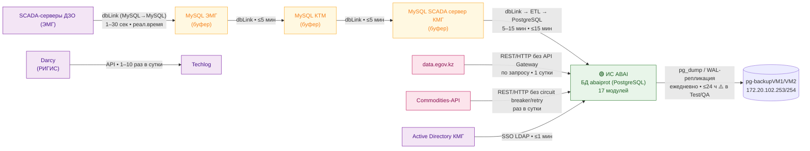
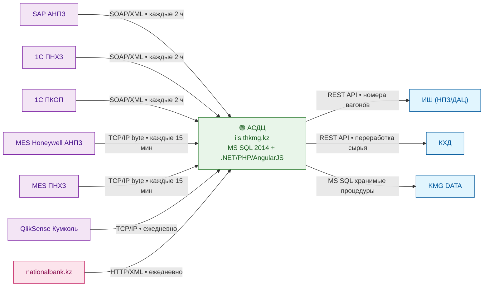
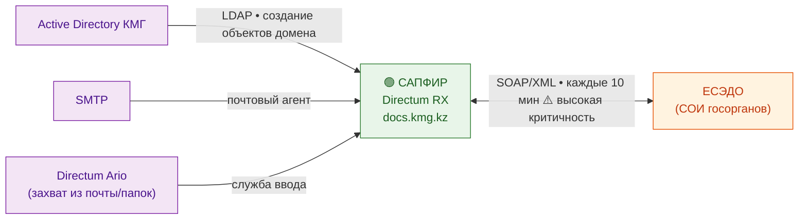
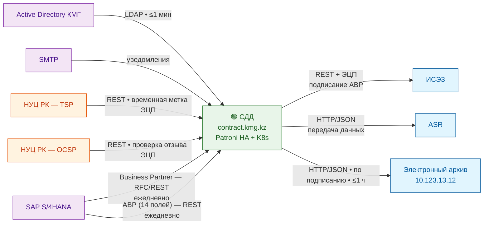
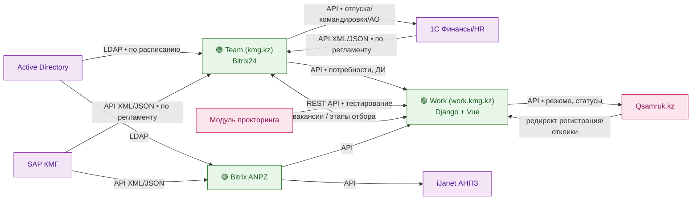
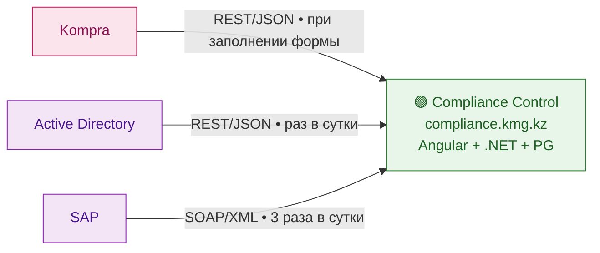
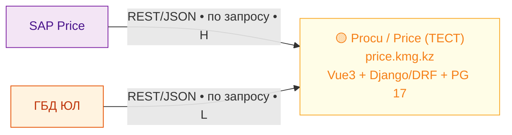
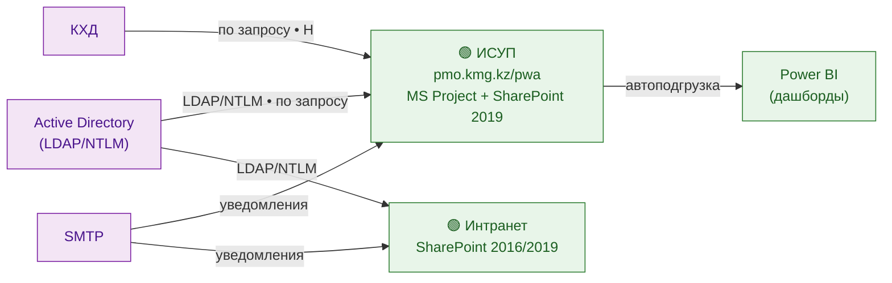

# 03. Потоки интеграций

Все 44+ потока данных из реестра «Поток/Данные», сгруппированные по системам-приёмникам.

> ⚠️ Архитектурный риск: API Gateway, circuit breaker и retry-политики **отсутствуют** во всех системах ДПППС.

> SVG-рендер ключевой схемы (ABAI / SCADA): [svg/03-integrations-abai.svg](./svg/03-integrations-abai.svg)

## 3.1. Интеграции ИС ABAI

## 3.2. Интеграции АСДЦ (analytics)

## 3.3. Интеграции САПФИР (СЭД)

## 3.4. Интеграции СДД (контракты)

## 3.5. Интеграции HR-кластера (Team / Work)

## 3.6. Интеграции Compliance Control

## 3.7. Интеграции Procu / Price (ЗАКУПКИ)

## 3.8. Интеграции ИСУП и Интранета

## 3.9. Сводная таблица потоков (по реестру документа)

| № | Поток / Данные | Источник | Приёмник | Технология | Частота | Критичность |
|---|---|---|---|---|---|---|
| 1 | РИГИС | Darcy | Techlog | API | 1–10 раз в сутки | 1 сутки |
| 1.1 | Телеметрия скважин | SCADA ДЗО | MySQL ЭМГ | dbLink | реал.время 1–30 сек | ≤1 мин |
| 1.2 | Телеметрия (буфер) | MySQL ЭМГ | MySQL КТМ | dbLink | по расписанию | ≤5 мин |
| 1.3 | Телеметрия (буфер) | MySQL КТМ | MySQL SCADA КМГ | dbLink | по расписанию | ≤5 мин |
| 1.4 | Телеметрия (загрузка) | MySQL SCADA КМГ | abaiprot (PG) | dbLink → ETL | 5–15 мин | ≤15 мин |
| 2 | Госреестры | data.egov.kz | ABAI Экономика | REST | по запросу | 1 сутки |
| 3 | Котировки сырья | Commodities-API | ABAI Экономика | REST | раз в сутки | 1 сутки |
| 4 | SSO ABAI | AD КМГ | ABAI | LDAP | по запросу | ≤1 мин |
| 5 | Производственные данные между модулями | Модули ABAI | Модули ABAI | общие таблицы/view (PG) | по событию | ≤1 мин |
| 6 | Бэкапы БД ABAI | abaiprot | pg-backupVM1/VM2 ⚠️ | pg_dump / WAL | ежедневно | ≤24 ч |
| 7.1 | Финансовые/произв. АНПЗ | SAP АНПЗ | АСДЦ | SOAP | каждые 2 ч | Высокая |
| 7.2 | Финансовые/произв. ПНХЗ | 1С ПНХЗ | АСДЦ | SOAP/XML | каждые 2 ч | Высокая |
| 7.3 | Финансовые/произв. ПКОП | 1С ПКОП | АСДЦ | SOAP/XML | каждые 2 ч | Высокая |
| 7.4 | MES АНПЗ | MES Honeywell | АСДЦ | TCP/IP byte | каждые 15 мин | Высокая |
| 7.5 | MES ПНХЗ | MES ПНХЗ | АСДЦ | TCP/IP byte | каждые 15 мин | Высокая |
| 7.6 | Аналитика QlikSense | QlikSense Кумколь | АСДЦ | TCP/IP byte | ежедневно | Высокая |
| 7.7 | Курсы валют | nationalbank.kz | АСДЦ | HTTP/XML | ежедневно | Средняя |
| 7.8 | Номера вагонов | АСДЦ | ИШ | REST | по регламенту | Высокая |
| 7.9 | Переработка сырья | АСДЦ | КХД | REST | по регламенту | Высокая |
| 7.10 | Данные АСДЦ | АСДЦ | KMG DATA | MS SQL хранимые процедуры | по регламенту | Высокая |
| 8 | Документооборот с госорганами | САПФИР | ЕСЭДО | SOAP/XML | каждые 10 мин | Высокая |
| 8.1 | Синхронизация пользователей | AD | САПФИР | LDAP | по событию | Высокая |
| 9.1 | Авторизация СДД | AD | СДД | LDAP | по запросу | ≤1 мин |
| 9.2 | TSP метка ЭЦП | НУЦ РК TSP | СДД | REST | при подписании | ≤30 сек |
| 9.3 | OCSP проверка ЭЦП | НУЦ РК OCSP | СДД | REST | при подписании | ≤30 сек |
| 9.4 | Business Partner | SAP S/4HANA | СДД | RFC/REST | ежедневно | 1 сутки |
| 9.5 | АВР 14 полей | SAP S/4HANA | СДД (АВР) | REST | ежедневно | 1 сутки |
| 9.6 | Подписание АВР | СДД | ИСЭЗ | REST + ЭЦП | по запросу | ≤5 мин |
| 9.7 | Договоры → ЭА | СДД | Электронный архив | HTTP/JSON | по событию | ≤1 ч |
| 10.1 | Данные ЮЛ | Kompra | Compliance Control | REST/JSON | при заполнении | Высокая |
| 10.2 | Синхронизация AD | AD | Compliance Control | REST/JSON | раз в сутки | Высокая |
| 10.3 | Финансовые данные | SAP | Compliance Control | SOAP/XML | 3 раза в сутки | Высокая |
| 11 | Договоры SAP↔ЭА | SAP | ЭА (10.123.13.12:1334) | HTTP/JSON | по запросу | Высокая |
| 12.1 | Вакансии Team→Work | Team | Work | API | по событию | Высокая |
| 12.2 | Этапы отбора Work→Team | Work | Team | API | по событию | Высокая |
| 12.3 | Резюме Work→Qsamruk | Work | Qsamruk.kz | API (в разработке) | по событию | Высокая |
| 13.1 | Кадры AD→Team | AD | Team | LDAP | по расписанию | Высокая |
| 13.2 | Финансы 1С→Team | 1С | Team | API XML/JSON | по расписанию | Высокая |
| 13.3 | Заявления Team→1С | Team | 1С | API/выгрузка | по событию | Высокая |
| 13.4 | Bitrix ANPZ→iJanet | Bitrix ANPZ | iJanet АНПЗ | API | по событию | Высокая |
| 14.1 | Аутентификация ИСУП | AD | ИСУП | LDAP/NTLM | по запросу | Высокая |
| 14.2 | Финансовые КХД→ИСУП | КХД | ИСУП | — | по запросу | Высокая |
| 14.3 | Аналитика ИСУП→Power BI | ИСУП | Power BI | автоподгрузка | по запросу | Средняя |
| 15 | ГБД ФЛ↔Бюро (отключено) | ГБД ФЛ через ESB | Бюро пропусков | REST/JSON | при оформлении | Высокая |
| 16 | HikVision↔Бюро (отключено) | HikVision | Бюро пропусков | REST/HTTP | каждые 3 сек | Высокая |
