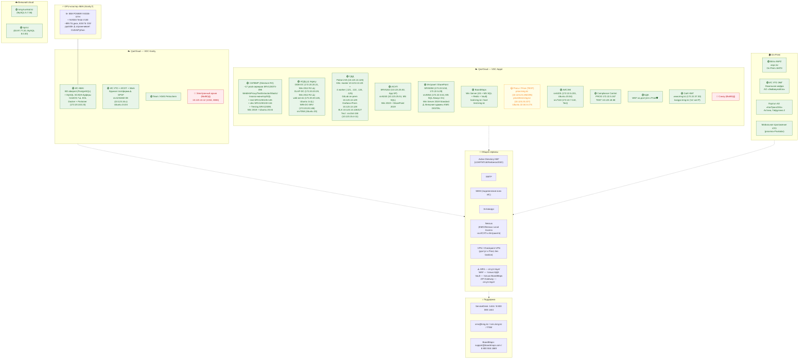

# 04. Инфраструктура и хостинг

> SVG-рендер: [svg/04-infrastructure.svg](./svg/04-infrastructure.svg)

## Хостинговая матрица

| Площадка | Системы | Особенности |
|---|---|---|
| **QazCloud VDC Koshy** | ABAI, УТО, ИСОТ, Work, Team, KMG Petrochem, Электронный архив | + GPU-кластер IBM POWER 9 для ML (ABAI) |
| **QazCloud VDC Aqqol** | САПФИР, АСДЦ, СДД, Procu/Price, ИСУП, Интранет, BoardMaps, АИСЭМ, Compliance, БДА, Санау, корп. сайт КМГ | Основная масса корпоративных систем |
| **On-Prem АНПЗ** | Bitrix ANPZ (anpz.kz) | Локальная инфра НПЗ |
| **Локальная инфра ЭМГ** | ИС УТО ЭМГ | АО «Эмбамунайгаз» |
| **Внешний cloud** | kmg-kumkol.kz, kpi.kz | Публичные сайты |

## Резервное копирование (по системам)

| Система | Стратегия бэкапа | Риск |
|---|---|---|
| ABAI | pg_dump/WAL → pg-backupVM1/VM2 (172.20.102.253/254) | ⚠️ Бэкапы в окружении Test/QA, нет DR-плана с RTO/RPO, нет автофейловера |
| АСДЦ | vdc-KMG (QazCloud): полные еженедельно + инкрементальные ежедневно | Ретеншн 1 мес |
| Procu/Price | ⚠️ **НЕТ бэкапов** (по паспорту) | Высокий риск утраты |
| ИСОТ | QazCloud: ежедневные инкрем. + еженедельные полные | Ретеншн 1 мес |
| АИСЭМ | Ретеншн 90 дней | — |
| СДД, ИСУП, Интранет, BoardMaps, ЭА, Bitrix-порталы | Еженедельно / регламентно | — |
| Compliance Control | Ежедневно | — |
| БДА, Санау | Еженедельно | — |

## Операционные системы (по реестру)

### Linux
- **Ubuntu 24.04** — единая платформа УТО + ИСОТ + Work (srv1231602-08)
- **Ubuntu 22.04 LTS** — Procu/Price, СДД (srv13120-130 prod, srv154-158 test)
- **Ubuntu 20.04** — АИСЭМ (srv5201/srv7110), часть Directum Insarco (САПФИР), srv7058 (АСДЦ)
- **Ubuntu 14** ⚠️ — web-ast-dc АСДЦ (172.20.20.145) — критическое устаревание
- **CentOS 7** ⚠️ — ИС ABAI (EOL без патчей безопасности и обновлений ядра)

### Windows
- **Win Server 2019 Standard** — САПФИР (~17 серверов SRV123073-090, SRV1230130-145, SharePoint), ИСУП (SRV5242, srv5243), Интранет (SRV5050, srv5054), BoardMaps
- **Win Server 2012 R2** ⚠️ — АСДЦ (ODB-DC 172.20.20.21, OLAP-DC 172.20.20.29, WIN-DC-SRV 172.20.20.146) — устаревшая ОС
