# 05. Данные и хранилища

> SVG-рендер: [svg/05-data.svg](./svg/05-data.svg)

## Карта данных по типам хранилищ

```mermaid
flowchart LR
    classDef rel fill:#E8F5E9,stroke:#2E7D32,color:#1B5E20
    classDef ms fill:#E1F5FE,stroke:#01579B,color:#01579B
    classDef my fill:#FFF8E1,stroke:#F9A825,color:#F57F17
    classDef nosql fill:#F3E5F5,stroke:#6A1B9A,color:#4A148C
    classDef bigd fill:#FFEBEE,stroke:#C62828,color:#B71C1C
    classDef obj fill:#E0F2F1,stroke:#00695C,color:#004D40
    classDef cache fill:#FFF3E0,stroke:#E65100,color:#BF360C
    classDef mq fill:#FCE4EC,stroke:#C2185B,color:#880E4F

    %% --- PostgreSQL ---
    subgraph PG["🐘 PostgreSQL — основная СУБД ДПППС"]
        direction LR
        PG1["abaiprot<br/>ABAI<br/>(единая для 17 модулей ⚠️)"]:::rel
        PG2["Patroni HA-кластер<br/>СДД<br/>10.123.13.120<br/>(HAProxy + master + etcd)"]:::rel
        PG3["PostgreSQL 17<br/>Procu / Price"]:::rel
        PG4["ИСОТ • Work • АИСЭМ"]:::rel
        PG5["Электронный архив"]:::rel
        PG6["БДА (PostgreSQL 11)<br/>Бюро пропусков (PG 11)"]:::rel
    end

    %% --- MS SQL ---
    subgraph MS["🪟 Microsoft SQL Server"]
        direction LR
        MS1["MS SQL 2014 ⚠️ EOL<br/>АСДЦ"]:::ms
        MS2["MS SQL Server<br/>ИСУП (srv5243)"]:::ms
        MS3["MS SQL Always On HA<br/>Failover Cluster<br/>Интранет (srv5054)"]:::ms
        MS4["MS SQL Server<br/>BoardMaps"]:::ms
        MS5["MS SQL<br/>САПФИР<br/>(наряду с PostgreSQL)"]:::ms
    end

    %% --- MySQL/MariaDB ---
    subgraph MY["🐬 MySQL / MariaDB"]
        direction LR
        MY1["MySQL/MariaDB<br/>Bitrix24-порталы<br/>Team / ANPZ / Petrochem / КМКЛ"]:::my
        MY2["MySQL для Bitrix-сайтов<br/>kmg.kz / kazgpz<br/>kmg-kumkol.kz (5.7.36)<br/>kpi.kz (8.0.30)"]:::my
        MY3["⚠️ MySQL-цепочка SCADA-буферов<br/>ЭМГ → КТМ → SCADA сервер КМГ<br/>(dbLink)"]:::my
    end

    %% --- NoSQL ---
    subgraph NO["📦 NoSQL"]
        N1["MongoDB<br/>Directum Insarco (САПФИР)"]:::nosql
    end

    %% --- BigData (ABAI) ---
    subgraph BD["🔥 BigData / Аналитика (внутри ABAI)"]
        BD1["Apache Druid (OLAP)"]:::bigd
        BD2["Apache Spark 3.3.0"]:::bigd
        BD3["Apache Kafka 3.2.1"]:::bigd
        BD4["Hadoop / HDFS"]:::bigd
    end

    %% --- OLAP / BI ---
    subgraph BI["📈 OLAP / BI"]
        BI1["Power BI<br/>(ИСУП — дашборды)"]:::bigd
        BI2["Qlik / QlikSense<br/>(Procu/Price; источник АСДЦ)"]:::bigd
        BI3["OLAP-DC (АСДЦ)<br/>kmgiis/kmgcab<br/>Win Server 2012 R2 ⚠️"]:::bigd
    end

    %% --- Object storage ---
    subgraph OBJ["🗄️ Объектное хранилище"]
        OBJ1["MinIO S3<br/>УТО (10.123.16.5)<br/>Procu/Price"]:::obj
        OBJ2["SeaweedFS S3 Gateway<br/>СДД"]:::obj
        OBJ3["s3.contract.kmg.kz<br/>(СДД)"]:::obj
    end

    %% --- Cache ---
    subgraph CA["⚡ Кэш"]
        CA1["Redis<br/>СДД, Procu/Price,<br/>ИСОТ, Work, АИСЭМ,<br/>BoardMaps"]:::cache
        CA2["Memcached<br/>(сайт kmg-kumkol.kz)"]:::cache
        CA3["Distributed Cache SharePoint<br/>(Интранет, ИСУП)"]:::cache
    end

    %% --- Message queues ---
    subgraph MQ["📨 Очереди сообщений"]
        MQ1["RabbitMQ<br/>ABAI, ИСОТ, Work,<br/>АИСЭМ, СДД, САПФИР"]:::mq
        MQ2["Apache Kafka 3.2.1<br/>ABAI, Бюро пропусков<br/>(отключена)"]:::mq
    end

    %% --- Search/Logs ---
    subgraph LOG["🔍 Поиск / Логи"]
        L1["Elasticsearch + Kibana + Logstash<br/>САПФИР • СДД (10.123.13.126/127)"]
        L2["Grafana + Prometheus<br/>СДД (10.123.13.128)<br/>(не во всех ИС)"]
    end

    %% --- Backup ---
    subgraph BK["💿 Бэкапы"]
        BK1["pg-backupVM1 (172.20.102.253)<br/>pg-backupVM2 (172.20.102.254)<br/>⚠️ Test/QA окружение"]
        BK2["vdc-KMG (QazCloud)<br/>еженедельные полные +<br/>ежедневные инкрем."]
    end
```

## Сводная таблица СУБД

| СУБД | Системы | Версия | Заметка |
|---|---|---|---|
| **PostgreSQL** | ABAI, СДД (Patroni HA), Procu/Price (PG 17), ИСОТ, Work, АИСЭМ, ЭА, БДА (PG 11), Бюро пропусков (PG 11) | 11–17 | Основная СУБД ДПППС |
| **MS SQL Server** | АСДЦ (2014 ⚠️), ИСУП, Интранет (Always On HA), BoardMaps, САПФИР | 2014–2019 | АСДЦ MS SQL 2014 — EOL |
| **MySQL/MariaDB** | Bitrix24 порталы, корп. сайты Bitrix, **SCADA-буферы ABAI** | 5.7.36, 8.0.30 | SCADA-цепочка через dbLink ⚠️ |
| **MongoDB** | Directum Insarco (САПФИР) | — | Только в САПФИР |

## Аналитика, BI, BigData

- **BI:** Power BI (ИСУП), Qlik/QlikSense (Procu/Price; источник для АСДЦ — Кумколь).
- **OLAP:** Apache Druid (внутри ABAI), OLAP-DC АСДЦ (kmgiis/kmgcab) на Win Server 2012 R2 ⚠️.
- **BigData (только в ABAI):** Spark 3.3.0, Kafka 3.2.1, Hadoop/HDFS.
- **ML/Python:** ABAI на 5 GPU-серверах IBM POWER 9 + Tesla V100 (~895 ГБ диск, 635 ГБ ОЗУ — дисбаланс отмечен как риск; ppc64le ограничивает экосистему Python-пакетов и CUDA).

## Категория информации и оценки ценности (реестр ОИБ/ДКБ от 04.2026)

| Система | Категория | C / I / A |
|---|---|---|
| ИС ABAI | Конфиденциальная | **4 / 4 / 4** (наивысшая) |
| АСДЦ | Конфиденциальная | 3 / 3 / 3 |
| УТО, ИСОТ, БДА, Электронный архив, Санау | Конфиденциальная | 2 / 2 / 2 |
| Остальные системы | Требуется заполнение в реестре | — |

## ИБ / контуры доступа

| Контур | Системы | Замечание |
|---|---|---|
| Аутентификация AD/SSO/LDAP | ABAI, САПФИР, СДД, ИСОТ, Work, Compliance Control, BoardMaps, Бюро пропусков, ИСУП, Интранет, Bitrix-порталы | Большинство |
| JWT | Compliance Control, Электронный архив | — |
| OAuth2 | Электронный архив | — |
| OWIN Cookie | АСДЦ ⚠️ legacy | — |
| Доступ к Prod | VPN / Checkpoint VPN | bastion-хостов нет |
| **MFA** | — | **ОТСУТСТВУЕТ** |
| **WAF** | Только БДА | — |
| **Vault** | Только BoardMaps | Остальные — env / appsettings |
| **API Gateway** | — | **ОТСУТСТВУЕТ во всех системах ДПППС** |
| **Шифрование at rest и in transit** | Не описано в архитектурном документе ABAI | — |
| ЭЦП (НУЦ РК TSP/OCSP) | СДД, BoardMaps, САПФИР, Team, Bitrix-порталы, ИСОТ/ЭНД | — |
