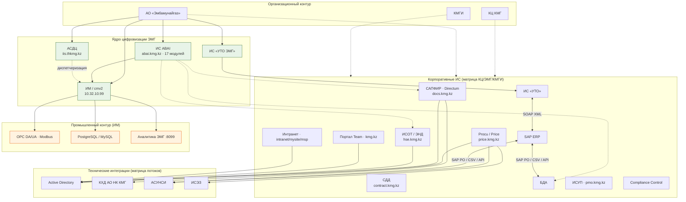
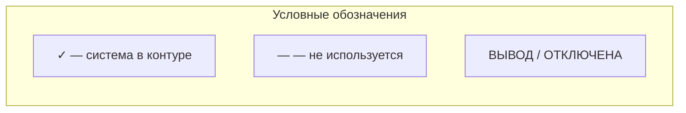
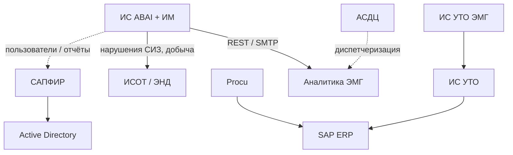
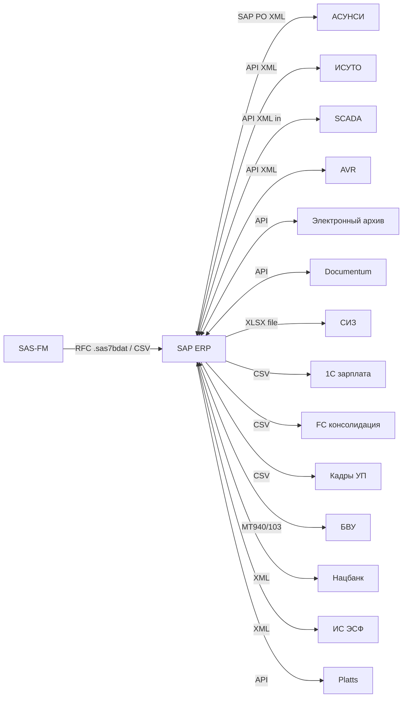
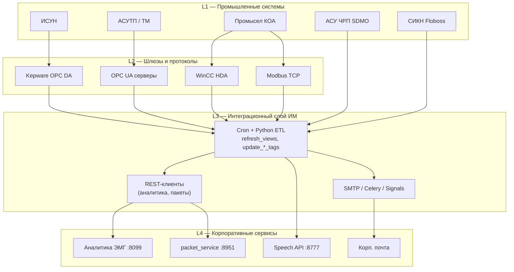

# Архитектура интеграций и ИС АО «Эмбамунайгаз»

Единая схема объединяет:

| Источник | Что описывает |
|----------|----------------|
| **Матрица интеграций** (19 систем) | Технические потоки: протоколы, данные, частота, роли поставщик/получатель |
| **Матрица «КЦ — ЭМГ — КМГИ»** | Размещение корпоративных ИС по организационному контуру и охват бизнес-функций |
| **Программа ИТ КМГ 2025–2028**, § 7.6.1.3 | Карта автоматизации ЭМГ (контекст) |
| **Схемы-изображения** (PDF) | Визуальные карты автоматизации (см. раздел 6) |

> **Общий ИТ-ландшафт:** [`it-landscape-emg.md`](it-landscape-emg.md) · **SVG:** [`it-landscape-emg-general.svg`](it-landscape-emg-general.svg) · **draw.io:** [`drawio/it-landscape-emg-general.drawio`](drawio/it-landscape-emg-general.drawio)

## Все схемы: draw.io (редактируемые) и SVG

| § | draw.io | SVG | Что показывает | Как объяснить бизнес-заказчику |
|---|---------|-----|----------------|---------------------------------|
| 0 | [`drawio/00-summary-architecture.drawio`](drawio/00-summary-architecture.drawio) | [`svg/00-summary-architecture.svg`](svg/00-summary-architecture.svg) | Общая картина: оргконтур КМГ + ключевые ИС + интеграции | «Это карта верхнего уровня: где находится ЭМГ в группе КМГ и через какие системы проходят основные процессы». |
| 1 | [`drawio/01-corporate-landscape.drawio`](drawio/01-corporate-landscape.drawio) | [`svg/01-corporate-landscape.svg`](svg/01-corporate-landscape.svg) | Корпоративные домены: финансы, кадры, документооборот, безопасность, производственный контур | «Показывает, какие бизнес-функции закрыты системами и где есть межфункциональные зависимости». |
| 2.1 | [`drawio/02-1-emg-abai-focus.drawio`](drawio/02-1-emg-abai-focus.drawio) | [`svg/02-1-emg-abai-focus.svg`](svg/02-1-emg-abai-focus.svg) | Фокус на ЭМГ: связи ABAI с ключевыми смежными системами | «Показывает, какие критичные сервисы ЭМГ зависят от ABAI и что будет затронуто при изменениях». |
| 3 | [`drawio/03-abai-im-architecture.drawio`](drawio/03-abai-im-architecture.drawio) | [`svg/03-abai-im-architecture.svg`](svg/03-abai-im-architecture.svg) | Детальная архитектура ИМ/ABAI: сбор телеметрии, обработка и выдача аналитики | «Это схема производственных данных: от датчиков и источников до управленческой аналитики». |
| 4 | [`drawio/04-sap-erp-integrations.drawio`](drawio/04-sap-erp-integrations.drawio) | [`svg/04-sap-erp-integrations.svg`](svg/04-sap-erp-integrations.svg) | SAP ERP как интеграционный хаб предприятия | «Показывает, как финансы, закупки, кадры и внешние контрагенты синхронизируются через SAP». |
| 5 | [`drawio/05-abai-layers.drawio`](drawio/05-abai-layers.drawio) | [`svg/05-abai-layers.svg`](svg/05-abai-layers.svg) | Логические слои L1-L4: от промысловых систем до корпоративных сервисов | «Объясняет уровни ответственности: где источник данных, где интеграция, где бизнес-потребление». |
| ландшафт | [`drawio/06-it-landscape-general.drawio`](drawio/06-it-landscape-general.drawio) | [`svg/06-it-landscape-general.svg`](svg/06-it-landscape-general.svg) | Единый ИТ-ландшафт ЭМГ по слоям L0-L5 | «Базовая карта для руководства: какие системы критичны и как они связаны между собой». |
| ландшафт (детально) | [`drawio/07-it-landscape-mermaid-detailed.drawio`](drawio/07-it-landscape-mermaid-detailed.drawio) | [`svg/07-it-landscape-mermaid-detailed.svg`](svg/07-it-landscape-mermaid-detailed.svg) | Расширенная версия ландшафта с большей детализацией связей | «Используется, когда нужно разложить верхнеуровневую картину на конкретные интеграционные потоки». |
| КМГ+ЭМГ | [`drawio/10-kmg-emg-architecture.drawio`](drawio/10-kmg-emg-architecture.drawio) | [`svg/10-kmg-emg-architecture.svg`](svg/10-kmg-emg-architecture.svg) | **Общая архитектура КМГ + ЭМГ**: выделены корпоративная сеть КМГ и сеть ЭМГ, проброшены интеграции между системами | «Одна картина для руководства: где проходит граница сетей КМГ и ЭМГ и какие интеграции пересекают этот периметр». |

- **draw.io** — открыть в [diagrams.net](https://app.diagrams.net), править блоки и связи. Каталог: [`drawio/README.md`](drawio/README.md)
- **SVG** — вставка в Word, PowerPoint, Figma. Каталог: [`svg/README.md`](svg/README.md)

Пересборка draw.io: `python3 scripts/mmd_to_drawio.py`

---

## 0. Сводная архитектура (интеграции + контур КМГ)

**SVG:** [`svg/00-summary-architecture.svg`](svg/00-summary-architecture.svg)



**Связь двух матриц:** матрица «КЦ — ЭМГ — КМГИ» показывает, *какие ИС обслуживают* дочернее общество; матрица интеграций — *как именно* они обмениваются данными (AD, SAP, OPC, REST и т.д.). **ИС ABAI** и **ИМ** — единственный контур с детализацией промысловой телеметрии.

---

## 1. Общий ландшафт корпоративных систем

Полная схема ИТ-ландшафта по слоям L0–L5 — **[`it-landscape-emg.md`](it-landscape-emg.md)** · SVG: [`svg/06-it-landscape-general.svg`](svg/06-it-landscape-general.svg)

**SVG (интеграции):** [`svg/01-corporate-landscape.svg`](svg/01-corporate-landscape.svg)

```mermaid
flowchart TB
    subgraph Identity["Идентификация и доступ"]
        AD["Active Directory<br/>(LDAP)"]
    end

    subgraph Security["Информационная безопасность"]
        DLP["Solar Dozor<br/>(DLP)"]
        FW["Forcepoint Web Gateway"]
        FUDOPAM["FUДOPAM<br/>(PAM)"]
    end

    subgraph Docs["Документооборот и архив"]
        Directum["Directum<br/>(СЭД + BPM)"]
        Alfresco["Alfresco ECM"]
        EA["Электронный архив<br/>(Азия-Софт, CMIS)"]
    end

    subgraph Finance["Финансы и планирование"]
        SAP["SAP ERP"]
        SAS["SAS-FM"]
        FC["FC — фин. консолидация"]
        NB["Нацбанк<br/>(курсы валют)"]
        BV["БВУ / банк<br/>(MT940, MT103)"]
        Platts["Platts.com"]
    end

    subgraph HR["Кадры и персонал"]
        UP["ПК «Управление персоналом»"]
        ZUP["1С — зарплата"]
        EPASS["E-Pass"]
    end

    subgraph Ops["Операционные системы ЭМГ / КМГ"]
        ABAI["ИС ABAI / ИМ<br/>abai.kmg.kz · 10.32.10.99"]
        UTOEMG["ИС «УТО ЭМГ»"]
        ASDC["АСДЦ<br/>iis.thkmg.kz"]
        ISUTO["ИС «УТО»"]
        ARGUS["Argus Pro"]
        SP["sPoint"]
        SAPFIR["САПФИР / Directum"]
        ISOT["ИСОТ / ЭНД"]
        BDA["БДА"]
        AVR["AVR + SAP"]
        KGIS["КГИС"]
        Zhyldyz["Жулдыз"]
    end

    subgraph CorpPortal["Корпоративный контур КМГ"]
        Team["Портал Team"]
        Intranet["Интранет"]
        ISUP["ИСУП"]
        Compliance["Compliance Control"]
        SDD["СДД contract.kmg.kz"]
    end

    subgraph NSI["НСИ и закупки"]
        ASUNSI["АСУНСИ"]
        ISEZ["ИСЭЗ"]
    end

    AD --> Directum & Alfresco & KGIS & DLP & FUDOPAM & EPASS & Zhyldyz & Procu
    Exchange["Microsoft Exchange"] --> DLP
    FW --> DLP

    SAP <-->|SAP PO / XML| ASUNSI
    SAP <-->|RFC / CSV| SAS
    SAP <-->|XML| ISUTO & SCADA & AVR & EA & Platts
    SAP <-->|SOAP| UP
    SAP <-->|CSV| ZUP & FC & BV & NB & ISEF["ИС ЭСФ"]
    UP <-->|DB functions| UP
    EA <-->|CMIS| EA
    Alfresco --> AD
    Directum --> AD
    Procu --> ASUNSI & ISEZ & AD
    UTOEMG --> ISUTO
    ISUTO <-->|SOAP XML| SAP
    ARGUS -->|REST JSON| ISUTO
    SP -->|REST JSON| KHD["КХД АО НК КМГ"]
    SAPFIR -->|REST JSON| KHD
    AVR <-->|API XML| SAP
    ASDC -.-> ABAI
    ISOT & Team & Intranet & Compliance & SDD --> AD

    ABAI -.->|см. раздел 3| Ops
```



**Роль Active Directory:** единый источник учётных записей (логин, UPN, ФИО, e-mail) для Directum, Alfresco, КГИС, DLP, FUDOPAM, E-Pass, Жулдыз, Procu — односторонний LDAP, online, автоматически.

---

## 2. Матрица ИС «КЦ — ЭМГ — КМГИ»

Размещение информационных систем в группе КМГ (✓ — охват функции, — — нет, ? — частично / уточняется).

| ИС | URL / примечание | КЦ | ЭМГ | КМГИ | Связь с тех. интеграциями |
|----|------------------|:--:|:---:|:----:|---------------------------|
| **ИС ABAI** | abai.kmg.kz, 17 модулей | ✓ | ✓ | ✓ | ИМ 10.32.10.99, OPC/REST — **раздел 3** |
| **САПФИР** | Directum Insarco, docs.kmg.kz | ✓ | ✓ | ✓ | КХД (sPoint), LDAP ← AD |
| **АСДЦ** | Аналитика диспетчерского центра, iis.thkmg.kz | — | ✓ | — | Смежный контур с ABAI / телеметрией |
| **СДД** | Договорное делопроизводство, contract.kmg.kz | — | ✓ | ? | Частично с Procu / закупками |
| **ИС «УТО»** | Управление транспортным обеспечением | — | ? | ? | SAP SOAP XML — **раздел 4** |
| **ИС «УТО ЭМГ»** | Для АО «Эмбамунайгаз» | — | ✓ | — | Локальный контур → ИС «УТО» → SAP |
| **ИСОТ / ЭНД** | hse.kmg.kz, охрана труда | ✓ | ✓ | ✓ | Корп. ИБ/HSE; уведомления ABAI (СИЗ) |
| **АИСЭМ** | aisem.kmg.kz, экомониторинг | — | — | — | Не в контуре ЭМГ |
| **Procu / Price** | price.kmg.kz | — | ✓ | ? | API ← АСУНСИ, ↔ ИСЭЗ |
| **Work** | work.kmg.kz, рекрутинг | — | — | — | — |
| **Электронный архив** | Documentum | ✓ | ✓ | ✓ | **ВЫВОД**; интеграция SAP/API в матрице потоков |
| **ИС «Санау»** | — | — | — | — | **ВЫВОД** |
| **БДА** | База данных активов | ? | ? | ✓ | Связь с SAP / активами |
| **Бюро пропусков** | buro.kmg.kz | — | — | — | **ОТКЛЮЧЕНА** |
| **Портал Team** | kmg.kz, кадры | ✓ | ✓ | ✓ | AD |
| **Интранет** | intranet / mysite / msp.kmg.kz | ✓ | ✓ | ✓ | AD |
| **ИСУП** | pmo.kmg.kz/pwa, проекты | — | ✓ | ✓ | — |
| **Compliance Control** | compliance.kmg.kz | ✓ | ✓ | ✓ | — |
| **BoardMaps** | bsd.kmg.kz | — | — | — | — |



### 2.1. Фокус на ЭМГ: как ИС стыкуются с ABAI

**SVG:** [`svg/02-1-emg-abai-focus.svg`](svg/02-1-emg-abai-focus.svg)



---

## 3. Архитектура ИС «Интеллектуальное месторождение» (№19, хост 10.32.10.99)

**SVG:** [`svg/03-abai-im-architecture.svg`](svg/03-abai-im-architecture.svg)

Центральный контур сбора телеметрии, обогащения данных месторождений и рассылки аналитики (пункт №19 нового перечня интеграций). Запуск задач — **cron** + **Django/Celery** + сигналы `post_save`.


### 3.1. Потоки данных ИМ №19 (детализация)

| Источник | Протокол / формат | Данные | Частота | Направление |
|----------|-------------------|--------|---------|-------------|
| ИС ABAI (PostgreSQL) | SQL | Фонд скважин, статусы, техрежимы, категории, ремонты | 08:00, 13:30, 18:00 | → ИМ (read) |
| Kepware / ИСУН | OPC DA | PUMP, ISUN_RVS, ISUN_GAS | :00 / :01 (2 ч) | → ИМ |
| КОА реклоузеры | OPC DA | Мощности, токи, U, МТО/МТЗ | 5 мин | → ИМ → packet_service |
| АСУТП/ТМ (12+ OPC UA) | OPC UA | РГС, расходы, насосы, задвижки (ATB, DMB, GRN…) | 5 мин | → ИМ → аналитика |
| Modbus TCP КУУН | Modbus | Расходомеры, скважины УАЗ | 7 мин | → ИМ |
| SDMO (4× MySQL) | SQL | Дисбаланс ЧРП, суточные avg | :47 / 07:17 | → ИМ |
| KTM Floboss | SQL | СИКН 2hours_kto | вручную | → ИМ |
| koa-cm WinCC HDA | SQL | hdadatatable, ABK/KJS | cron КОА | ↔ ИМ |
| emg (ИСУ-ЭМГ) | SQL | chrp_well.working | 15 мин | ↔ ИМ |
| Аналитика ЭМГ | REST JSON | Теги, скважины | 5 мин | ИМ → |
| packet_service | REST JSON | Реклоузеры bd 522/601 | 5 мин | ИМ → |
| Распознавание речи | multipart → JSON | Аудио рапортов ПРС | online | ↔ ИМ |
| SMTP | RFC 5322 | СИЗ, добыча, XLSX-реестры | cron + signals | ИМ → |

---

## 4. Интеграции SAP ERP (хаб предприятия)

**SVG:** [`svg/04-sap-erp-integrations.svg`](svg/04-sap-erp-integrations.svg)



---

## 5. Слои архитектуры ABAI (логическое представление)

**SVG:** [`svg/05-abai-layers.svg`](svg/05-abai-layers.svg)



---

## 6. Системы только через AD + визуальные карты

**LDAP (матрица интеграций):** E-Pass, Жулдыз, КГИС, FUDOPAM, Solar Dozor (+ Exchange, Forcepoint), Directum, Alfresco, Procu.

**ИС ABAI** (п. 3 матрицы потоков) — детализация в разделах **3–5** (п. 19, хост ИМ 10.32.10.99).

### Визуальные схемы (PDF-изображения)

Загруженные PDF без текстового слоя — растровые карты автоматизации. Они дополняют Mermaid-схемы выше и соответствуют разделу программы ИТ **7.6.1.3**:

| Файл | Назначение в сводной архитектуре |
|------|----------------------------------|
| Широкая карта (6568) | Общая карта автоматизации / процессов группы |
| Схема e4c7 | Детализация контуров ЭМГ |
| Полоса a287 | Легенда / уровни зрелости |
| Полоса c4ac | Заголовок раздела карты |

> Для просмотра откройте PDF в просмотрщике; в репозитории зафиксирована **текстовая** и **Mermaid**-версия, объединяющая обе матрицы.

---

## 8. Общая архитектура КМГ + ЭМГ (сети и интеграции)

**draw.io:** [`drawio/10-kmg-emg-architecture.drawio`](drawio/10-kmg-emg-architecture.drawio) · **SVG:** [`svg/10-kmg-emg-architecture.svg`](svg/10-kmg-emg-architecture.svg)

Общая (**укрупнённая**) архитектурная схема группы с явным выделением **двух сетевых контуров**. Чтобы схема оставалась читаемой, системы сгруппированы в укрупнённые функциональные блоки, а интеграции проброшены на уровне блоков — без множества пересечений. Построена воспроизводимым генератором `scripts/build_kmg_emg_architecture.py`. Покомпонентная детализация интеграций — в C4-схеме [`svg/09-emg-c4-component.svg`](svg/09-emg-c4-component.svg).

| Сеть | Что входит |
|------|-----------|
| **Сеть ЭМГ** (АО «Эмбамунайгаз», зелёный контур) | Ядро цифровизации (ИС ABAI, ИС «УТО ЭМГ», АСДЦ, ИМ), промышленный контур OT (ИСУН, АСУТП/ТМ, ТМ АГЗУ, КУУН, СДМО, KTM), локальные сервисы аналитики (:8099, packet_service, распознавание речи) |
| **Корпоративная сеть КМГ** (АО НК «КазМунайГаз», синий контур) | Active Directory; SAP ERP + финансы; документооборот, архив и КХД; НСИ и закупки; информационная безопасность; кадры, транспорт и корпоративные порталы |

**Кросс-сетевые интеграции (ЭМГ ↔ КМГ)** выделены оранжевым и проходят через канал между контурами сетей:

- ИС «УТО ЭМГ» → ИС «УТО» (КМГ) → SAP ERP — локальный транспортный контур;
- ИС ABAI → ИСОТ/ЭНД — СИЗ, нарушения, добыча;
- ИС ABAI → СЭД Directum/САПФИР — пользователи/отчёты;
- ИС ABAI → КХД АО НК КМГ — данные добычи;
- ИС ЭМГ → Active Directory — единый каталог учётных записей (LDAP).

**Условные обозначения:** зелёный/синий контур — сети ЭМГ/КМГ; оранжевая линия — кросс-сетевая интеграция; двойная стрелка — двусторонний обмен (↔); серый пунктир — LDAP; фиолетовый пунктир — служебные/асинхронные потоки и владение. Покомпонентная детализация — в C4-схеме [`svg/09-emg-c4-component.svg`](svg/09-emg-c4-component.svg).

**Пересборка:**

```bash
pip install -r requirements.txt
python3 scripts/build_kmg_emg_architecture.py
```

---

## 7. Навигация по разделам

| Вопрос | Раздел |
|--------|--------|
| Какие ИС есть у ЭМГ в группе КМГ? | **2** |
| Как ABAI собирает телеметрию? | **3**, **5** |
| Как SAP связан с транспортом и НСИ? | **4** |
| Общий ИТ-ландшафт по слоям? | **[`it-landscape-emg.md`](it-landscape-emg.md)** · [`svg/06-it-landscape-general.svg`](svg/06-it-landscape-general.svg) |
| Все схемы в SVG? | **[`svg/README.md`](svg/README.md)** |
| Полная картина «организация + потоки»? | **0**, **1** |

---

## Источники

| Документ | Содержание |
|----------|------------|
| Матрица интеграций (19 систем) | Роли, протоколы, форматы, направление, частота, способ запуска — см. [`it-landscape-emg-registry.md`](it-landscape-emg-registry.md) |
| Матрица «КЦ — ЭМГ — КМГИ» | Охват ИС по организационному контуру |
| Программа ИТ КМГ 2025–2028, § 7.6.1.3 | Текущая карта автоматизации ЭМГ (контекст) |
| PDF-схемы (растровые) | Визуальные карты автоматизации |
