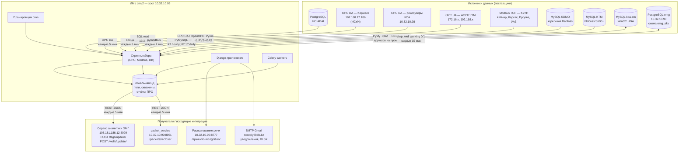
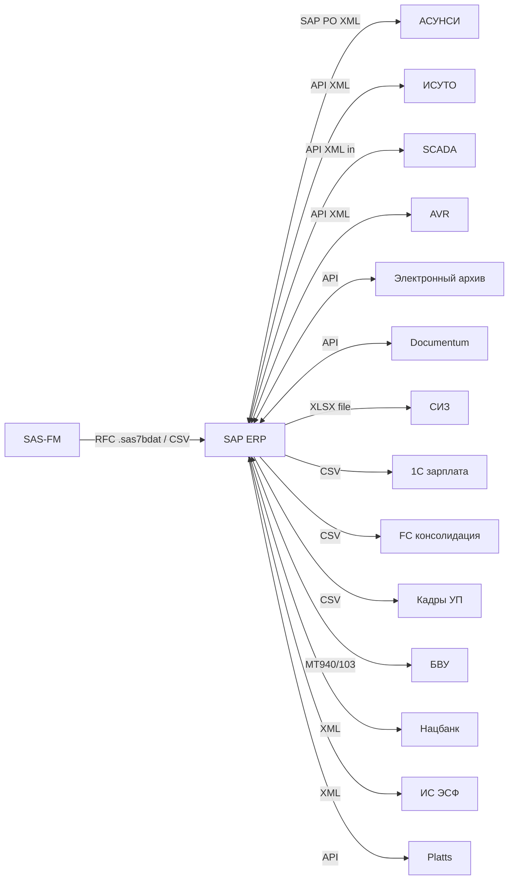
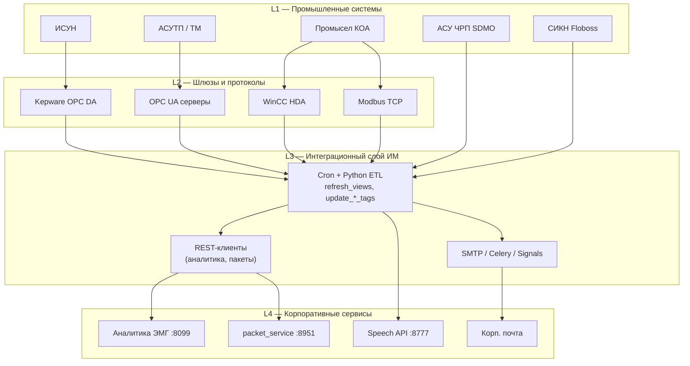

# Архитектура интеграций АО «Эмбамунайгаз»

Документ построен по матрице интеграций и разделу **7.6.1.3 «Текущая карта автоматизации ЭМГ»** (Программа ИТ и цифровизации КМГ, 2025–2028).

---

## 1. Общий ландшафт корпоративных систем

```mermaid
flowchart TB
    subgraph Identity["Идентификация и доступ"]
        AD["Active Directory<br/>(LDAP)"]
    end

    subgraph Security["Информационная безопасность"]
        DLP["Solar Dozor<br/>(DLP)"]
        FW["Forcepoint Web Gateway"]
        FUDOPAM["FUДOPAM<br/>(PAM)"]
    end

    subgraph Docs["Документооборот и архив"]
        Directum["Directum<br/>(СЭД + BPM)"]
        Alfresco["Alfresco ECM"]
        EA["Электронный архив<br/>(Азия-Софт, CMIS)"]
    end

    subgraph Finance["Финансы и планирование"]
        SAP["SAP ERP"]
        SAS["SAS-FM"]
        FC["FC — фин. консолидация"]
        NB["Нацбанк<br/>(курсы валют)"]
        BV["БВУ / банк<br/>(MT940, MT103)"]
        Platts["Platts.com"]
    end

    subgraph HR["Кадры и персонал"]
        UP["ПК «Управление персоналом»"]
        ZUP["1С — зарплата"]
        EPASS["E-Pass"]
    end

    subgraph Ops["Операционные системы"]
        ABAI["ИС ABAI / ИМ<br/>10.32.10.99"]
        ISUTO["ИСУТО"]
        ARGUS["Argus Pro<br/>(GPS-мониторинг)"]
        SP["sPoint"]
        Procu["Procu"]
        AVR["AVR + SAP"]
        KGIS["КГИС"]
        Zhyldyz["Жулдыз"]
    end

    subgraph NSI["НСИ и закупки"]
        ASUNSI["АСУНСИ"]
        ISEZ["ИСЭЗ"]
    end

    AD --> Directum & Alfresco & KGIS & DLP & FUDOPAM & EPASS & Zhyldyz & Procu
    Exchange["Microsoft Exchange"] --> DLP
    FW --> DLP

    SAP <-->|SAP PO / XML| ASUNSI
    SAP <-->|RFC / CSV| SAS
    SAP <-->|XML| ISUTO & SCADA & AVR & EA & Platts
    SAP <-->|SOAP| UP
    SAP <-->|CSV| ZUP & FC & BV & NB & ISEF["ИС ЭСФ"]
    UP <-->|DB functions| UP
    EA <-->|CMIS| EA
    Alfresco --> AD
    Directum --> AD
    Procu --> ASUNSI & ISEZ & AD
    ISUTO <-->|SOAP XML| SAP
    ARGUS -->|REST JSON| ISUTO
    SP -->|REST JSON| KHD["КХД АО НК КМГ"]
    AVR <-->|API XML| SAP

    ABAI -.->|см. раздел 2| Ops
```

**Роль Active Directory:** единый источник учётных записей (логин, UPN, ФИО, e-mail) для Directum, Alfresco, КГИС, DLP, FUDOPAM, E-Pass, Жулдыз, Procu — односторонний LDAP, online, автоматически.

---

## 2. Архитектура ИС ABAI (информационная модель, хост 10.32.10.99)

Центральный контур сбора телеметрии, обогащения данных месторождений и рассылки аналитики. Запуск задач — **cron** + **Django/Celery** + сигналы `post_save`.

### 2.1. Потоки данных ABAI (детализация)

| Источник | Протокол / формат | Данные | Частота | Направление |
|----------|-------------------|--------|---------|-------------|
| ИС ABAI (PostgreSQL) | SQL | Фонд скважин, статусы, техрежимы, категории, ремонты | 08:00, 13:30, 18:00 | → ИМ (read) |
| Kepware / ИСУН | OPC DA | PUMP, ISUN_RVS, ISUN_GAS | :00 / :01 (2 ч) | → ИМ |
| КОА реклоузеры | OPC DA | Мощности, токи, U, МТО/МТЗ | 5 мин | → ИМ → packet_service |
| АСУТП/ТМ (12+ OPC UA) | OPC UA | РГС, расходы, насосы, задвижки (ATB, DMB, GRN…) | 5 мин | → ИМ → аналитика |
| Modbus TCP КУУН | Modbus | Расходомеры, скважины УАЗ | 7 мин | → ИМ |
| SDMO (4× MySQL) | SQL | Дисбаланс ЧРП, суточные avg | :47 / 07:17 | → ИМ |
| KTM Floboss | SQL | СИКН 2hours_kto | вручную | → ИМ |
| koa-cm WinCC HDA | SQL | hdadatatable, ABK/KJS | cron КОА | ↔ ИМ |
| emg (ИСУ-ЭМГ) | SQL | chrp_well.working | 15 мин | ↔ ИМ |
| Аналитика ЭМГ | REST JSON | Теги, скважины | 5 мин | ИМ → |
| packet_service | REST JSON | Реклоузеры bd 522/601 | 5 мин | ИМ → |
| Распознавание речи | multipart → JSON | Аудио рапортов ПРС | online | ↔ ИМ |
| SMTP | RFC 5322 | СИЗ, добыча, XLSX-реестры | cron + signals | ИМ → |

---

## 3. Интеграции SAP ERP (хаб предприятия)

---

## 4. Слои архитектуры ABAI (логическое представление)

---

## 5. Системы с интеграцией только через AD (без детализации в матрице)

Следующие системы в реестре описаны преимущественно как потребители LDAP-атрибутов: **E-Pass**, **Жулдыз**, **КГИС**, **FUДOPAM**, **Solar Dozor** (дополнительно Exchange, Forcepoint), **Directum**, **Alfresco**.

**ИС ABAI** (п. 3 матрицы) — отдельное описание интеграций вынесено в разделы 2–4 (детализация по п. 12, хост ИМ).

---

## Источники

| Документ | Содержание |
|----------|------------|
| Матрица интеграций (18 систем) | Роли, протоколы, форматы, направление, частота, способ запуска |
| Программа ИТ КМГ 2025–2028, § 7.6.1.3 | Текущая карта автоматизации ЭМГ (контекст) |
