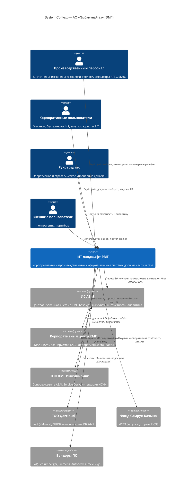
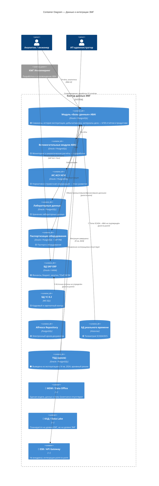
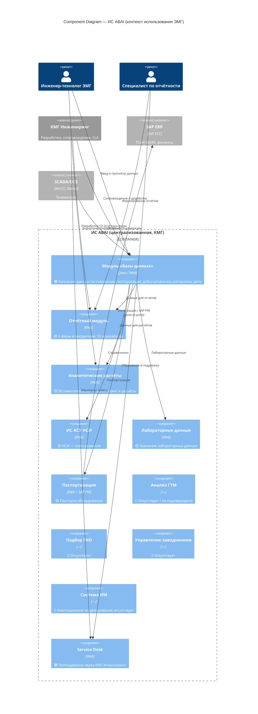
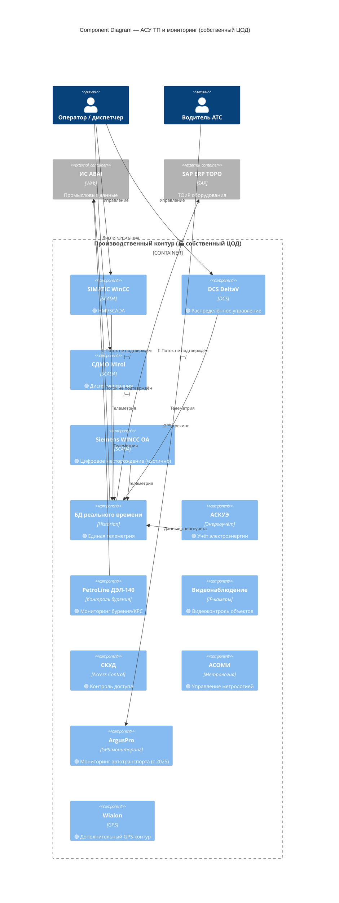
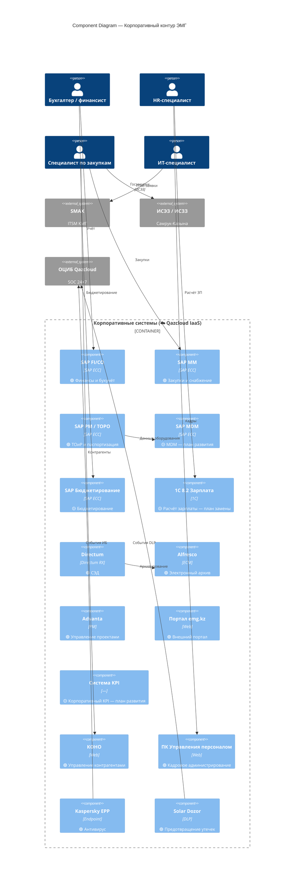
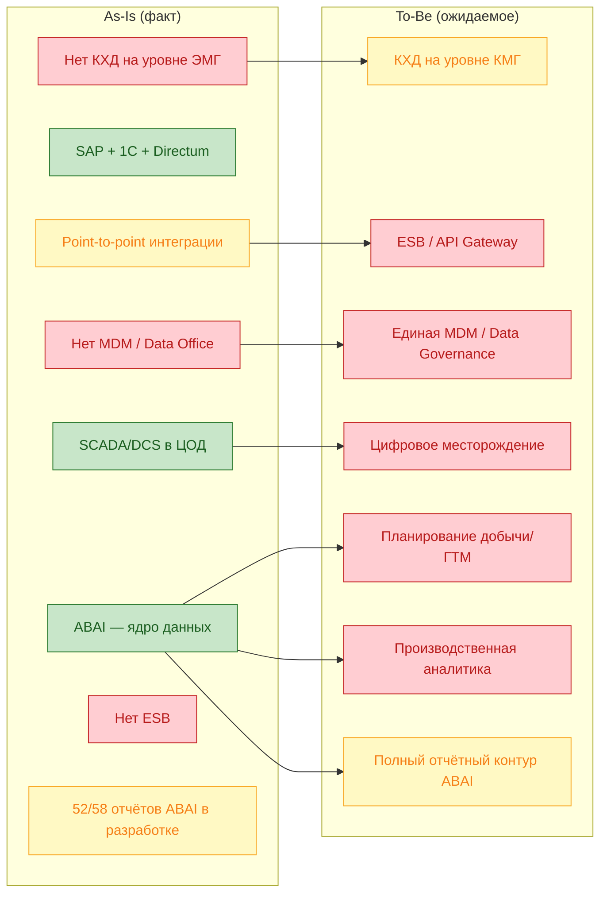

# C4-архитектура АО «Эмбамунайгаз» (ЭМГ)

Диаграммы построены по результатам обследования ИТ-ландшафта ЭМГ (верхнеуровневая схема + ответы на уточняющие вопросы).

**Легенда статусов**

| Обозначение | Значение |
|---|---|
| 🟢 | В промышленной эксплуатации |
| 🟡 | Планируется замена / развитие |
| 🔴 | Средство цифровизации отсутствует |
| ☁️ | Размещение в облаке Qazcloud (IaaS, VMware) |
| 🏭 | Размещение в собственном ЦОД |

---

## Level 1 — System Context (Контекстная диаграмма)

Показывает ЭМГ как единую систему в окружении пользователей и внешних систем.



---

## Level 2 — Container (Контейнерная диаграмма)

Декомпозиция ИТ-ландшафта ЭМГ на прикладные контейнеры и инфраструктурные блоки.

```mermaid
C4Container
    title Container Diagram — ИТ-ландшафт ЭМГ

    Person(prod, "Производственный персонал")
    Person(corp, "Корпоративные пользователи")
    Person(mgmt, "Руководство")

    System_Boundary(emg, "АО «Эмбамунайгаз»") {

        Container(portal_ext, "Внешний портал", "Web", "emg.kz — 🟢 публичный портал", "☁️")
        Container(portal_int, "Внутренний портал", "Web", "🔴 отсутствует", "—")

        Container(sap, "SAP ERP", "SAP ECC", "🟢 FI, CO, MM, PM, TOPO, MDM — финансы, бюджет, ТОиР, закупки", "☁️")
        Container(onec, "1С 8.2", "1С:Предприятие", "🟡 Зарплата — планируется замена", "☁️")
        Container(directum, "СЭД Directum", "Directum RX", "🟢 Электронный документооборот", "☁️")
        Container(advanta, "Advanta", "PM-система", "🟢 Управление проектами", "☁️")
        Container(alfresco, "Alfresco", "ECM", "🟢 Цифровое хранилище документов / электронный архив", "☁️")

        Container(ofm, "OFM / Жулдыз", "Schlumberger", "🟢 Анализ эффективности добычи", "☁️")
        Container(situational, "Ситуационный центр", "Web/Dashboard", "🟢 Оперативный мониторинг", "☁️")

        Container(scada, "АСУ ТП / SCADA", "WinCC, DeltaV, СДМО Mirol, WINCC OA", "🟢 Диспетчеризация производственных объектов", "🏭")
        Container(rtdb, "БД реального времени", "Historian", "🟢 Единая база телеметрии (детали не раскрыты)", "🏭")
        Container(monitor, "Производственный мониторинг", "ArgusPro, Wialon, PetroLine, видео, СКУД, АСКУЭ, АСОМИ", "🟢 GPS-транспорт (ArgusPro с 2025), контроль бурения, энергоучёт", "🏭 / ☁️")

        Container(engineering, "Инженерное ПО", "Petrel, tNavigator, Eclipse, Techlog, ArcGIS, Revit, Civil 3D, ЛИРА-САПР", "🟢 Моделирование пласта, проектирование инфраструктуры", "Workstation")

        Container(ib, "Средства ИБ", "Kaspersky EPP, Solar Dozor DLP", "🟢 Защита рабочих станций и предотвращение утечек", "☁️ / 🏭")

        Container(missing_plan, "🔴 Планирование добычи / ГТМ / процессов", "—", "Отсутствует — Excel / ручные процессы")
        Container(missing_analytics, "🔴 Производственная аналитика", "—", "Подбор ГНО, осложнения, заводнение, эффективность ГТМ/ТКРС, ИМ — отсутствуют")
        Container(missing_digital, "🔴 Цифровое месторождение", "—", "Целевая платформа не определена")
        Container(missing_eco, "🔴 Экомониторинг", "—", "Автоматизированный контур отсутствует")
        Container(missing_kpi, "🔴 Стратегические KPI", "—", "Система отсутствует")
        Container(missing_dwh, "🔴 КХД / DWH / BI", "—", "На уровне ЭМГ отсутствует; планируется на уровне КМГ")
        Container(missing_esb, "🔴 ESB / API Gateway", "—", "Интеграции point-to-point, реестр отсутствует")
    }

    System_Ext(abai, "ИС ABAI", "Централизованная система КМГ")
    System_Ext(smax, "SMAX", "ITSM-платформа КМГ — 🟢 с 2023")
    System_Ext(qazcloud, "Qazcloud", "IaaS + ОЦИБ SOC")
    System_Ext(kmg_eng, "КМГ Инжиниринг", "Сопровождение ABAI, ИСУН")
    System_Ext(samruk, "Самрук-Казына", "ИСЭЗ, ИСЗЗ")

    Rel(prod, scada, "Мониторинг и управление", "HMI/SCADA")
    Rel(prod, monitor, "GPS, видео, контроль бурения")
    Rel(prod, engineering, "Моделирование, проектирование")
    Rel(prod, abai, "Ввод данных, отчёты", "Web")
    Rel(corp, sap, "Учёт, закупки, бюджет")
    Rel(corp, onec, "Расчёт зарплаты")
    Rel(corp, directum, "Документооборот")
    Rel(corp, smax, "ITSM-заявки", "Web")
    Rel(mgmt, situational, "Оперативные дашборды")
    Rel(mgmt, ofm, "Анализ добычи")
    Rel(mgmt, missing_plan, "Планирование (вручную)")

    Rel(scada, rtdb, "Телеметрия", "OPC/Modbus")
    Rel(rtdb, abai, "🔴 Поток не подтверждён", "—")
    Rel(scada, sap, "🔴 Поток не подтверждён", "point-to-point")
    Rel(sap, abai, "Обмен данными", "point-to-point")
    Rel(onec, sap, "🔴 Поток не подтверждён", "point-to-point")
    Rel(directum, alfresco, "Архив документов")
    Rel(emg, qazcloud, "Размещение ☁️-контейнеров", "VMware IaaS")
    Rel(ib, qazcloud, "SOC-мониторинг 24×7", "ОЦИБ")
    Rel(kmg_eng, abai, "Сопровождение и развитие")
    Rel(kmg_eng, emg, "ИСУН", "SQL Server")
    Rel(corp, samruk, "Закупки", "ИСЭЗ")
```

---

## Level 2 — Container: слои данных и интеграций

Отдельная декомпозиция данных и интеграционного контура (ключевая проблемная зона обследования).



---

## Level 3 — Component: ИС ABAI (ключевая система)

Детализация модулей ABAI, доступных ЭМГ (по данным обследования).



---

## Level 3 — Component: АСУ ТП и производственный мониторинг



---

## Level 3 — Component: Корпоративные системы



---

## Deployment — размещение контейнеров

```mermaid
C4Deployment
    title Deployment Diagram — размещение систем ЭМГ

    Deployment_Node(qazcloud, "Qazcloud IaaS", "VMware") {
        Deployment_Node(vm_corp, "VM-кластер корпоративных ИС", "Linux / Windows") {
            Container(sap, "SAP ERP", "SAP ECC")
            Container(onec, "1С 8.2", "1С")
            Container(directum, "Directum", "Directum RX")
            Container(alfresco, "Alfresco", "ECM")
            Container(portal, "Портал emg.kz", "Web")
            Container(ofm, "OFM / Жулдыз", "Analytics")
            Container(ib, "Kaspersky + DLP", "Security")
        }
    }

    Deployment_Node(onprem, "Собственный ЦОД ЭМГ", "On-Premise") {
        Deployment_Node(scada_cluster, "Кластер АСУ ТП", "Industrial") {
            Container(wincc, "WinCC", "SCADA")
            Container(deltav, "DeltaV", "DCS")
            Container(mirol, "СДМО Mirol", "SCADA")
            Container(rtdb, "Historian", "RTDB")
        }
        Deployment_Node(monitor_cluster, "Мониторинг", "Mixed") {
            Container(argus, "ArgusPro", "GPS")
            Container(petrol, "PetroLine", "Drilling")
            Container(video, "Видеонаблюдение", "IP")
        }
    }

    Deployment_Node(kmg_cloud, "Инфраструктура КМГ", "Centralized") {
        Container(abai, "ИС ABAI", "Centralized KMG system")
        Container(smax, "SMAX", "ITSM")
    }

    Deployment_Node(kmg_eng, "КМГ Инжиниринг", "Service Provider") {
        Container(support, "Service Desk ABAI", "Support")
    }

    Rel(onprem, qazcloud, "VPN / защищённые каналы", "Production data")
    Rel(qazcloud, kmg_cloud, "Корпоративные интеграции", "HTTPS / VPN")
```

---

## Сводная карта: as-is → целевое состояние



---

## Примечания к диаграммам

1. **ABAI** — централизованная система группы КМГ; ЭМГ использует её как сервис (договор с КМГ Инжиниринг), не владея разработкой.
2. **ТБД** выведена из эксплуатации с IV квартала 2024 г.; данные мигрированы в ABAI.
3. **CityPoint** (GPS, 2021–2024) заменён на **ArgusPro** (промэксплуатация с 2025 г.).
4. **SMAX** (ITSM) — централизованная платформа КМГ, используется с 2023 г. (на верхнеуровневой схеме ошибочно обозначена как отсутствующая).
5. Потоки **SCADA/DCS → ABAI/аналитика** в ответах ЭМГ не раскрыты — на диаграммах помечены как неподтверждённые.
6. **КХД, MDM, ESB** — сознательно вынесены за пределы ЭМГ или отмечены как отсутствующие; развитие ожидается на уровне корпоративного центра КМГ.
