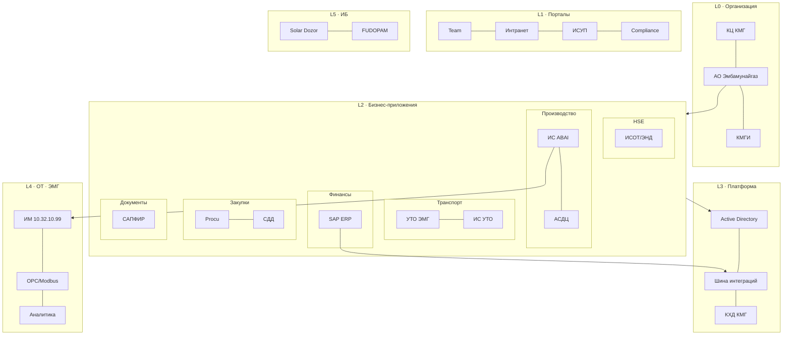

# Общая схема ИТ-ландшафта АО «Эмбамунайгаз»

## Схема (файлы для скачивания)

| Формат | Файл | Для чего |
|--------|------|----------|
| **SVG** | [`it-landscape-emg-general.svg`](it-landscape-emg-general.svg) | Копирование в Word, PowerPoint, Visio, Figma |
| **PNG** | [`it-landscape-emg-general.png`](it-landscape-emg-general.png) | Вставка в презентации, Confluence, печать |

---

## Структура ландшафта (слои)

---

## Системы по доменам

| Домен | Ключевые ИС |
|-------|-------------|
| **Производство** | ИС ABAI (abai.kmg.kz), АСДЦ, sPoint, Жулдыз, SCADA |
| **Транспорт** | ИС «УТО ЭМГ», ИС «УТО», Argus Pro |
| **Финансы** | SAP ERP, SAS-FM, 1С, AVR, FC, БВУ, Platts |
| **Закупки** | Procu/Price, СДД (contract.kmg.kz), ИСЭЗ, АСУНСИ |
| **Документы** | САПФИР/Directum, Alfresco, электронный архив |
| **Кадры / HSE** | Управление персоналом, E-Pass, ИСОТ/ЭНД (hse.kmg.kz) |
| **ГИС** | КГИС, БДА |
| **Платформа** | Active Directory, шина (SOAP/REST/XML/CSV), КХД КМГ |
| **OT (промысел)** | ИМ/cmv2, OPC DA/UA, Modbus, PostgreSQL/MySQL, аналитика ЭМГ |
| **ИБ** | Solar Dozor, FUDOPAM, Forcepoint, Exchange |
| **Вывод** | Documentum, ИС «Санау» · **Отключена:** buro.kmg.kz |

---

## Связанные материалы

- Детальные интеграции и потоки данных: [`architecture-emg-integrations.md`](architecture-emg-integrations.md)
