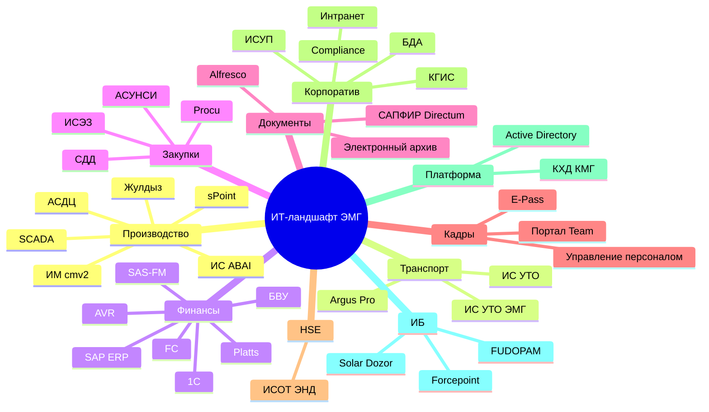
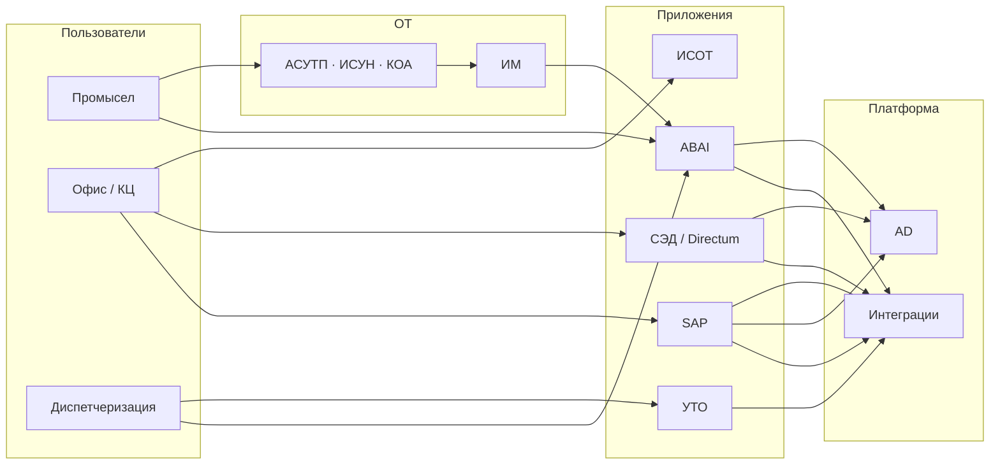

# Общий ИТ-ландшафт АО «Эмбамунайгаз» (контур КМГ)

Схема объединяет корпоративные ИС (матрица **КЦ — ЭМГ — КМГИ**), технические интеграции (матрица потоков) и промышленный контур **ABAI / ИМ**.

Детализация интеграций ABAI: [`architecture-emg-integrations.md`](architecture-emg-integrations.md).

### SVG для копирования (Word, PowerPoint, Confluence)

| Файл | Назначение |
|------|------------|
| **[`it-landscape-emg-general.svg`](it-landscape-emg-general.svg)** | **Рекомендуется для копирования** — вектор, Word/PowerPoint/Figma |
| [`it-landscape-emg-general.png`](it-landscape-emg-general.png) | Растр для предпросмотра в Markdown / Confluence |
| [`it-landscape-emg.svg`](it-landscape-emg.svg) | Автогенерация из Mermaid (детальнее) |
| [`it-landscape-emg.mmd`](it-landscape-emg.mmd) | Исходник Mermaid |

**Как скопировать:** скачайте `it-landscape-emg-general.svg` и вставьте в документ, или откройте в браузере.

**Предпросмотр в Markdown** (PNG — локальные SVG в превью часто не работают):

---

## 1. ИТ-ландшафт по слоям (общая схема)

```mermaid
flowchart TB
    subgraph L0["L0 · Организационный контур"]
        KC["КЦ АО НК «КазМунайГаз»"]
        EMG["АО «Эмбамунайгаз»"]
        KMGI["КМГИ"]
    end

    subgraph L1["L1 · Пользовательский и корпоративный уровень"]
        direction LR
        Team["Портал Team<br/>kmg.kz"]
        Intranet["Интранет<br/>intranet · mysite · msp"]
        ISUP["ИСУП<br/>pmo.kmg.kz"]
        Compliance["Compliance Control"]
        BoardMaps["BoardMaps · bsd.kmg.kz"]
    end

    subgraph L2["L2 · Бизнес-приложения"]
        direction TB

        subgraph Prod["Производство и мониторинг"]
            ABAI["ИС ABAI<br/>abai.kmg.kz"]
            ASDC["АСДЦ<br/>iis.thkmg.kz"]
            Zhyldyz["Жулдыз"]
            SP["sPoint"]
            SCADA["SCADA"]
        end

        subgraph Trans["Транспорт"]
            UTOEMG["ИС «УТО ЭМГ»"]
            UTO["ИС «УТО»"]
            ARGUS["Argus Pro · GPS"]
        end

        subgraph Fin["Финансы и учёт"]
            SAP["SAP ERP"]
            SAS["SAS-FM"]
            ZUP["1С · зарплата"]
            FC["FC · консолидация"]
            AVR["AVR · акты работ"]
        end

        subgraph Proc["Закупки и договоры"]
            Procu["Procu / Price"]
            SDD["СДД<br/>contract.kmg.kz"]
            ISEZ["ИСЭЗ"]
        end

        subgraph Doc["Документы и архив"]
            SAPFIR["САПФИР · Directum<br/>docs.kmg.kz"]
            Directum["Directum · СЭД"]
            Alfresco["Alfresco ECM"]
            EA["ЭА · Азия-Софт"]
        end

        subgraph HR["Кадры и доступ"]
            UP["ПК «Управление персоналом»"]
            EPASS["E-Pass"]
            Work["Work · рекрутинг"]
        end

        subgraph HSE["Охрана труда и среда"]
            ISOT["ИСОТ / ЭНД<br/>hse.kmg.kz"]
            AISEM["АИСЭМ · экомониторинг"]
        end

        subgraph Geo["Геоинформация и активы"]
            KGIS["КГИС"]
            BDA["БДА · база активов"]
        end
    end

    subgraph L3["L3 · Интеграция и НСИ"]
        AD["Active Directory"]
        ASUNSI["АСУНСИ"]
        ESB["Шина / API / файлы<br/>SOAP · REST · XML · CSV"]
        KHD["КХД АО НК КМГ"]
        NB["Нацбанк · курсы"]
        BV["БВУ · MT940/103"]
        Platts["Platts.com"]
        ESF["ИС ЭСФ"]
    end

    subgraph L4["L4 · Промышленный и OT-контур ЭМГ"]
        IM["ИМ / cmv2 · 10.32.10.99"]
        OPC["OPC DA/UA · Modbus"]
        OTDB[("PostgreSQL / MySQL<br/>промысловые БД")]
        Analytics["Аналитика ЭМГ"]
    end

    subgraph L5["L5 · Информационная безопасность"]
        DLP["Solar Dozor · DLP"]
        FW["Forcepoint Web Gateway"]
        FUDOPAM["FUDOPAM · PAM"]
        Exchange["Microsoft Exchange"]
    end

    subgraph Retired["Вывод / отключено"]
        DOCUM["Documentum · ВЫВОД"]
        Sanau["ИС «Санау» · ВЫВОД"]
        Buro["Бюро пропусков · ОТКЛЮЧЕНА"]
    end

    KC & EMG & KMGI --> L1 & L2

    ABAI --> IM
    IM --> OPC --> OTDB
    IM --> Analytics
    ASDC -.-> ABAI
    UTOEMG --> UTO

    SAP --> ESB
    SAS --> ESB
    UTO & ARGUS & AVR & SCADA & EA & Procu --> ESB
    Procu --> ASUNSI & ISEZ
    SAPFIR & SP --> KHD
    SAP <-->|главный хаб| ESB

    SAPFIR & Directum & Alfresco & KGIS & Procu & EPASS & Zhyldyz & Team & Intranet & ISOT & Compliance & SDD --> AD
    Exchange & FW --> DLP
    FUDOPAM --> AD

    classDef emg fill:#d4edda,stroke:#155724,stroke-width:2px
    classDef hub fill:#cce5ff,stroke:#004085,stroke-width:2px
    classDef ot fill:#fff3cd,stroke:#856404,stroke-width:2px
    classDef sec fill:#f8d7da,stroke:#721c24
    classDef ret fill:#e2e3e5,stroke:#6c757d,stroke-dasharray:5 5

    class EMG,ABAI,IM,UTOEMG,ASDC emg
    class SAP,AD,ESB,KHD hub
    class OPC,OTDB,Analytics,SCADA ot
    class DLP,FW,FUDOPAM,Exchange sec
    class DOCUM,Sanau,Buro ret
```

---

## 2. ИТ-ландшафт по доменам (карта приложений)

---

## 3. Каталог систем (сводная таблица)

| Домен | Система | URL / контур | Статус | Контур КЦ/ЭМГ/КМГИ |
|-------|---------|--------------|--------|---------------------|
| **Производство** | ИС ABAI | abai.kmg.kz | Активна | ✓ / ✓ / ✓ |
| | ИМ / cmv2 | 10.32.10.99 | Активна | Техн. слой ABAI |
| | АСДЦ | iis.thkmg.kz | Активна | — / ✓ / — |
| | Жулдыз | — | Активна | LDAP |
| | sPoint | — | Активна | → КХД |
| | SCADA | — | Активна | → SAP |
| **Транспорт** | ИС «УТО ЭМГ» | — | Активна | — / ✓ / — |
| | ИС «УТО» | — | Активна | — / ? / ? |
| | Argus Pro | — | Активна | → ИСУТО |
| **Финансы** | SAP ERP | — | Активна | Хаб группы |
| | SAS-FM | — | Активна | → SAP |
| | 1С зарплата | — | Активна | ← SAP |
| | AVR | — | Активна | ↔ SAP |
| **Закупки** | Procu / Price | price.kmg.kz | Активна | — / ✓ / ? |
| | СДД | contract.kmg.kz | Активна | — / ✓ / ? |
| | ИСЭЗ | — | Активна | ↔ Procu |
| | АСУНСИ | — | Активна | ↔ SAP |
| **Документы** | САПФИР (Directum) | docs.kmg.kz | Активна | ✓ / ✓ / ✓ |
| | Directum | — | Активна | LDAP |
| | Alfresco | — | Активна | LDAP |
| | ЭА (Азия-Софт) | — | Активна | CMIS |
| **Кадры** | Портал Team | kmg.kz | Активна | ✓ / ✓ / ✓ |
| | Управление персоналом | — | Активна | ↔ SAP |
| | E-Pass | — | Активна | LDAP |
| | Work | work.kmg.kz | Активна | — / — / — |
| **HSE** | ИСОТ / ЭНД | hse.kmg.kz | Активна | ✓ / ✓ / ✓ |
| | АИСЭМ | aisem.kmg.kz | Активна | — / — / — |
| **ГИС** | КГИС | — | Активна | LDAP |
| | БДА | — | Активна | ? / ? / ✓ |
| **Корпоратив** | Интранет | intranet, mysite, msp | Активна | ✓ / ✓ / ✓ |
| | ИСУП | pmo.kmg.kz | Активна | — / ✓ / ✓ |
| | Compliance | compliance.kmg.kz | Активна | ✓ / ✓ / ✓ |
| | BoardMaps | bsd.kmg.kz | Активна | — / — / — |
| **Платформа** | Active Directory | — | Активна | Идентификация |
| | КХД КМГ | — | Активна | sPoint, САПФИР |
| **ИБ** | Solar Dozor | — | Активна | DLP |
| | FUDOPAM | — | Активна | PAM |
| | Forcepoint | — | Активна | Web |
| **Вывод** | Documentum | — | **ВЫВОД** | ✓ / ✓ / ✓ |
| | ИС «Санау» | — | **ВЫВОД** | — |
| | Бюро пропусков | buro.kmg.kz | **ОТКЛЮЧЕНА** | — |

---

## 4. Упрощённая схема «одним взглядом»

---

## 5. Легенда

| Обозначение | Значение |
|-------------|----------|
| Зелёный контур | Системы и слои, специфичные для **ЭМГ** |
| Синий контур | Групповые **хабы** (SAP, AD, шина интеграций) |
| Жёлтый контур | **OT** / промысловая автоматизация |
| Красный контур | **ИБ** |
| Пунктир | Системы на **выводе** или **отключены** |

---

## Связанные документы

| Документ | Назначение |
|----------|------------|
| [`architecture-emg-integrations.md`](architecture-emg-integrations.md) | Протоколы, потоки данных, cron, OPC |
| Матрица интеграций | Технические связи 19 систем |
| Матрица КЦ — ЭМГ — КМГИ | Охват ИС по организациям |
