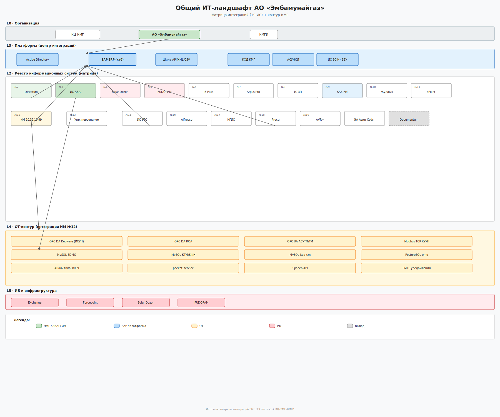
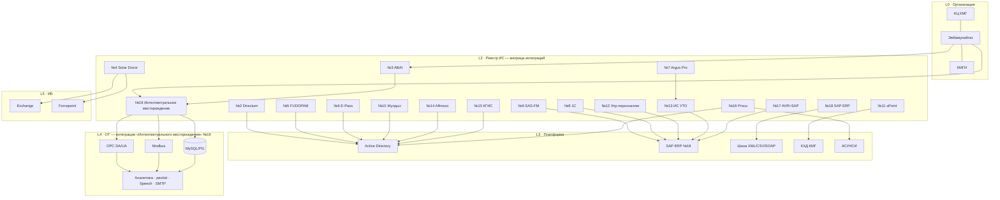

# Общая схема ИТ-ландшафта АО «Эмбамунайгаз»

Собрано из:
- **Матрицы интеграций** (19 ИС) — реестр и протоколы
- **Матрицы КЦ – ЭМГ – КМГИ** — охват по организациям
- **Программы ИТ КМГ 2025–2028** (§ 7.6.1.3)

---

## Файлы схемы

| Формат | Файл |
|--------|------|
| **draw.io** | [`drawio/it-landscape-emg-general.drawio`](drawio/it-landscape-emg-general.drawio) — редактируемая схема (diagrams.net) |
| **SVG** | [`svg/06-it-landscape-general.svg`](svg/06-it-landscape-general.svg) — для Word / PowerPoint / Figma |
| **Все draw.io** | [`drawio/README.md`](drawio/README.md) |
| **Все SVG** | [`svg/README.md`](svg/README.md) — полный набор схем из architecture-emg-integrations |
| **PNG** | [`it-landscape-emg-general.png`](it-landscape-emg-general.png) — предпросмотр |
| **Реестр 19 ИС** | [`it-landscape-emg-registry.md`](it-landscape-emg-registry.md) — таблица интеграций |
| **Справочник систем и компонентов** | [`it-landscape-emg-components-catalog.md`](it-landscape-emg-components-catalog.md) — описание каждой ИС и блоков схемы |
| **Потоки ABAI/ИМ** | [`architecture-emg-integrations.md`](architecture-emg-integrations.md) |

---

## Общая схема (19 систем по новому перечню + SAP-хаб)

---

## Реестр 19 информационных систем

| № | Система | Роль в ландшафте |
|---|---------|------------------|
| 2 | Directum | СЭД, документооборот → AD |
| 3 | ИС ABAI | Производство, abai.kmg.kz → ИМ |
| 4 | Solar Dozor | DLP ← Exchange, Forcepoint |
| 5 | FUDOPAM | PAM → AD |
| 6 | E-Pass | Пропуска → AD |
| 7 | Argus Pro | GPS-мониторинг → ИС УТО |
| 8 | 1С | Зарплата ← SAP |
| 9 | SAS-FM | Фин. планирование → SAP |
| 10 | Жулдыз | Мониторинг месторождения → AD |
| 11 | sPoint | Наряды-допуски → КХД |
| 12 | Управление персоналом | Кадры, табельные данные и кадровые сервисы ↔ SAP / корпоративный портал |
| 13 | ИС УТО | Транспорт ↔ SAP, GPS-данные от Argus |
| 14 | Alfresco | ECM → AD |
| 15 | КГИС | ГИС → AD |
| 16 | Procu | Закупки ↔ АСУНСИ, ИСЭЗ, AD |
| 17 | AVR+SAP | Акты выполненных работ ↔ SAP |
| 18 | **SAP ERP** | **Центральный хаб интеграций (финансы, НСИ, банки, ЭСФ, кадровый контур)** |
| **19** | **Интеллектуальное месторождение (ИМ)** | **OT-хаб: OPC/Modbus/БД, обмен с ABAI и промышленными контурами** |

---

## Корпоративный контур КМГ (дополнение к матрице)

| ИС | URL | ЭМГ |
|----|-----|:---:|
| САПФИР / Directum | docs.kmg.kz | ✓ |
| АСДЦ | iis.thkmg.kz | ✓ |
| ИС УТО ЭМГ | — | ✓ |
| ИСОТ/ЭНД | hse.kmg.kz | ✓ |
| Team, Интранет, ИСУП, Compliance | kmg.kz, intranet… | ✓ |
| Documentum, Санау | — | **ВЫВОД** |

---

## Как читать схему

1. **SAP ERP (№18)** — центр финансовых и кадровых интеграций.
2. **Интеллектуальное месторождение (№19)** — центр промысловой телеметрии (связан с ABAI №3).
3. **Active Directory** — идентификация для Directum, Alfresco, КГИС, Procu, E-Pass, Жулдыз, FUDOPAM.
4. Детальные протоколы, cron и IP — в [`it-landscape-emg-registry.md`](it-landscape-emg-registry.md) и [`architecture-emg-integrations.md`](architecture-emg-integrations.md).
