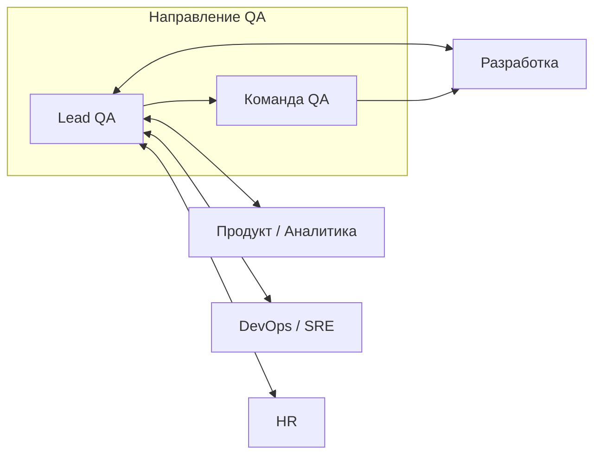

# Должностная инструкция  
## Руководитель направления тестирования (Lead QA Engineer)

**Утверждаю:** _________________________  
**Дата утверждения:** «___» __________ 20___ г.

**С должностной инструкцией ознакомлен:** _________________________  
**Дата ознакомления:** «___» __________ 20___ г.

---

## 1. Общие положения

1.1. Настоящая должностная инструкция определяет функциональные обязанности, права и ответственность **Руководителя направления тестирования (Lead QA Engineer)** (далее — **Руководитель QA**).

1.2. Руководитель QA относится к категории руководителей / ведущих специалистов (в зависимости от организационной структуры компании) и подчиняется непосредственно **Руководителю разработки (CTO / Head of Engineering)** или **Руководителю продукта (CPO)** — по согласованию внутренней структуры.

1.3. На должность Руководителя QA назначается лицо с высшим техническим образованием и опытом работы в тестировании программного обеспечения **не менее 5 лет**, из них **не менее 2 лет** на позициях Senior QA или Lead QA, а также с подтверждённым опытом построения процессов тестирования и развития команды.

1.4. Руководитель QA должен знать:
- методологии и практики тестирования (функциональное, интеграционное, регрессионное, smoke/sanity, re-test);
- тест-дизайн и работу с требованиями до начала разработки;
- тестирование **Web**, **Mobile** (iOS/Android) и **REST API** в микросервисной архитектуре;
- работу с **Kafka** (события, дубликаты, DLQ, трассировка);
- **SQL** для проверки данных и расследования инцидентов (в т.ч. read-only на проде);
- инструменты: TMS, CI/CD, Postman/аналоги, Charles/Proxyman, DevTools, OpenSearch/Kibana;
- основы автоматизации на **Python** (оценка ROI, поддержка фреймворка);
- Agile-практики (Scrum, Kanban), метрики качества, управление рисками релиза;
- трудовое законодательство в части, касающейся его деятельности (при наличии прямых подчинённых).

1.5. В отсутствие Руководителя QA его обязанности исполняет назначенный заместитель (Senior QA) с сохранением ответственности за порученный участок работ.

1.6. Руководитель QA в своей деятельности руководствуется настоящей инструкцией, внутренними регламентами компании (Definition of Done, политика релизов, политика работы с продакшен-данными), стандартами оформления багов и тестовой документации.

---

## 2. Цель должности

Обеспечить предсказуемое качество продуктов компании (веб, мобильные приложения, API, интеграции) за счёт выстраивания и непрерывного улучшения процессов тестирования, развития команды QA, управления рисками релизов и прозрачной коммуникации качества для бизнеса и разработки.

---

## 3. Должностные обязанности

### 3.1. Стратегия и процессы качества

3.1.1. Формировать и актуализировать **стратегию тестирования** по продуктам и направлениям (Web / Mobile / API / интеграции).

3.1.2. Выстраивать и поддерживать процессы QA «с нуля» или при масштабировании: **QA Notes**, тест-планы, чек-листы, матрицы покрытия, регламенты тест-прогонов, критерии **go/no-go** перед релизом.

3.1.3. Внедрять и сопровождать **TMS** (Test Management System), единые шаблоны тест-кейсов и баг-репортов, связь требований (AC) с тестовым покрытием.

3.1.4. Определять и контролировать **Definition of Done** для задач разработки с точки зрения качества (тестирование, регресс, документация, метрики).

3.1.5. Участвовать в **review требований** до разработки: аналитика, Figma, груминги; фиксировать риски, негативные сценарии и NFR.

3.1.6. Организовывать **приоритизацию дефектов** перед релизом (severity × priority × blast radius × обходные пути).

3.1.7. Вести **метрики качества** (дефекты по severity, escape rate, время закрытия, стабильность регресса, покрытие критичных сценариев) и ежемесячно отчитываться руководству.

### 3.2. Руководство командой

3.2.1. Формировать, развивать и координировать работу команды QA (Middle / Senior), распределять зоны ответственности по продуктам и платформам.

3.2.2. Проводить **1:1**, постановку целей, оценку performance, планы развития (ИПР) для подчинённых.

3.2.3. Организовывать **найм**: описание вакансий, проведение технических собеседований по единой методике (структура, компетенции, антибиас, обратная связь кандидату и HR).

3.2.4. Проводить **онбординг**, менторинг, ревью тестовой документации и сложных баг-репортов.

3.2.5. Разрешать эскалации по спорным дефектам, срокам тестирования и scope релиза.

### 3.3. Тестирование продуктов (hands-on на уровне эксперта)

3.3.1. Участвовать в тестировании **критичных и высокорисковых** изменений (e-commerce, подписки, платежи, highload-сценарии).

3.3.2. Обеспечивать экспертизу по **Web**: DevTools, Network/Console, сверка с Swagger, локализация, кэш, SEO/a11y по чек-листам продукта.

3.3.3. Обеспечивать экспертизу по **Mobile**: lifecycle, push, offline, матрица устройств, Charles/Proxyman, регресс перед выкладкой в store.

3.3.4. Обеспечивать экспертизу по **API**: REST (коды ответа, валидация, пагинация, auth), изоляция багов (фронт / API / сервис), **Kafka** (event → эффект, дубликаты, DLQ, trace-id).

3.3.5. Использовать **SQL** и **логи (OpenSearch/Kibana)** для расследования инцидентов; формировать артефакты для разработки (trace_id, шаги, гипотезы).

3.3.6. Контролировать учёт **NFR**: таймауты, идемпотентность платежей, rate limit, алерты, нагрузочное тестирование — в координации с DevOps/SRE.

### 3.4. Автоматизация и инструменты

3.4.1. Определять **стратегию автоматизации** (что автоматизировать, ROI, поддержка), приоритизировать API- и smoke-наборы.

3.4.2. Развивать автотесты на **Python** (или согласованном стеке): API checks, подготовка данных, разбор логов; задавать стандарты кода автотестов.

3.4.3. Интегрировать автотесты в **CI/CD**, следить за стабильностью пайплайнов и flaky-тестами.

3.4.4. Утверждать набор инструментов команды (TMS, моки, прокси, мониторинг) и обучение ими.

### 3.5. Релизы и инциденты

3.5.1. Утверждать **тест-прогоны** (smoke, sanity, регресс, re-test) и итоговое решение **go/no-go** совместно с релиз-менеджером / тимлидом разработки.

3.5.2. Вести **релизные чек-листы** для web и mobile; фиксировать известные риски и ограничения.

3.5.3. Участвовать в **post-mortem** по production-инцидентам: root cause, action items для QA и смежных команд.

3.5.4. Согласовывать политику работы с **продакшен-данными** (только read-only, маскирование, аудит доступа).

### 3.6. Взаимодействие со смежными подразделениями

3.6.1. Работать с **разработкой**: уточнение AC, раннее вовлечение QA, shift-left, парное расследование багов.

3.6.2. Работать с **продуктом и аналитикой**: приёмка фич, приоритизация техдолга качества.

3.6.3. Работать с **DevOps/SRE**: окружения, деплой, мониторинг, алерты, нагрузочные стенды.

3.6.4. Работать с **HR**: найм, грейды, обучение; с **поддержкой/операциями** — при customer-facing инцидентах.

3.6.5. Представлять позицию QA на планированиях (Scrum/Kanban), daily, демо, ретроспективах.

---

## 4. Права

4.1. Запрашивать и получать от подразделений компании информацию и документы, необходимые для выполнения обязанностей (ТЗ, API-спеки, доступы к стендам, логи, аналитика).

4.2. Вносить предложения по изменению процессов разработки и релизов, блокирующим качеству.

4.3. **Останавливать релиз** (рекомендация no-go) при невыполнении критериев качества — с эскалацией на руководство разработки/продукта.

4.4. Участвовать в выборе инструментов TMS, автоматизации и тестовой инфраструктуры в рамках утверждённого бюджета.

4.5. Подписывать (в пределах делегированных полномочий) внутренние регламенты QA и шаблоны документации.

4.6. Привлекать сотрудников смежных подразделений к совместному расследованию инцидентов.

4.7. Представлять интересы направления QA на уровне руководства компании.

---

## 5. Ответственность

5.1. За качество и своевременность тестирования продуктов в зоне ответственности команды QA.

5.2. За достоверность отчётности по качеству, метрикам и рискам релизов.

5.3. За соблюдение регламентов: оформление багов, тест-документация, политика доступа к данным, конфиденциальность.

5.4. За развитие компетенций команды и результативность найма (в т.ч. соответствие грейдам Middle / Senior / Lead).

5.5. За необоснованные **escape-дефекты** в production по критичным сценариям при наличии возможности их выявления на тестировании — в рамках согласованной матрицы ответственности с разработкой.

5.6. За нарушение трудовой дисциплины, правил внутреннего распорядка и требований охраны труда (при наличии подчинённых — и за их соблюдение в части, делегированной руководителю).

5.7. За причинение материального ущерба — в порядке, установленном законодательством и локальными актами компании.

---

## 6. Ключевые показатели эффективности (KPI), ориентиры

| Показатель | Описание |
|------------|----------|
| Escape rate | Доля критичных/высоких дефектов, найденных в prod после релиза |
| Стабильность регресса | % успешных регресс-прогонов без блокирующих ложных срабатываний |
| Покрытие критичных сценариев | Наличие актуальных тест-кейсов/чек-листов на payment, подписку, auth |
| Время цикла QA | От «готово к тесту» до «принято/возвращено» по приоритетным задачам |
| TMS-гигиена | Актуальность тестовой базы, связь с требованиями |
| Найм | Time-to-hire, доля успешных прохождений испытательного срока |
| Автоматизация | Доля smoke/API, покрытых CI; снижение flaky-тестов |
| Удовлетворённость смежных команд | Обратная связь dev/product (опрос или ретро) |

Конкретные целевые значения KPI утверждаются ежегодно совместно с руководителем разработки/продукта.

---

## 7. Компетенции Lead (минимальный профиль)

Соответствие внутренней шкале оценки кандидатов и сотрудников (см. `docs/README_interview_excel.md`, лист «Сводка»):

| Область | Ожидание для Lead |
|---------|-------------------|
| API / микросервисы | Уверенная работа с REST, Kafka, локализация багов, SQL |
| Процессы | Построение QA с нуля, TMS, метрики, приоритизация, собеседования |
| Кейсы | План расследования e-com/mobile, гипотезы, баг-репорт, риски релиза |
| Автоматизация | Python с пониманием ROI; стратегия, не только скрипты |
| Лидерство | Команда, найм, эскалации, коммуникация с бизнесом |

Пороги при техническом интервью (ориентир): **API ≥ 10/14**, **Процессы ≥ 9/12**, **Кейс ≥ 18/24**, общий балл **85–100** (см. `QA_Interview_Evaluation.xlsx`).

---

## 8. Взаимодействие (схема)

---

## 9. Заключительные положения

9.1. Настоящая инструкция вступает в силу с момента утверждения.

9.2. Изменения в инструкцию вносятся приказом руководителя компании по представлению непосредственного руководителя Lead QA.

9.3. Приложения (при необходимости): регламент баг-репорта, шаблон test plan, матрица устройств mobile, чек-лист go/no-go — хранятся в корпоративной базе знаний / репозитории `docs/`.

---

*Версия документа: 1.0*  
*Связанные материалы: `docs/README_interview_excel.md`, `scripts/generate_qa_interview_excel.py`*
