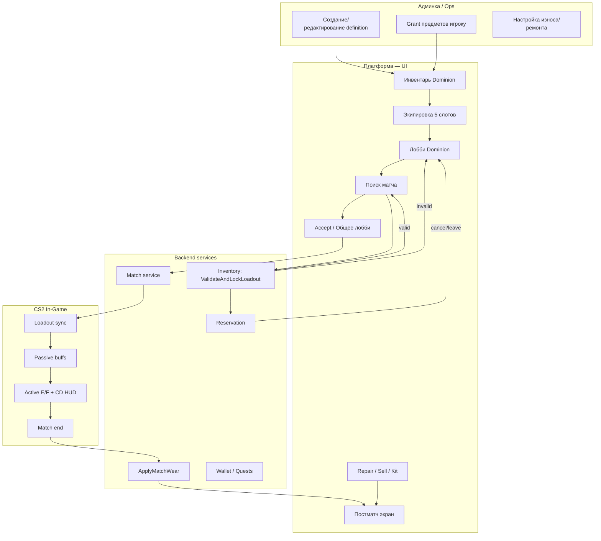

# Dominion — E2E Test Plan (полный флоу)

**Версия:** 1.0  
**Дата:** 07.08.2026  
**Источники:** Dominion Lobby, Inventory, Система предметов Dominion, Каталог модификаторов  
**Автор:** QA (Senior, fintech/gamedev)

---

## 1. Цели и границы

### 1.1 Цель
Спроектировать сквозной (E2E) флоу тестирования режима **Dominion** — от выдачи/получения предметов до постматчевого экрана, включая UI лобби, инвентарь, матчмейкинг, in-game HUD и админские операции с каталогом предметов.

### 1.2 In Scope
| Область | Что покрываем |
|---------|----------------|
| **Инвентарь** | Grant, GetInventory, экипировка, Consume, Sell, Repair (Gold + Kit), износ, резервация |
| **Предметы Dominion** | 5 слотов × Base/Advanced, 122 предмета (матричное покрытие + smoke по каждому слоту) |
| **Лобби Dominion** | роли Boss/Mercenary, PRO-валидация, инвайты, loadout, поиск, sync |
| **Матч** | accept, общее лобби, in-game HUD (E/F, status bar), leaver penalty |
| **Постматч** | статистика, прочность, награды, квесты, ремонт |
| **Админка** | dictionary/taxonomy (definitions), выдача предметов, баланс, мониторинг событий |

### 1.3 Out of Scope
- **NFT** — не тестируем
- Юнит/интеграционные тесты отдельных Go-модулей без UI
- Нагрузочное тестирование MM (отдельный план)
- Рекламный x2 бонус (отдельная дока по рекламе)

---

## 2. Тестовое окружение и персоны

### 2.1 Окружения
| Env | Назначение |
|-----|------------|
| **QA-INT** | API inventory + lobby, stub match service |
| **QA-STAGE** | полный стек + CS2 dev server |
| **PREPROD** | smoke перед релизом |

### 2.2 Тестовые аккаунты (обязательный набор)

| ID | Персона | Подписка | Роль в Dominion | Особенности |
|----|---------|----------|-----------------|-------------|
| `U-PRO-LEAD` | Лидер PRO | PRO | Boss | Полный Advanced loadout, Gold ≥ 50k |
| `U-PRO-MEM` | Участник PRO | PRO | Boss | Второй слот Boss-команды |
| `U-F2P-LEAD` | Лидер F2P | — | Mercenary | Только Base-предметы |
| `U-F2P-MEM` | Участник F2P | — | Mercenary | Для инвайт-сценариев |
| `U-F2P-BROKEN` | F2P с поломками | — | Mercenary | 5 предметов с durability=0 |
| `U-F2P-MIXED` | F2P смешанный | — | Mercenary | 3 слота заполнены, 2 пустых |
| `U-PRO-NOGOLD` | PRO без Gold | PRO | Boss | Для RepairByGold negative |
| `U-ADMIN` | Администратор | — | — | Доступ к dictionary + Grant |
| `U-SUPPORT` | Саппорт | — | — | Read-only админка, Grant |

### 2.3 Тестовые данные — предметы (матрица покрытия)

Вместо 122 отдельных E2E на каждый предмет — **матрица + smoke**:

| Слот | Base (F2P) | Advanced (Boss/PRO) | Редкости для repair/wear |
|------|------------|---------------------|--------------------------|
| Голова (E) | Анти-Крипт V1 (C) | Нейро-Сборщик Геликс (R, active E) | C, R, E, L |
| Грудь (F) | Био-Патч HP V1 (C) | Био-Резерв Zetta (R, active F) | C, R, E, L |
| Кисти | Рефлекс Пистолета V1 (C) | Имплант Шрапнель-Магнит (E) | C, R, E |
| Ноги | Брюки Vanguard Синие (C) | Брюки Vanguard Core (E) | C, R, E |
| Ступни | Стелс-Подошва V1 (C) | Ботинки Ghost Sneaker (E) | C, R, E |

**Полный регресс предметов (in-game):** отдельный чеклист `ITEM-REG-001..122` — прогон в custom lobby / bot match, 1 раунд на предмет.

---

## 3. Архитектура E2E-флоу

---

## 4. Фазы тестирования (от начала до конца)

| Фаза | Название | Тип | Зависимости |
|------|----------|-----|-------------|
| **P0** | Sanity / Smoke | 15 кейсов, ~30 мин | Env up, аккаунты |
| **P1** | Инвентарь + предметы | API + UI | P0 |
| **P2** | Лобби + MM | UI + sync | P1 |
| **P3** | Матч + in-game | CS2 client | P2 |
| **P4** | Постматч + economy | UI + events | P3 |
| **P5** | Админка + ops | Admin UI / API | P1 |
| **P6** | Regression + edge cases | Full suite | P0–P5 |

---

## 5. E2E Test Cases

### Формат
- **ID:** уникальный идентификатор  
- **Priority:** P0 (blocker) / P1 (critical) / P2 (major) / P3 (minor)  
- **Type:** UI / API+UI / Game  

---

## Блок A — Админка и каталог (Dictionary / Taxonomy)

| ID | Название | Priority | Preconditions | Steps | Expected Result |
|----|----------|----------|---------------|-------|-----------------|
| **ADM-E2E-001** | Создание definition предмета Dominion | P1 | `U-ADMIN`, пустой definition | 1. Открыть админку → Dictionary → New Item 2. Заполнить: name, slot=head, rarity=Common, traits=repairable,sellable, game_code=dominion 3. Указать buff/debuff тексты, base_price=1000, durability_loss=28 4. Сохранить | Definition создан; появляется в каталоге; кеш dictionary обновлён |
| **ADM-E2E-002** | Редактирование tooltip-текста без breaking change | P2 | Существующий предмет в prod-like env | 1. Изменить описание баффа 2. Сохранить 3. Открыть tooltip в лобби | Tooltip в UI показывает новый текст; gameplay properties не изменились |
| **ADM-E2E-003** | PRO-флаг на Advanced-предмете | P1 | Definition Advanced (Boss) | 1. Установить restriction=PRO 2. Grant предмет F2P-игроку | Предмет в инвентаре с blur + lock; экипировка заблокирована |
| **ADM-E2E-004** | Grant предмета игроку (admin) | P0 | `U-ADMIN`, `U-F2P-LEAD` | 1. Admin → Users → Grant Item 2. Выбрать 5 Base-предметов (по слоту) 3. idempotency_key=unique | Предметы в GetInventory(game=dominion); событие items.awarded (если подключено) |
| **ADM-E2E-005** | Повторный Grant с тем же idempotency_key | P1 | ADM-E2E-004 выполнен | 1. Повторить Grant с тем же key | Дубликат отсечён; stackCount не удваивается; HTTP 200 no-op |
| **ADM-E2E-006** | Настройка таблицы RepairByGold (per rarity) | P2 | Админ-баланс | 1. Изменить % стоимости попытки 1 для Rare 2. Сломать Rare-предмет у тест-юзера 3. Repair UI | UI показывает новую стоимость; списание Gold корректно |
| **ADM-E2E-007** | Просмотр audit log операций Grant | P3 | Логирование включено | 1. Выполнить Grant 2. Открыть audit | Запись: admin_id, user_id, items, timestamp |
| **ADM-E2E-008** | Деактивация definition (soft delete) | P2 | Предмет не в активных loadout | 1. Deactivate definition 2. Открыть Selection UI | Предмет не предлагается к экипировке; у владельцев остаётся в инвентаре |

---

## Блок B — Инвентарь (UI + backend)

| ID | Название | Priority | Preconditions | Steps | Expected Result |
|----|----------|----------|---------------|-------|-----------------|
| **INV-E2E-001** | Отображение инвентаря Dominion | P0 | У игрока есть dominion + platform items | 1. Открыть Инвентарь → фильтр Dominion | Показаны game-bound + platform items; группировка по слотам |
| **INV-E2E-002** | Экипировка предмета в слот | P0 | Свободный слот head | 1. Клик на слот → Selection UI 2. Выбрать Base-предмет 3. Confirm | Иконка в лобби; флаг equipped; предмет остаётся в инвентаре |
| **INV-E2E-003** | Снятие предмета со слота | P1 | Слот заполнен | 1. Снять предмет | Слот Empty; предмет в инвентаре; не удалён |
| **INV-E2E-004** | Tooltip предмета (hover) | P1 | Экипирован предмет с buff+debuff | 1. Hover на иконку слота | Название, тип Base/Advanced, buff (зелёный), debuff (красный), active skill для E/F |
| **INV-E2E-005** | PRO blur и CTA покупки | P0 | `U-F2P-LEAD`, Advanced в инвентаре | 1. Открыть инвентарь 2. Hover PRO-предмет | Blur + «Требуется PRO»; попап с кнопкой покупки подписки |
| **INV-E2E-006** | Попытка экипировать PRO без подписки | P0 | F2P, Advanced item | 1. Клик Equip на Advanced | Ошибка; предмет не экипирован; CTA PRO |
| **INV-E2E-007** | Индикатор прочности в лобби | P1 | Предмет durability=45% | 1. Открыть лобби | Шкала 45%; цвет по порогам |
| **INV-E2E-008** | Сломанный предмет (0%) — визуал | P0 | durability_current=0 | 1. Экипировать сломанный 2. Открыть лобби | Подсветка «Сломан»; подсказка о ремонте; баффы не активны in-game |
| **INV-E2E-009** | Продажа одного предмета | P1 | sellable, не equipped, не reserved | 1. Sell → preview gold = base_price × 0.08 2. Confirm | Gold начислен; предмет удалён; popup с суммой был до confirm |
| **INV-E2E-010** | Продажа экипированного — блок | P1 | Предмет в loadout | 1. Попытка Sell | Предупреждение: сначала снять |
| **INV-E2E-011** | Массовая продажа | P2 | 3+ sellable items | 1. Multi-select → Sell all | Все проданы; суммарный preview; один confirm |
| **INV-E2E-012** | RepairByGold — успех с 1-й попытки | P1 | Сломан Common (1000g), Gold достаточно | 1. Repair UI: attempt 1, cost 520, chance 87% 2. Confirm (mock success) | durability=100%; Gold −520; success animation |
| **INV-E2E-013** | RepairByGold — fail + streak | P1 | Сломанный предмет | 1. Fail attempt 1 2. Проверить attempt 2 cost/chance | repair_streak_failed=1; attempt 2: 572g, 74%; durability остаётся 0 |
| **INV-E2E-014** | Repair streak сохраняется после успеха | P1 | После успеха на attempt 2 | 1. Снова сломать предмет 2. Открыть Repair | Следующий ремонт начинается с attempt 2 (не сбрасывается) |
| **INV-E2E-015** | Repair cap после 7 fails | P2 | repair_streak_failed=7 | 1. Открыть Repair | Cost = 50% от нового предмета; chance = 9% |
| **INV-E2E-016** | RepairByKit — гарантированный | P1 | Сломан Common + Common kit | 1. Use kit → confirm popup | durability=100%; kit stack −1; Gold не списан |
| **INV-E2E-017** | RepairByKit — rarity mismatch | P1 | Сломан Epic + Common kit | 1. Apply kit | Ошибка rarity mismatch; предмет не починен |
| **INV-E2E-018** | Repair исправного предмета — блок | P2 | durability > 0 | 1. Repair | Ошибка not broken |
| **INV-E2E-019** | Repair при insufficient Gold | P1 | `U-PRO-NOGOLD` | 1. RepairByGold | Ошибка insufficient balance; attempt не засчитан |
| **INV-E2E-020** | Операции при active reservation — блок | P0 | Поиск активен, loadout залочен | 1. Попытка Sell/Repair/Consume сломанного в loadout | HTTP 409 reserved; UI показывает блокировку |
| **INV-E2E-021** | Grant доливка stackable при reservation | P2 | Активный repair_kit stack | 1. Grant +1 kit с тем же user | stackCount увеличен; операция разрешена |
| **INV-E2E-022** | Критический износ <10% — warning | P2 | durability=9% | 1. Открыть инвентарь/постматч | «Внимание: Критический износ! Требуется ремонт» |

---

## Блок C — Лобби Dominion (UI)

| ID | Название | Priority | Preconditions | Steps | Expected Result |
|----|----------|----------|---------------|-------|-----------------|
| **LOB-E2E-001** | Создание лобби Mercenary (F2P) | P0 | `U-F2P-LEAD` | 1. Dominion → Create Lobby 2. Выбрать сторону Mercenary | 5 слотов карточек; селектор роли Mercenary |
| **LOB-E2E-002** | Создание лобби Boss (PRO) | P0 | `U-PRO-LEAD` | 1. Create → Boss | 2 слота; Advanced доступны |
| **LOB-E2E-003** | Селектор роли: >2 игрока блокирует Boss | P0 | Лобби 3+ человек | 1. Лидер пытается Boss | Ошибка: «Максимум 2 игрока для данной роли» |
| **LOB-E2E-004** | Смена стороны с валидацией PRO | P0 | PRO-лидер, F2P в группе | 1. Попытка переключить на Boss при 3 F2P | Валидация блокирует; ошибка по доке |
| **LOB-E2E-005** | Выбор карты и региона (лидер) | P1 | Лидер в лобби | 1. Сменить map + region | Видно всем; sync в real-time; пинг отображается |
| **LOB-E2E-006** | Не-лидер не может менять map/region | P2 | Участник | 1. Попытка сменить map | Контролы disabled |
| **LOB-E2E-007** | Кнопка «Инфо / Правила» | P3 | Лобби открыто | 1. Клик Info | Модалка с гайдом; описание E/F |
| **LOB-E2E-008** | Ready flow — все должны нажать Готов | P0 | Лобби 2 игрока | 1. Участник Ready 2. Лидер без Ready всех → Поиск | Поиск заблокирован; счётчик готовых X/Y |
| **LOB-E2E-009** | Старт поиска лидером | P0 | Все Ready, loadout валиден | 1. Лидер → Поиск | Кнопка → «Отмена»; таймер ожидания; ValidateAndLockLoadout |
| **LOB-E2E-010** | Поиск с пустыми слотами — warning | P1 | 2/5 слотов пусто | 1. Старт поиска | Warning о неполном loadout; поиск разрешён |
| **LOB-E2E-011** | Поиск со сломанным предметом — блок | P0 | `U-F2P-BROKEN` | 1. Старт поиска | valid=false; ошибка item_broken; поиск не стартует |
| **LOB-E2E-012** | Поиск с дублем слота — блок | P1 | 2 предмета в head | 1. Старт поиска | slot_duplicated_head; лок не ставится |
| **LOB-E2E-013** | Отмена поиска → ReleaseBatch | P0 | Поиск активен | 1. Отмена | Резервация снята; предметы доступны Sell/Repair |
| **LOB-E2E-014** | Выход из лобби после Ready — блок | P1 | Игрок нажал Ready | 1. Выход | Кнопка «Выход» disabled |
| **LOB-E2E-015** | Kick участника лидером | P1 | 2 игрока | 1. Kick | Участник вылетел; слот пустой |
| **LOB-E2E-016** | Инвайт друга в команду | P0 | Игрок в лобби | 1. Пустой слот → Пригласить 2. Друг принимает | Друг в **той же команде** что инвайтер |
| **LOB-E2E-017** | Инвайт: PRO-хост Mercenary, F2P друг | P0 | PRO в Mercenary, F2P друг | 1. Инвайт F2P 2. F2P принимает | Вход успешен; нельзя перенести команду в Boss |
| **LOB-E2E-018** | Инвайт: PRO-хост Boss, F2P друг | P0 | PRO в Boss | 1. F2P принимает инвайт | Ошибка: «Вы не можете присоединиться к лобби в команду Боссов без подписки ПРО» |
| **LOB-E2E-019** | Real-time sync loadout | P1 | 2 игрока в лобби | 1. Игрок A меняет chest item | Игрок B видит изменение без refresh |
| **LOB-E2E-020** | Real-time sync map/region | P1 | 2 игрока | 1. Лидер меняет карту | У всех обновилось |
| **LOB-E2E-021** | Гибкий состав 1–5 → MM доукомплектация | P1 | Соло в поиске | 1. 1 игрок Mercenary → поиск | MM добирает до 5; матч 2v5 формируется |
| **LOB-E2E-022** | Hover на снаряжение союзника | P2 | 2 в лобби | 1. Hover на слот союзника | Tooltip с его предметом (без Selection) |
| **LOB-E2E-023** | Selection UI: Base перед Advanced | P2 | PRO Boss | 1. Открыть Selection head | Сначала Base, затем Advanced |
| **LOB-E2E-024** | Locked Advanced без PRO в Selection | P1 | F2P | 1. Selection | Advanced с иконкой замка |

---

## Блок D — Матчмейкинг и общее лобби

| ID | Название | Priority | Preconditions | Steps | Expected Result |
|----|----------|----------|---------------|-------|-----------------|
| **MM-E2E-001** | Матч найден — accept flow | P0 | Поиск активен | 1. Match found popup 15–20s 2. Все Accept | Переход в общее лобби |
| **MM-E2E-002** | Decline / timeout — leaver penalty | P0 | Match found | 1. 1 игрок не Accept | Временный бан на поиск 15/30/120/720 мин; остальные возврат в лобби |
| **MM-E2E-003** | Общее лобби — состав 2+5 | P0 | Accept всеми | 1. Экран showdown | 2 Boss + 5 Merc карточки; снаряжение обеих команд |
| **MM-E2E-004** | Изучение снаряжения противника | P1 | Общее лобби | 1. Hover enemy loadout | Tooltip с buff/debuff |
| **MM-E2E-005** | Таймер общего лобби 30 сек | P1 | Общее лобби | 1. Ждать 30s | Автоконнект к CS2 серверу |
| **MM-E2E-006** | Резервация сохраняется до конца матча | P0 | Loadout залочен | 1. Во время матча — Sell/Repair | 409 reserved |
| **MM-E2E-007** | used_instances переданы в match | P1 | Матч стартовал | 1. Проверить payload match | Только inventory_item IDs |

---

## Блок E — In-Game (CS2)

| ID | Название | Priority | Preconditions | Steps | Expected Result |
|----|----------|----------|---------------|-------|-----------------|
| **GAME-E2E-001** | Loadout применён в CS2 | P0 | Полный loadout | 1. Зайти в матч | Все 5 слотов дают эффекты (smoke: 1 passive) |
| **GAME-E2E-002** | Сломанный предмет — нет эффекта | P0 | durability=0 | 1. Матч | Баффы/дебаффы не работают; визуал «сломан» |
| **GAME-E2E-003** | Active skill E (head) — Boss | P0 | Нейро-Сборщик Геликс | 1. Нажать E 2. Повтор до CD | Скилл срабатывает; иконка CD заполняется; КД ~20с |
| **GAME-E2E-004** | Active skill F (chest) — Boss | P0 | Био-Резерв Zetta | 1. Нажать F | +50 armor; CD ~25с |
| **GAME-E2E-005** | Status bar — passive icons | P2 | Предмет с постоянным баффом | 1. Наблюдать HUD | Иконка в status bar (низ экрана) |
| **GAME-E2E-006** | Visual aura Boss | P3 | Advanced loadout | 1. Визуальный осмотр | Свечение/эффекты по предметам |
| **GAME-E2E-007** | Passive trigger — representative | P1 | Анти-Крипт V1 | 1. Опустошить магазин | Пинг ближайшего врага |
| **GAME-E2E-008** | Debuff weapon block — representative | P1 | Рефлекс Молния (no molotov) | 1. Buy menu | Зажигательные/Молотов недоступны |
| **GAME-E2E-009** | Chrome Repair V2 — reset E CD | P2 | Оба скилла на CD | 1. F (Chrome Repair) | E CD сброшен; F на CD 50с |
| **GAME-E2E-010** | Статистика способностей в постматче | P1 | Boss, использован E/F | 1. Завершить матч | Счётчик использований E/F на экране итогов |

---

## Блок F — Прочность и постматч

| ID | Название | Priority | Preconditions | Steps | Expected Result |
|----|----------|----------|---------------|-------|-----------------|
| **WEAR-E2E-001** | Износ после штатного матча | P0 | Матч завершён нормально | 1. Finish match 2. Постматч экран | durability −N (по редкости); нотификация 95%→94% |
| **WEAR-E2E-002** | Идемпотентность ApplyMatchWear | P1 | match.finished x2 | 1. Дубль события | Износ применён 1 раз (dedup by match_id) |
| **WEAR-E2E-003** | Ливер — износ + penalty | P0 | Игрок вышел до конца | 1. Leave match | Износ списан; бан на поиск 15/30/120/720 |
| **WEAR-E2E-004** | Server crash — износ НЕ списан | P0 | Матч отменён системой | 1. Crash/cancel | durability без изменений |
| **WEAR-E2E-005** | Full team leave — тех.поражение | P2 | Вся команда ливнула | 1. Cancel | Износ как за обычный матч |
| **WEAR-E2E-006** | Постматч: блок статистики | P1 | Матч завершён | 1. Экран итогов | K/D/A, ADR; Dominion stats (E/F, damage) |
| **WEAR-E2E-007** | Постматч: блок наград | P1 | Матч завершён | 1. Экран итогов | XP, Gold; прогресс daily quest |
| **WEAR-E2E-008** | «Починить всё» с постматча | P2 | 2+ сломанных | 1. Кнопка Repair all | Переход в flow Repair |
| **WEAR-E2E-009** | Редкость → разный износ за матч | P2 | Common vs Legendary | 1. Два матча | C: −28, L: −11 (по таблице) |

---

## Блок G — Сквозные E2E сценарии (Happy Path + Critical Paths)

| ID | Название | Priority | Flow |
|----|----------|----------|------|
| **E2E-FULL-001** | **Happy Path F2P Mercenary** | P0 | Admin Grant Base×5 → Equip → Lobby → Ready → Search → Accept → General Lobby → CS2 match → Win/Lose → Postmatch wear → Repair kit → Re-queue |
| **E2E-FULL-002** | **Happy Path PRO Boss duo** | P0 | PRO Boss×2 → Advanced loadout E+F → Search → Match → Use E/F → Postmatch → RepairByGold → Sell old item |
| **E2E-FULL-003** | **Invite flow cross-subscription** | P0 | PRO Merc host + F2P friend → invite → join same team → match → verify F2P can't switch to Boss |
| **E2E-FULL-004** | **Economy loop** | P1 | Play until broken → Repair fail×2 → success → Sell duplicate → Buy from shop (если есть) → Equip |
| **E2E-FULL-005** | **Reservation lifecycle** | P0 | Search (lock) → cancel (release) → repair → search again (lock) → full match → release after match |
| **E2E-FULL-006** | **Group 5 stack Mercenary** | P1 | 5 F2P → all Ready → search → no MM fill needed for group |
| **E2E-FULL-007** | **Solo fill MM** | P1 | 1 player search → MM adds 4 mercs + 2 bosses + 4 mercs enemy |
| **E2E-FULL-008** | **Admin hotfix tooltip** | P2 | Admin changes text → player sees in lobby without client restart (cache TTL) |

---

## 6. Матрица покрытия предметов (122 шт.)

### 6.1 Стратегия
| Уровень | Что делаем | Когда |
|---------|------------|-------|
| **L1 Smoke** | Экипировка + tooltip + in-game 1 раунд | Каждый релиз, sampling 20% |
| **L2 Slot regression** | По 1 предмету на редкость в слоте | Sprint regression |
| **L3 Full** | Все 122 в checklist | Major release / balance patch |

### 6.2 Чеклист по слотам (минимум для L2)

**Голова (24 PRO + 20 Base ≈ 44)** — приоритет active E:
- [ ] Нейро-Сборщик Геликс (E active)
- [ ] Протокол Зеро-Флеш (L active)
- [ ] Анти-Крипт V1 (C passive trigger)
- [ ] Шлем Гладиатор Хром Синий (E passive vision)

**Грудь / Скелет (F active)**:
- [ ] Био-Резерв Zetta (R)
- [ ] Кинетический Усилитель (R)
- [ ] Адаптивный Камуфляж Призрак (L)
- [ ] Био-Патч HP V1 (C)

**Кисти / Имплант**:
- [ ] Перчатки Маркер-Пыль (L)
- [ ] Рефлекс Пистолета V1 (C)

**Ноги / Имплант**:
- [ ] Брюки Ghost Серая (L)
- [ ] Брюки Vanguard Синие (C)

**Ступни / Имплант**:
- [ ] Имплант Пиро-Шаг (L)
- [ ] Стелс-Подошва V1 (C)

### 6.3 Типы модификаторов (из каталога) — обязательные E2E

| Тип баффа | Representative item | Game check |
|-----------|---------------------|------------|
| Постоянный бонус | Стелс-Подошва V1 | Silent landing |
| Срабатывает по событию | Мини-Радар V1 | +200$ on round win |
| Активная способность E | Визор Оракул | Grenade xray 25s CD |
| Активная способность F | Био-Регенерация | Bullet mirror 40s CD |
| Debuff weapon block | Рефлекс Молния | No molotov buy |
| Debuff stat | Velocity Chip | −5% move speed |

---

## 7. Негативные и граничные кейсы (консолидировано)

| ID | Сценарий | Expected |
|----|----------|----------|
| **NEG-001** | Два игрока экипируют один inventory_item_id | Второй получает ошибку ownership/conflict |
| **NEG-002** | ValidateAndLock: 1 из 5 невалиден | Весь batch invalid; лок не ставится |
| **NEG-003** | TTL reservation истёк во время поиска | Авто ReleaseBatch; поиск отменён |
| **NEG-004** | Повторный ReleaseBatch | Idempotent no-op |
| **NEG-005** | Consume repair_kit когда stack=1 | Строка удалена из inventory |
| **NEG-006** | Sell last copy equipped item | Blocked |
| **NEG-007** | PRO expired mid-lobby с Advanced equipped | Валидация при search/start; ошибка или force unequip |
| **NEG-008** | Tooltip cache stale после admin edit | Обновление после TTL / hard refresh policy |
| **NEG-009** | Match accept при потере сети | Reconnect + state recovery |
| **NEG-010** | Одновременный Repair + Sell (race) | Один успех, второй 409/400 |

---

## 8. Автоматизация E2E — рекомендации

| Слой | Инструмент | Покрытие |
|------|------------|----------|
| API | Postman/Newman или Go tests | Inventory port, idempotency, reservation |
| UI Platform | Playwright/Cypress | Lobby, inventory, postmatch |
| Game | GSI + demo parser / bot lobby | Buff trigger, E/F CD |
| Admin | API tests + UI smoke | Grant, definition CRUD |

**CI pipeline:**
1. PR → API suite (INV + LOB contracts)
2. Nightly → UI E2E P0/P1
3. Weekly → GAME item matrix L2
4. Release → FULL E2E-FULL-001..008

---

## 9. Entry / Exit criteria

### Entry
- [ ] QA-INT/STAGE доступен
- [ ] Тест-аккаунты и Grant выполнен
- [ ] Dictionary synced с prod-like данными
- [ ] CS2 dev server в пуле

### Exit (release)
- [ ] 100% P0 passed
- [ ] ≥95% P1 passed (остаток — waived с ticket)
- [ ] Нет открытых Blocker/Critical по Dominion
- [ ] Item matrix L2 пройдена
- [ ] Reservation + wear idempotency verified

---

## 10. Трассировка требований → тесты

| Требование (док) | Test IDs |
|------------------|----------|
| 5 слотов, Base/Advanced | INV-002, LOB-023, GAME-001 |
| PRO validation | INV-005,006; LOB-004,018,024 |
| Durability + broken | INV-008; WEAR-001; GAME-002 |
| Repair Gold + streak | INV-012..015 |
| Repair Kit | INV-016,017 |
| Sell 8% | INV-009, ADM-004 |
| ValidateAndLockLoadout | LOB-011,012; MM-006; E2E-FULL-005 |
| Invite team + PRO rules | LOB-016..018; E2E-FULL-003 |
| Match accept penalty | MM-002 |
| General lobby 30s | MM-003..005 |
| In-game E/F HUD | GAME-003,004 |
| Postmatch stats/rewards | WEAR-006,007 |
| Real-time sync | LOB-019,020 |
| Leaver wear + ban | WEAR-003 |
| Server crash no wear | WEAR-004 |

---

## 11. Приложение: полный перечень E2E ID (сводка)

| Блок | Кол-во кейсов |
|------|---------------|
| Admin (ADM) | 8 |
| Inventory (INV) | 22 |
| Lobby (LOB) | 24 |
| Matchmaking (MM) | 7 |
| In-Game (GAME) | 10 |
| Wear/Postmatch (WEAR) | 9 |
| Full flows (E2E-FULL) | 8 |
| Negative (NEG) | 10 |
| **Итого structured E2E** | **98** |
| Item regression checklist | 122 (L3) |

---

*Документ готов к импорту в TestRail / Zephyr / Xray. Для импорта в Excel используйте колонки: ID, Module, Priority, Preconditions, Steps, Expected, Automation (Y/N), Requirement Ref.*
