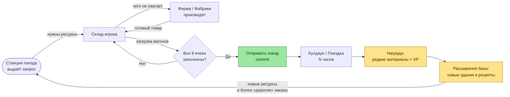

# Задание 1. Реверс‑инжиниринг референсов — Поезда в Township

## 1.1. Что это за механика и где она в игре

Поезд (Train) в Township — это асинхронный «ордерный» сток ресурсов. Игрок видит на карте железнодорожную станцию, при тапе открывается экран с одним поездом из 3 вагонов. На каждом вагоне нарисованы 3 ячейки‑заказа: **иконка ресурса + требуемое количество**. После полной загрузки поезд уезжает на N часов и возвращается с наградами (опыт, монеты, материалы для построек).

> Ключевое наблюдение: поезд — это **дополнительный «слив» произведённых ресурсов** поверх обычных продаж в магазине. Награды у поезда не деньгами, а *материалами для расширения*, которые иначе достать сложно.

## 1.2. Ключевые состояния (state machine)

Я выделил 7 состояний, которые игрок реально проживает на UI‑уровне. Скриншоты названы как «слот» в галерее (см. ниже Screenshot Plan).

| # | Состояние | Что видит игрок | Что может сделать |
|---|-----------|-----------------|-------------------|
| S0 | **Idle / Empty Station** | Пустая станция на карте, бейдж «!». | Открыть экран поезда. |
| S1 | **New Order Available** | Поезд на путях, 3 вагона по 3 ячейки = 9 заказов. Все ячейки серые/пустые. Кнопка «Загрузить» неактивна для тех, чего не хватает. | Тапать по конкретному заказу → загружать. |
| S2 | **Partially Loaded** | Часть ячеек закрыта галочкой и помечена ✓. Над поездом таймер «осталось загрузить». | Догружать оставшиеся, докупать недостающее за кристаллы (premium), идти производить. |
| S3 | **Missing Resources** | На ячейке надпись «нужно ещё X». Подсветка красным. Появляется кнопка **«Купить за 🟣 Tcash»**. | Произвести ресурс на ферме, купить, или ждать. |
| S4 | **Fully Loaded → Send** | Все 9 ячеек ✓. Появляется большая зелёная кнопка **«Отправить»**. | Тап → анимация отправления, поезд уезжает. |
| S5 | **In Transit (Cooldown)** | На станции таймер обратного отсчёта. Принимать новый поезд нельзя. | Скип за 🟣, либо ждать. |
| S6 | **Returned with Reward** | Поезд возвращается, всплывает окно наград (XP + материалы для застроек + иногда монеты). | Забрать награду, после чего возвращаемся в **S0/S1**. |

## 1.3. Core Loop (текстом)

1. Игрок **видит запрос** от поезда (что и сколько надо).
2. Сверяется со складом: **частично грузит из имеющегося**, остальное идёт **производить** на ферме / фабриках (запускает чейн «пшеница → мука → хлеб»).
3. По мере готовности ресурса возвращается и **догружает вагоны**.
4. Когда все 9 ячеек закрыты — **отправляет поезд** (явный коммит‑экшен).
5. Ждёт N часов (или скипает за премиум).
6. Получает **редкие материалы** для расширения зон/строек.
7. Тратит материалы на новые здания → **открываются новые рецепты** → следующий поезд просит более «дорогие» ресурсы → **петля затягивается**.

## 1.4. Core Loop (схема)

### Вариант A — ASCII‑схема (для быстрого чтения)

```
        ┌──────────────────────────────────────────────────────────┐
        │                                                          │
        ▼                                                          │
  ┌───────────┐   запрос   ┌────────────┐  производ.  ┌──────────┐ │
  │  Станция  │──────────► │   Склад    │────────────►│  Ферма / │ │
  │   поезда  │            │   игрока   │             │ Фабрики  │ │
  └───────────┘            └────────────┘             └──────────┘ │
        ▲                        │                         │      │
        │  отправить (commit)    │ загрузка                │ товар│
        │◄───────────────────────┘                         │      │
        │                                                  ▼      │
        │              ┌──────────────────┐         ┌──────────┐  │
        │   награда    │ Кулдаун / Поездка│◄────────│  Склад   │  │
        └──────────────│    (N часов)     │         └──────────┘  │
                       └──────────────────┘                       │
                                │                                 │
                                ▼                                 │
                       ┌────────────────────┐                     │
                       │  Редкие материалы  │──── открывают ──────┘
                       │  для роста базы    │     новые здания
                       └────────────────────┘
```

### Вариант B — Mermaid‑схема (для рендера на GitHub)



> Зелёный узел — ключевой commit‑экшен «Отправить» (после него действия необратимы).
> Жёлтые узлы — точка выплаты награды и её влияние на прогрессию базы (это и есть «закрывающая скобка» цикла).

## 1.5. Зачем это игре (мой анализ как PM/GD)

| Что даёт фича | Почему это работает |
|----------------|---------------------|
| **Сток для перепроизводства**. Без поезда игрок быстро забивает склад, и производство теряет смысл. | Решает «болезнь песочниц» — отсутствие цели тратить ресурсы. |
| **Долгосрочные таймеры (8h+).** | Создают ретеншен D1/D7: игрок возвращается в игру, чтобы «забрать поезд». |
| **Награды редкими материалами для застроек.** | Связывает поезд с **прогрессией базы**, а не просто с экономикой. |
| **Soft‑monetization point**: можно скипнуть кулдаун или докупить недостающий ресурс за премиум‑валюту. | Не блокирует прогресс F2P игроков, но создаёт «удобный» офер. |
| **Социальный хук** (в Township есть запрос помощи у соседей). | Поезд = повод зайти в кооп, повышает Stickiness. |

## 1.6. Screenshot Plan (что снимать при ручном тестировании)

> Реальные скриншоты из мобильной Township сделать в Cloud‑окружении не могу, поэтому фиксирую *что именно нужно отснять* и какое состояние машины состояний это иллюстрирует. На реальной защите я предоставлю эти 7 PNG.

| Слот | Имя файла | Состояние | Что важно поймать в кадр |
|------|-----------|-----------|---------------------------|
| 1 | `S1_new_order.png` | New Order Available | Все 9 ячеек пустые, видна общая кнопка «Загрузить». |
| 2 | `S2_partial.png` | Partially Loaded | Несколько ячеек ✓, остальные с числами «3/5». |
| 3 | `S3_missing.png` | Missing Resources | Красная подсветка + кнопка «Купить за Tcash». |
| 4 | `S4_full.png` | Fully Loaded → Send | Все ✓, активная зелёная кнопка «Отправить». |
| 5 | `S4b_send_anim.png` | Send Animation | Поезд тронулся, дым из трубы. |
| 6 | `S5_cooldown.png` | In Transit | Станция пустая + таймер «осталось 8:00:00» + кнопка «Скип». |
| 7 | `S6_reward.png` | Returned | Окно «Награда»: XP + материалы. |

## 1.7. Чему я научился, что переиспользую в задании 2–4

- Поезд — это **3 пары циклов**: микро (1 заказ), средний (1 поезд), макро (десятки поездов → новая зона базы).
- Главный «commit»‑экшен — **«Отправить»**, до него все действия обратимы.
- Премиум‑валюта используется в двух точках: «купить недостающее» и «скипнуть кулдаун». Это и переносим в AstroCrop.
