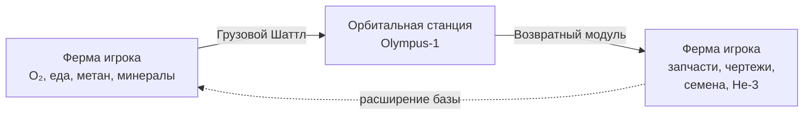

# Задание 2. Адаптация под сеттинг AstroCrop (Марс)

> Берём ядро механики поездов из Township и пересобираем под фантастику колонизации Марса. Функциональное ядро не трогаем — меняем только нарратив, визуал и «обвязку», чтобы фича выглядела родной для AstroCrop.

Ниже — прямой ответ на 3 пункта ТЗ.

---

## 2.1. Что мы отправляем и зачем (кто шлёт ответный груз)

### Что отправляем

Колония AstroCrop производит то, что **для нас рутина, а для космоса — дефицит**. Делю на 4 тира по мере прогрессии игрока:

| Тир | Примеры груза | Откуда берётся на ферме |
|-----|---------------|--------------------------|
| **Т1 — сырьё** | Излишки кислорода (O₂‑баллоны), питьевая вода из ледника, реголит‑грунт | Базовые фабрики: оксигенератор, добытчик льда |
| **Т2 — сельхоз** | Гидропонная пшеница‑M, марсианская соя, грибной протеин | Гидропонные купола, биореакторы |
| **Т3 — обработанное** | Биотопливо, питательные пайки, медицинский гель | Цех переработки |
| **Т4 — редкие** | Кристалл замёрзшего метана, перхлораты, изотоп Fe‑57 | Глубокие шахты (открываются на поздней игре) |

> Привязка к прогрессии: каждый новый шаттл просит ресурсы более высокого тира → у игрока появляется мотивация открывать новые здания и не «зависать» на T1.

### Кому отправляем и что получаем взамен

**Заказчик — орбитальная станция Olympus‑1.** Это космический хаб над Марсом: люди там есть, а вырастить себе еду и кислород они не могут — зависят от наземных колоний вроде нашей.

**Ответный груз** — то, чего у нас на Марсе нет, а у Olympus‑1 в избытке (потому что доставляется кораблями с Земли):

| Что прилетает обратно | Зачем игроку |
|------------------------|--------------|
| **Запчасти и модули** (балки, стеклокупола, генераторы) | Расширение базы — прямой аналог Township «building materials» |
| **Чертежи зданий** | Гейтят прогрессию: без чертежа нельзя построить здание следующего уровня |
| **Семена редких культур** (земные / ГМО) | Открывают новые рецепты, дают премиум‑урожай |
| **Кредиты Федерации** | Мягкая валюта |
| **Helium‑3** (редко, в малых дозах) | Премиум‑валюта, чтобы у F2P‑игрока был способ её фармить |

**Нарратив одной строкой:** «Земля смотрит на Марс. Чем больше мы экспортируем — тем быстрее прилетает следующая волна снабжения и колония растёт».

### Схема обмена

---

## 2.2. Три «препятствия» — почему Шаттл не может улететь сразу

Эти препятствия — наш **слой ретеншена и микро‑геймплея**: до и после загрузки игрок взаимодействует с фичей не один раз. Каждое можно скипнуть за Helium‑3 → встроенная точка монетизации.

### Препятствие №1 — Дозаправка топливом

- **In‑game логика:** на Марсе ракетное топливо синтезируется из CO₂ + метана (реальная NASA‑технология ISRU — звучит правдоподобно).
- **На UI:** у Шаттла шкала **Fuel 0 / 100**. Топливо производится на собственной фабрике игрока с ограниченной скоростью.
- **Что заставляет делать игрока:** запускать топливный конвейер **заранее**, держать его прокачанным даже на поздней игре.
- **GD‑эффект:** планирование, утилизация низкоуровневых фабрик; награда за «прошареность».
- **Скип за He‑3:** «Импорт топлива с Olympus‑1» — мгновенная заправка.

### Препятствие №2 — Песчаная буря (окно запуска)

- **In‑game логика:** Марс известен глобальными пыльными бурями — узнаваемая часть сеттинга.
- **На UI:** индикатор погоды у площадки: 🌪️ **Буря** / ☀️ **Окно запуска**. Окна ясной погоды длятся ~20 минут и приходят раз в N часов.
- **Что заставляет делать игрока:** ловить окно. Можно отправить и в бурю — но с **штрафом по награде** (например, −30%).
- **GD‑эффект:** **soft FOMO** — «ясно сейчас, надо успеть». Идеальный триггер для push‑нотификаций («Окно запуска через 5 минут!») → буст ретеншена.
- **Скип за He‑3:** «Стабилизатор погоды» — мгновенно открывает окно.

### Препятствие №3 — Балансировка трюма по весу

- **In‑game логика:** при марсианской гравитации и аэродинамике перекошенный по весу шаттл сорвётся со взлёта — узнаваемый «инженерный» нарратив.
- **На UI:** трюм из 6 слотов (3 слева, 3 справа) и шкала‑весы между ними. Сумма весов левой и правой стороны должна отличаться не более чем на N% (например, 10%).
- **Что заставляет делать игрока:** не просто бросать ресурсы куда попало, а **думать, в какой слот класть** — лёгкий паззл поверх загрузки.
- **GD‑эффект:** тактильно интереснее «бесшовной» загрузки Township; механически отличает фичу от прямого клона; при желании можно докрутить в челлендж‑режим (узкий допуск дисбаланса даёт бонус к награде).
- **Скип за He‑3:** «Авто‑балансировщик» — кнопка, перекладывающая груз сама.

> Все три препятствия — **не блокеры, а гейм‑крючки**. F2P‑игрок проходит их рутиной (произвести топливо, дождаться окна, переложить ящики), платящий — конвертирует время в Helium‑3.

---

## 2.3. Главный «кайф» игрока (один абзац)

> Главный кайф — **момент, когда твой собственный, выращенный своими руками урожай и добытые в шахтах редкости стартуют в небо**: ты слышишь обратный отсчёт T‑10…0, ясное погодное окно сходится с заполненным трюмом и идеально выровненными весами, двигатели поджигают марсианскую пыль, и через несколько часов с орбиты падает возвратный контейнер с теми самыми чертежами, которых тебе не хватало для следующего купола. Township учит «выращивай и продай», а AstroCrop **превращает эту рутину в маленькую миссию NASA** — ты больше не фермер, ты логистик целой колонии, и каждый успешный запуск ощутимо двигает базу вперёд.

---

## 2.4. Маппинг Township → AstroCrop (для команды)

| Township | AstroCrop | Комментарий |
|----------|-----------|-------------|
| Поезд / 3 вагона / 9 ячеек | Шаттл / 6 слотов трюма (3+3) | Меньше слотов, но добавлен паззл балансировки |
| «Отправить поезд» | «Запуск T‑10…0» с обратным отсчётом | Усиливаем драматургию ракетного старта |
| Кулдаун N часов | Полёт до Olympus‑1 + разгрузка | Показываем траекторию на мини‑карте |
| Награда: материалы для построек | Запчасти, чертежи, семена, He‑3 | Привязываем к прогрессии колонии |
| Премиум‑скип кулдауна | «Срочный запуск» за He‑3 | Та же монетизация, новый скин |
| Помощь соседей (соц.) | «Совместный груз» с альянсом колоний | На будущую секцию буткемпа |

## 2.5. Чем эта адаптация лучше прямого клона

1. **Сеттинг даёт смысл механике, а не наоборот.** Топливо, бури и баланс — не «налепленные правила», а очевидные следствия Марса. Игрок принимает их без объяснений.
2. **Три новых слоя удлиняют сессию** до и после загрузки: производство топлива, ожидание окна, паззл балансировки. Township делает один проход «загрузил → отправил».
3. **Монетизация остаётся той же**, но получает **3 точки скипа** вместо одной — мягко увеличивает ARPU без агрессии.
4. **Эмоциональный пик** (старт ракеты) сильнее, чем «поезд тронулся». Это бесплатный буст ощущения прогресса.
