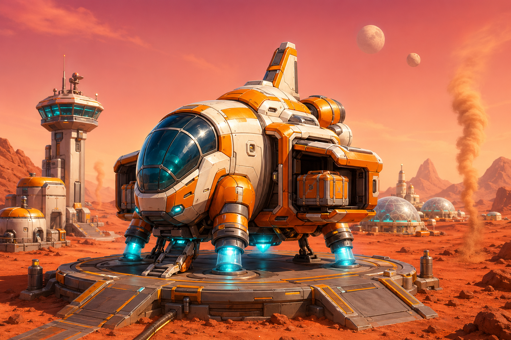
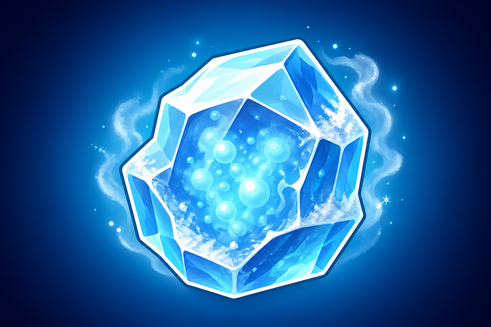

# Задание 3. Мини‑ТЗ на визуал + AI‑референсы

> Цель — задать художникам **тон, силуэт и палитру** для двух визуалов: общий вид Шаттла на взлётной полосе и иконка одного «сложного» ресурса. Ниже — бриф, использованные промпты и сами AI‑референсы (генерировались как стартовый муд‑борд для арт‑команды, **не финальный ассет**).

---

## 3.1. Внешний вид Шаттла на взлётной полосе

**Назначение визуала:** ключевой art‑кадр для маркетинга + ориентир для 3D‑художника, который будет моделить сам Шаттл (in‑game вид сверху‑сбоку, ¾).

### Арт‑бриф

| Параметр | Значение |
|----------|----------|
| Стилистика | Sci‑fi, **яркие цвета** (как просили в ТЗ), стиль mobile‑casual 3D (Township × NASA), не реализм |
| Палитра | Оранжево‑белый корпус, голубой свет дюз, ржаво‑красный марсианский фон, розово‑персиковое небо |
| Силуэт | Коренастый, дружелюбный «грузовик‑ракета»: широкое основание, видимые контейнеры по бортам с люками, стеклянная кабина |
| Окружение | Стартовая площадка на красной марсианской поверхности, ферм‑купола вдалеке, башня управления, два спутника (Phobos & Deimos) на небе |
| Что **избегать** | Тёмный реалистичный sci‑fi (Alien/Mass Effect), военная техника, серая палитра, мелкие неразличимые детали |
| Размеры/ratio | 16:9 для маркетинга, дополнительно 1:1 кроп для иконки фичи |

### Промпт (использован для AI‑генерации)

```
A sci-fi cargo shuttle on a Martian launchpad, mobile game art style,
vibrant colors, slightly stylized cartoon-realistic 3D render. The
shuttle is a chunky, friendly-looking rocket-cargo hybrid with a glass
cockpit, bright orange and white hull plating, glowing cyan engine
nozzles, retractable cargo containers on its sides with visible
loading hatches. The launchpad is set on the rusty red Martian
surface with small dust devils, futuristic mission-control tower in
the background, distant Mars colony domes glowing under a
pinkish-orange sky with two small moons (Phobos & Deimos) visible.
Bright cinematic lighting, clean readable silhouette suitable for a
mobile farming game icon/asset, friendly Township/Hay Day mood
blended with sci-fi NASA aesthetics, no text, no logos.
```

### Результат



> Файл: `images/shuttle_concept.png`. Используется как первичный муд‑борд: **силуэт + палитра + общий настрой**. Для финального ассета художник должен переработать в нашем in‑house стиле (унифицировать пропорции с другими постройками фермы и упростить детализацию для читаемости на мобильном экране).

---

## 3.2. Иконка «сложного» ресурса — Кристалл замёрзшего метана

**Назначение визуала:** иконка ресурса в инвентаре, ячейках Шаттла и в окне наград. Должна быть читабельной в размере **96×96 px** на мобильном экране.

### Арт‑бриф

| Параметр | Значение |
|----------|----------|
| Стилистика | Mobile‑casual icon: глянцевый 3D‑рендер с чёткой обводкой, как иконки ресурсов в Township / Hay Day / Clash Royale |
| Палитра | Лёд‑бирюза (#7CD9F1 → #2E9CC2), холодный белый highlight, лёгкий иней по граням |
| Форма | Огранённый кристалл (gemstone, ~6–8 граней), чуть удлинённый, с **видимым «газом» внутри** (визуальный hint на «метан») |
| Окружение | Мягкий радиальный градиент за иконкой, лёгкий rim‑light, опционально частицы инея |
| Что **избегать** | Неоновое кислотное свечение, реалистичный лёд (станет похоже на просто алмаз/сапфир), сложные надписи |
| Размеры/ratio | 1:1, должна читаться в 96×96 и в 32×32 (например, в подсказках) |

### Промпт (использован для AI‑генерации)

```
A mobile-game resource icon: "Frozen Methane Crystal". Single
centered hero-object on a soft circular gradient background with
subtle rim light. The crystal is a chunky, faceted, translucent
ice-blue and pale cyan gemstone with hints of icy frost vapor
swirling around it, tiny pale blue sparkles, subtle inner glow
suggesting frozen gas trapped inside. Stylized cartoon-realistic 3D
render with thick clean outline, glossy highlights, mobile-game UI
icon style (Township, Hay Day, Clash Royale icon style). Square 1:1
composition, no text, no watermark, clear silhouette readable at
small sizes.
```

### Результат



> Файл: `images/frozen_methane_crystal_icon.png`. Это **референс палитры и формы**, не финальная иконка. Для прода нужно: убрать лишний шум, добавить плотную обводку 2 px (для контраста на любом фоне), привести к нашей icon‑grid 96×96.

---

## 3.3. Заметка для арт‑команды

1. Стиль‑связка двух ассетов: **холодный голубой** (метан, дюзы шаттла) + **тёплый оранжевый** (корпус, марсианская поверхность). Это даст комплементарную пару, которая выгодно смотрится в UI Шаттла, где иконка ресурса лежит на корпусе.
2. Все будущие иконки ресурсов AstroCrop предлагаю гонять через тот же шаблон промпта (centered hero‑object, soft radial bg, mobile‑game icon style) — получим консистентный pack.
3. Перед финализацией обязательно сделать **silhouette test**: ассет должен оставаться узнаваемым в чёрном силуэте на 64×64.
