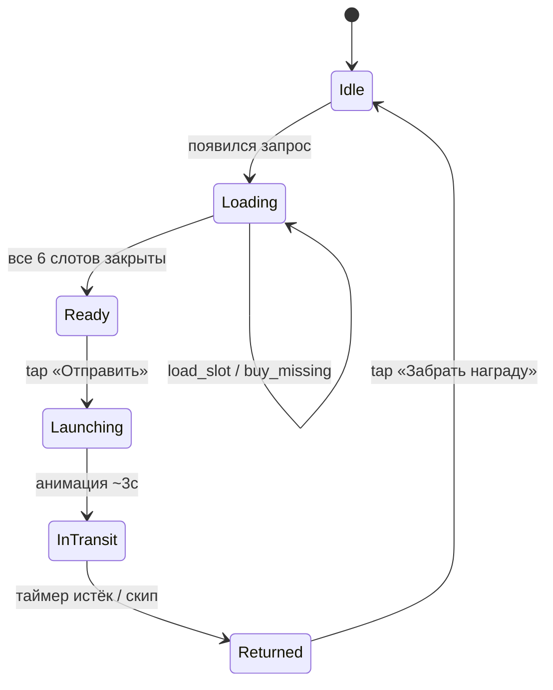

# Задание 4. ТЗ для программиста — Загрузка Грузового Шаттла (полный флоу)

> Документ описывает **полный флоу загрузки**, как в Township (Trains): от появления нового шаттла на станции до его отправки, кулдауна и возврата с наградой. Скоуп — функциональность, которую игрок видит и щёлкает. Экономика наград и баланс цен — отдельный документ.

- **Платформа:** Mobile (iOS/Android), Unity.
- **Версия:** v1.0 — первый полный релиз фичи «Грузовой Шаттл».
- **Связанные документы:** [01 — реверс‑инжиниринг Township](./01_reverse_engineering.md), [02 — адаптация под сеттинг](./02_setting_adaptation.md), [03 — визуальный бриф](./03_visual_brief.md).

---

## 4.1. Глоссарий

| Термин | Что значит |
|--------|------------|
| **Шаттл** | Сущность, аналог поезда из Township. Содержит трюм из 6 cargo‑слотов. |
| **Cargo Slot (слот)** | Одна ячейка трюма с конкретным запросом ресурса. |
| **Запрос** | `{resourceId, required}`. Задаётся конфигом при генерации шаттла. |
| **`loaded`** | Сколько игрок уже положил в слот. `0 ≤ loaded ≤ required`. |
| **`playerStock`** | Сколько ресурса лежит в инвентаре игрока. |
| **He‑3 (Helium‑3)** | Премиум‑валюта (см. задание 2). |
| **Кредиты** | Мягкая валюта. |

---

## 4.2. Прямой ответ на 3 вопроса брифа

### 1) Что видит игрок?

При тапе на станцию шаттла на карте фермы открывается **Экран Шаттла**. Игрок видит:

- **Хедер шаттла:** имя/код шаттла (например, `Mariner‑7`), общий прогресс `X / 6 слотов закрыто`, **таймер срока отправки** (если включён), кнопка `×` (закрыть), кнопка `📣 Помощь альянса`.
- **Трюм** — сетка из 6 одинаковых **cargo‑слотов** (3 + 3, левая и правая стороны). В каждом:
  - **Иконка ресурса** 96×96 px.
  - **Название ресурса** (1 строка, локализовано).
  - **Сколько нужно** — крупным числом, формат `loaded / required` (например, `3 / 5`).
  - **Прогресс‑бар** под счётчиком: заполняется по `loaded / required`.
  - **Сколько есть у игрока** — мелкой строкой, формат `У тебя: N` (тянется из `playerStock[resourceId]`). Если `N == 0` — текст красный.
  - **Кнопка действия** (см. вопрос 2). При закрытом слоте — бейдж `✓ Готово` поверх карточки.
- **Футер:** большая кнопка `🚀 Отправить` (активна только когда все 6 слотов в `Done`).

ASCII‑макет:

```
┌──────────────────────────────────────────────────┐
│ ← Шаттл «Mariner-7»     Срок: 18:42:11      [×] │
│ Прогресс: ▓▓▓▓░░ 4 / 6 слотов закрыто           │
├──────────────────────────────────────────────────┤
│ ┌─────────────┐ ┌─────────────┐ ┌─────────────┐ │
│ │ [icon] Соя  │ │ [icon] O₂   │ │ [icon] Метан│ │
│ │   5 / 5     │ │   2 / 8     │ │   0 / 3     │ │
│ │ ▓▓▓▓▓▓      │ │ ▓░░░░░░░    │ │ ░░░░░       │ │
│ │ У тебя: 12  │ │ У тебя: 0   │ │ У тебя: 0   │ │
│ │  ✓ Готово   │ │ [Купить 60] │ │ [Купить 30] │ │
│ └─────────────┘ └─────────────┘ └─────────────┘ │
│ ┌─────────────┐ ┌─────────────┐ ┌─────────────┐ │
│ │ … слот 4 …  │ │ … слот 5 …  │ │ … слот 6 …  │ │
│ └─────────────┘ └─────────────┘ └─────────────┘ │
├──────────────────────────────────────────────────┤
│ [📣 Помощь альянса]              [🚀 Отправить] │
└──────────────────────────────────────────────────┘
```

После старта шаттла на станции UI меняется (см. 4.3, 4.4): таймер полёта, потом окно наград.

### 2) На какие кнопки нажимает?

Все интерактивы фичи в одной таблице:

| Кнопка | Где находится | Когда активна | Что делает по тапу |
|--------|---------------|----------------|---------------------|
| **`Загрузить`** | В каждом слоте | `playerStock > 0` и `loaded < required` | Грузит `min(playerStock, required − loaded)` (см. стейты в 4.5.2). |
| **`Купить за He‑3`** | В слоте, заменяет `Загрузить` | `playerStock < required − loaded` | Открывает диалог покупки недостающего за He‑3. |
| **Иконка ресурса (deeplink)** | В карточке слота | Всегда | Переход на здание‑производитель, можно поставить производство в очередь. |
| **`📣 Помощь альянса`** | Хедер шаттла | Игрок в альянсе и `helpRequested == false` | Один раз на шаттл — рассылает в альянс запрос недостающих ресурсов. |
| **`🚀 Отправить`** | Футер | Все 6 слотов `loaded == required` | Открывает диалог подтверждения → анимация старта → шаттл уходит в полёт. |
| **`💎 Скип кулдауна`** | На станции, в полёте | `state == InTransit` | За He‑3 мгновенно завершает таймер. |
| **`Забрать награду`** | Окно после возврата | `state == Returned` | Зачисляет награду, шаттл уходит в `Idle`. |
| **`×`** | Хедер | Всегда | Закрывает экран. Прогресс по слотам сохранён. |

### 3) Что происходит, если ресурса не хватает?

Сценарий «нужно 5, на складе 0»:

1. Кнопка `Загрузить` в карточке уходит в стейт **Missing** — серая, неактивна. Тап → шейк‑анимация и тултип «Не хватает ресурса. Произведи на ферме или купи за He‑3».
2. Малый счётчик `У тебя: 0` подсвечен красным.
3. Рядом с серой кнопкой появляется синяя **`Купить (5) за 💎 50 He‑3`**. Цена считается формулой `price = missing × resourceConfig.he3PricePerUnit`.
4. Тап `Купить` → **диалог подтверждения**:
   - Если **He‑3 хватает** (`playerHe3 ≥ price`) → 2 кнопки `Отмена` / `Купить`. На `Купить`: атомарно `playerHe3 −= price` и `slot.loaded = required`. Слот → `Done`, перерисовка UI.
   - Если **He‑3 не хватает** → кнопка подменяется на `+ Пополнить`, ведёт в Premium Shop с `reason="he3_short"`. После пополнения игрок возвращается, повторяет покупку.
5. Тап `Отмена` или закрытие диалога → ничего не списано, прогресс слота сохранён.

Сценарий **частичной нехватки** «нужно 5, на складе 2»:

1. Кнопка показывает **`Загрузить (+2)`**, цвет жёлтый.
2. Тап → грузит 2, `loaded = 2`, `playerStock = 0`. Слот переходит в стейт **Missing**.
3. Кнопка перерисовывается в `Купить (3) за He‑3` — игрок может купить остаток, пойти производить или подождать.

**Альтернативные пути решения нехватки** (помимо покупки):

- **Произвести на ферме / в шахтах.** Тап по иконке ресурса в слоте → deeplink на здание‑производитель. Игрок ставит в очередь, через таймер ресурс падает на склад → стейт кнопки автоматически переезжает из `Missing` в `Available`.
- **Запросить у альянса.** Кнопка `📣 Помощь альянса` в хедере. Раз на шаттл. Союзники видят запрос в общем чате и могут отправить до N единиц каждого недостающего ресурса.
- **Подождать.** Если у шаттла есть таймер срока — игрок видит, сколько у него ещё есть времени.

**Edge‑case:** пока открыт диалог покупки, склад мог пополниться (фабрика выдала готовый ресурс по таймеру или прислал союзник). На закрытии диалога **обязательно пересчитываем** стейт кнопки — он мог уехать из `Missing` в `Available`.

---

## 4.3. Состояния шаттла (state machine)

| Состояние | Условие | Что показывает UI на станции | Действия игрока |
|-----------|---------|------------------------------|------------------|
| **`Idle`** | Шаттл ещё не запрошен или уже улетел и не вернулся | Пустая площадка, бейдж `!` если новый запрос ждёт активации | Тап → `Loading` (генерация запроса) |
| **`Loading`** | Шаттл стоит, есть активный запрос, не все слоты закрыты | Шаттл на полосе, индикатор `X/6` | Открыть экран загрузки |
| **`Ready`** | Все слоты закрыты, ждёт нажатия `Отправить` | Зелёный glow вокруг шаттла | Тап `Отправить` |
| **`Launching`** | Игрок нажал `Отправить` | Анимация старта T‑3..0, дым, звук | Нет (анимация ~3 сек) |
| **`InTransit`** | Шаттл в полёте | Таймер обратного отсчёта, мини‑карта траектории | Скип за He‑3 |
| **`Returned`** | Кулдаун закончился | Шаттл на полосе с лутбоксом, конфетти | Тап `Забрать награду` |
| **`Idle (cooldown_until_next)`** | Награда забрана | Площадка пустая, таймер «следующий запрос через…» | Ждать |



> Выгрузка ресурсов из слота **запрещена** (как в Township) — это сохраняет `Загрузить` как commit‑экшен и не ломает экономику.

---

## 4.4. Полный флоу игрока

### 4.4.1. Появление запроса

1. По таймеру (или по первому входу в день) на станции активируется новый шаттл. Бейдж `!` на иконке станции.
2. Тап по станции → открывается **Экран Шаттла** (см. 4.5).
3. `Analytics: shuttle_request_opened {shuttleId, slotsConfig}`.

### 4.4.2. Загрузка слотов (основной цикл)

Для каждого из 6 слотов игрок проходит микро‑цикл:

1. Смотрит, что нужно (иконка + `loaded / required`) и что есть (`У тебя: N`).
2. Жмёт `Загрузить` / `Купить` / уходит производить через deeplink.
3. UI слота перерисовывается синхронно (см. 4.5.2).

### 4.4.3. Отправка

1. Когда все 6 слотов в `Done`, шаттл переходит в `Ready`. Кнопка `Отправить` в футере становится активной (зелёная, пульсация).
2. Тап `Отправить` → модалка **«Запустить шаттл? Грузы вернутся через ~4ч. Вернуть ресурсы будет нельзя»**, кнопки `Отмена` / `Запустить`.
3. Тап `Запустить` → шаттл уходит в `Launching` → анимация старта (T‑3..0, дым, звук) → `InTransit`.
4. **С этого момента** загруженные ресурсы списаны окончательно (точка коммита).
5. `Analytics: shuttle_launched {shuttleId, totalCargo, slotsConfig, timeFromOpenedSec}`.

### 4.4.4. Кулдаун / полёт

1. На станции таймер `HH:MM:SS`. Тап по станции → мини‑экран статуса полёта с траекторией Марс ↔ Olympus‑1.
2. Кнопка `💎 Скип за He‑3` (цена линейно зависит от оставшегося времени).
3. По истечению таймера → `Returned`. Push‑нотификация **«Шаттл вернулся!»**.

### 4.4.5. Получение награды

1. На станции бейдж `🎁`. Тап → экран наград.
2. Анимация «лутбокс открывается», предметы выпадают по одному (запчасти, чертежи, семена, He‑3, кредиты).
3. Для редких дропов (чертежи, He‑3) — отдельный VFX (золотой луч).
4. Тап `Забрать всё` → ресурсы зачисляются на склад / в коллекции, шаттл уходит в `Idle`.
5. `Analytics: shuttle_reward_claimed {shuttleId, items[]}`.
6. Через `nextRequestDelay` (конфиг) станция снова активируется → новый шаттл.

### 4.4.6. Ветки и крайние случаи

| Ситуация | Поведение |
|----------|-----------|
| Игрок закрыл экран не догрузив | Прогресс слотов сохранён. На станции виден бейдж прогресса `2/6`. |
| Игрок убил приложение | Всё персистится: `loaded` по слотам, состояние шаттла, серверный таймер кулдауна. |
| Сервер недоступен в момент тапа `Загрузить` | Локальный optimistic update + queued‑request. При неудаче через 5 сек — откат + тост «Не удалось загрузить, попробуй ещё раз». |
| Игрок сменил устройство / переустановил | Состояние шаттла лежит на сервере, восстанавливается при логине. |
| У шаттла истёк таймер срока | Шаттл сгорает, загруженные ресурсы возвращаются на склад с штрафом −20%. Запрос обнуляется. |
| Союзник прислал ресурс | Ресурс падает на склад → перерисовка UI слота (стейт может перейти из `Missing` в `Available`). |
| Игрок открыл диалог покупки и параллельно фабрика выдала ресурс | На закрытии диалога стейт кнопки слота пересчитывается (см. 4.2 edge‑case). |

---

## 4.5. UI экрана Шаттла

### 4.5.1. Хедер

- **Имя шаттла**, например `Mariner‑7` (генерируется из пула имён).
- **Таймер срока** (опционально, если у шаттла есть deadline) — `HH:MM:SS`. При истечении — состояние `Expired` (см. 4.4.6).
- **Прогресс шаттла** `X/6` слотов закрыто.
- **`📣 Помощь альянса`** — активна, пока запрос ещё не отправлен и игрок состоит в альянсе. Один раз на шаттл.
- **Кнопка `×`** — закрыть экран, вернуться на ферму.

### 4.5.2. Карточка слота — стейты кнопки действия

| Стейт | Условие | Кнопка | Доп.‑элементы | По тапу |
|-------|---------|--------|----------------|----------|
| **Available** | `playerStock ≥ required − loaded` и `loaded < required` | Зелёная `Загрузить` | — | `delta = required − loaded` → перевод в `Done`. |
| **Partial** | `0 < playerStock < required − loaded` | Жёлтая `Загрузить (+N)` | — | `delta = playerStock` → перевод в `Missing`. |
| **Missing** | `playerStock == 0` и `loaded < required` | Серая `Загрузить` (disabled) **+** синяя `Купить (N) за 💎` | Красный счётчик `У тебя: 0`, deeplink с иконки ресурса на здание‑производитель | Тап `Купить` → диалог покупки (см. 4.6.1). |
| **Done** | `loaded == required` | — (заменена бейджем `✓ Готово`) | Карточка слегка «состарена», прогресс‑бар полный | Нет действия (тултип «Слот заполнен»). |

### 4.5.3. Футер

- **`🚀 Отправить`** — активна только в `Ready`. До этого серая, по тапу — тост «Закрой все 6 слотов».

---

## 4.6. Диалоги и второстепенные экраны

### 4.6.1. Диалог покупки за He‑3

```
        ┌────────────────────────────────────┐
        │  Купить недостающее                │
        │  [icon] Кристалл замёрзшего метана │
        │  Нужно: 3 шт.                      │
        │  Цена: 💎 30 He‑3                  │
        │                                    │
        │  Баланс: 💎 120 He‑3               │
        │                                    │
        │  [ Отмена ]    [ Купить ]          │
        └────────────────────────────────────┘
```

- Если `playerHe3 < price` → кнопка `Купить` заменяется на `+ Пополнить` (deeplink в Premium Shop).
- На подтверждении транзакция атомарна (см. 4.7.2).

### 4.6.2. Диалог отправки

```
   Запустить шаттл «Mariner-7»?
   Грузы вернутся через ~4 ч.
   После старта вернуть ресурсы будет нельзя.

   [ Отмена ]   [ 🚀 Запустить ]
```

### 4.6.3. Окно наград

- Слот‑машина анимация: предметы выпадают по одному из лутбокса.
- Для редких дропов (чертежи, He‑3) — отдельный VFX (золотой луч).
- Кнопка `Забрать всё` зачисляет всё разом.

---

## 4.7. Серверная и клиентская логика

### 4.7.1. Источник правды

- **Конфиг шаттла** (что нужно, deadline, награды) — серверный, прилетает при `GET /shuttle/current`.
- **Состояние** (`loaded` по слотам, фаза, таймеры) — серверное, клиент кэширует.
- **Склад игрока** — серверный.

### 4.7.2. Атомарные операции

Все операции, меняющие склад и состояние, выполняются одним серверным запросом и атомарны:

| Операция | Эндпоинт | Что меняет |
|----------|----------|------------|
| Загрузить слот | `POST /shuttle/{id}/load` `{slotIndex, amount}` | `playerStock −= amount`, `slot.loaded += amount` |
| Купить недостающее | `POST /shuttle/{id}/buy` `{slotIndex}` | `playerHe3 −= price`, `slot.loaded = required` |
| Запросить помощь | `POST /shuttle/{id}/ask_help` | `helpRequested = true`, рассылка в альянс |
| Отправить шаттл | `POST /shuttle/{id}/launch` | `state = InTransit`, `arriveAt = now + cooldown` |
| Скип кулдауна | `POST /shuttle/{id}/skip` | `playerHe3 −= price`, `state = Returned` |
| Забрать награду | `POST /shuttle/{id}/claim` | склад `+= reward`, `state = Idle` |

### 4.7.3. Клиентский псевдокод

Тап `Загрузить`:

```pseudo
function onLoadTap(slot):
    if slot.state == Done: return
    if playerStock[slot.resourceId] <= 0:
        showTooltip("not_enough_resource"); return

    delta = min(playerStock[slot.resourceId], slot.required - slot.loaded)

    optimistic:
        playerStock[slot.resourceId] -= delta
        slot.loaded += delta
        refreshSlot(slot); refreshShuttleHeader()

    api.post(`/shuttle/${shuttleId}/load`, {slotIndex, amount: delta})
        .onSuccess: applyServerState(response)
        .onError:
            rollbackOptimistic()
            toast("Не удалось загрузить, попробуй ещё раз")

    Analytics.log("shuttle_slot_loaded", {shuttleId, slotIndex, resourceId, delta})

    if slot.loaded == slot.required:
        playSfx("slot_complete"); playVfx("checkmark_pop", slot.position)
        if allSlotsDone(): onShuttleReady()
```

Тап `Купить за He‑3`:

```pseudo
function onBuyTap(slot):
    missing = slot.required - slot.loaded
    price = missing * resourceConfig[slot.resourceId].he3PricePerUnit

    if playerHe3 < price:
        openShop(reason="he3_short", needed=price - playerHe3)
        return

    showConfirmDialog(price, missing) -> confirmed:
        if not confirmed: return

        api.post(`/shuttle/${shuttleId}/buy`, {slotIndex})
            .onSuccess(response):
                playerHe3 = response.playerHe3
                slot.loaded = slot.required
                refreshSlot(slot)
                playSfx("slot_complete")
            .onError:
                toast("Не удалось купить, попробуй ещё раз")
```

### 4.7.4. Структуры данных

```ts
type ResourceId = string;

type CargoSlot = {
  slotIndex: 0 | 1 | 2 | 3 | 4 | 5;
  resourceId: ResourceId;
  required: int;        // immutable после генерации
  loaded: int;          // 0..required
};

type Shuttle = {
  shuttleId: string;
  shuttleName: string;
  slots: CargoSlot[6];
  state: "Idle" | "Loading" | "Ready" | "Launching" | "InTransit" | "Returned";
  expiresAt?: timestamp; // дедлайн отправки (опционально)
  arriveAt?:  timestamp; // конец кулдауна, если InTransit
  rewardConfig: RewardConfig;
  helpRequested: bool;
};

type ResourceConfig = {
  id: ResourceId;
  iconPath: string;
  locKey: string;
  he3PricePerUnit: int;
  producerBuildingId: string; // для deeplink из карточки слота
};
```

---

## 4.8. Аналитика

| Событие | Параметры |
|---------|-----------|
| `shuttle_request_opened` | `shuttleId, slotsConfig` |
| `shuttle_screen_opened` | `shuttleId, currentLoadedTotal` |
| `shuttle_slot_loaded` | `shuttleId, slotIndex, resourceId, delta, remaining` |
| `shuttle_slot_buy_offer_shown` | `shuttleId, resourceId, missing, he3Price` |
| `shuttle_slot_buy_confirmed` | `shuttleId, resourceId, missing, he3Spent` |
| `shuttle_slot_buy_canceled` | `shuttleId, resourceId, missing` |
| `shuttle_slot_buy_he3_short` | `shuttleId, resourceId, he3Need, he3Have` |
| `shuttle_help_requested` | `shuttleId, missingMap` |
| `shuttle_launched` | `shuttleId, totalCargo, timeFromOpenedSec` |
| `shuttle_skip_used` | `shuttleId, he3Spent, timeRemainingSec` |
| `shuttle_reward_claimed` | `shuttleId, items[]` |
| `shuttle_expired` | `shuttleId, slotsClosed` |

---

## 4.9. Acceptance Criteria

1. На открытии экрана шаттла UI всех 6 слотов и хедера строится за < 250 мс на baseline‑девайсе.
2. Каждый слот корректно отображает один из 4 стейтов (`Available` / `Partial` / `Missing` / `Done`) и переключается **синхронно** при изменении склада или после ответа сервера.
3. При нехватке ресурса появляется кнопка `Купить за He‑3`; цена считается по `missing × he3PricePerUnit`.
4. Покупка за He‑3 атомарна: либо списались валюта **и** ресурс зачислен в слот, либо ничего не изменилось (на ошибке сети — откат и тост).
5. Если He‑3 не хватает — открывается Premium Shop с `reason="he3_short"`, экран загрузки на фоне сохраняет прогресс.
6. Кнопка `Отправить` активна **только** когда все 6 слотов в `Done`, и неактивна в любом другом случае.
7. После `Отправить` ресурсы окончательно списаны, а UI шаттла переходит в анимацию `Launching` → `InTransit` без дополнительных тапов.
8. Прогресс слотов и состояние шаттла **персистятся**: kill app → reopen → данные восстановлены с сервера, UI идентичен.
9. Скип кулдауна за He‑3 корректно мгновенно завершает таймер и переводит шаттл в `Returned`.
10. Запрос помощи альянса доступен **ровно один раз** на шаттл и недоступен после `Отправить`.
11. Все события аналитики из таблицы 4.8 стреляют согласно своим триггерам.
12. Все строки UI берутся из `locKey` — нет хардкода.
13. Deeplink из карточки слота на здание‑производитель работает корректно: возвращает игрока обратно на экран шаттла кнопкой «назад» с сохранением прогресса.

---

## 4.10. Открытые вопросы для GD/PM

- Можно ли **выгружать** ресурс из слота обратно? **Решение по умолчанию:** нет (как в Township) — это держит `Загрузить` как commit‑экшен и не ломает экономику.
- Должен ли быть **общий таймер срока** на шаттл или таймер на слот? **Решение по умолчанию:** общий, как в Township; срок включаем только на ивент‑шаттлах.
- Сколько слотов нужно сделать на старте — 6 или 9? **Решение по умолчанию:** 6 (3+3, см. задание 2 — это нужно для будущей балансировки веса).
- Где показывать кнопку `Купить за He‑3`: в карточке слота или в общем футере экрана? **Решение по умолчанию:** в карточке слота — даёт более прицельную монетизацию и понятнее игроку «за что плачу».
- Нужно ли подтверждение покупки при малых суммах (< 10 He‑3)? **Решение по умолчанию:** да, всегда — защита от случайного тапа на премиум‑валюту.
