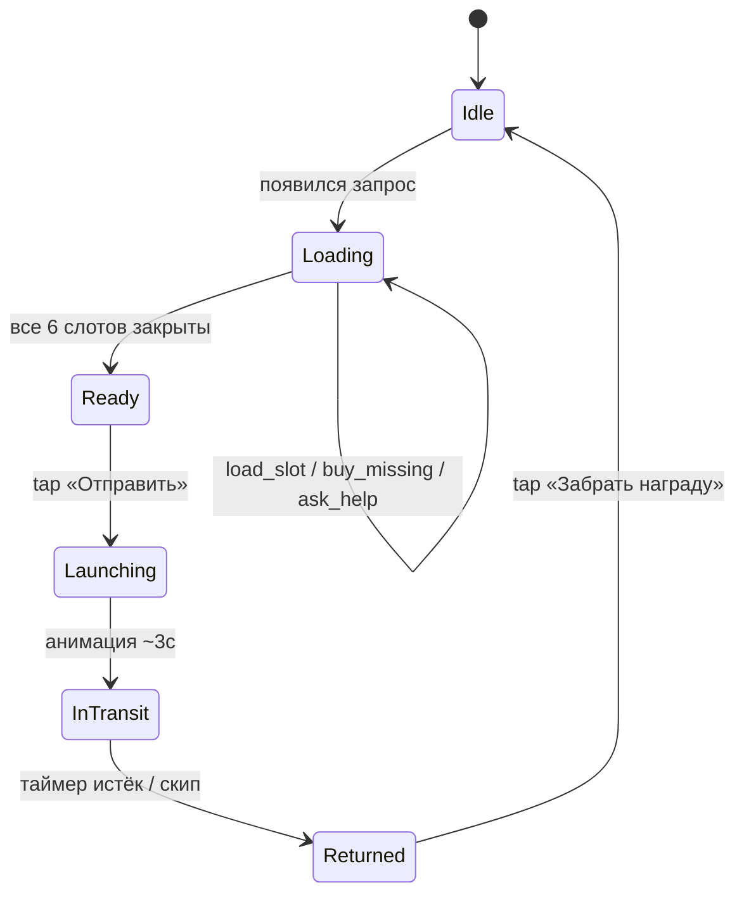

# ТЗ: Фича «Грузовой Шаттл» — экран загрузки и отправки

| Метаданные ||
|---|---|
| **Проект** | AstroCrop (мобильная ферма, сеттинг — Марс) |
| **Фича** | Грузовой Шаттл — аналог поездов из Township |
| **Версия документа** | 1.0 |
| **Тип документа** | Функциональное ТЗ (стиль SA) |
| **Целевая аудитория** | Клиентский разработчик, серверный разработчик, QA |
| **Связанные документы** | [01 — реверс‑инжиниринг Township](./01_reverse_engineering.md), [02 — адаптация под сеттинг](./02_setting_adaptation.md), [03 — визуальный бриф](./03_visual_brief.md) |

> Документ описывает функциональность **Экрана загрузки и отправки шаттла** — от появления нового запроса на станции до возврата шаттла с наградой. Скоуп — то, что игрок видит и щёлкает; экономика наград и баланс цен — отдельный документ.

---

## 1. Контекст и бизнес‑цели

В AstroCrop игрок управляет фермой‑колонией на Марсе. Без дополнительного «стока» произведённых ресурсов экономика быстро упирается в потолок (склад заполнен, мотивация производить падает). Фича «Грузовой Шаттл» решает три задачи продукта:

1. **Сток для произведённых ресурсов** — игрок отгружает излишки на орбитальную станцию Olympus‑1.
2. **Прогрессия базы** — в обмен прилетают редкие материалы и чертежи, которые невозможно получить иначе.
3. **Ретеншен и монетизация** — таймеры производства, окна запуска и кулдаун полёта возвращают игрока в игру; точки скипа за He‑3 дают мягкую монетизацию.

Механически фича — прямой аналог поездов в Township: трюм из нескольких слотов с фиксированным запросом ресурсов, кнопка «Отправить» как commit‑экшен, кулдаун, возврат с наградой.

---

## 2. Нефункциональные требования

| Категория | Требование |
|-----------|------------|
| **Производительность** | Открытие Экрана Шаттла за < 250 мс на baseline‑девайсе (Android Go / iPhone 8). |
| **Сеть** | Все мутации идут через сервер; UI работает с optimistic update + откатом при ошибке. |
| **Целостность** | Любая операция, меняющая склад и состояние шаттла, **атомарна**. |
| **Персистентность** | Состояние шаттла, прогресс по слотам и таймеры — на сервере, восстанавливаются при логине. |
| **Локализация** | 100% строк UI берутся через `locKey`. Никакого хардкода. |
| **Доступность** | Все интерактивы доступны на устройствах с диагональю от 4.7″; touch‑target ≥ 44 px. |

---

## 3. Глоссарий

| Термин | Определение |
|--------|-------------|
| **Шаттл** | Сущность фичи. Содержит трюм из 6 cargo‑слотов и метаданные (имя, дедлайн, награды). |
| **Cargo Slot (слот)** | Одна ячейка трюма с фиксированным запросом `{resourceId, required}`. |
| **`loaded`** | Сколько игрок уже положил в слот. `0 ≤ loaded ≤ required`. |
| **`playerStock`** | Сколько ресурса лежит в инвентаре игрока. |
| **He‑3 (Helium‑3)** | Премиум‑валюта (см. задание 2). |
| **Состояние шаттла** | Один из 7 стейтов state machine (см. п. 6). |

---

## 4. Роли и сценарии использования (Use Cases)

В фиче одна роль — **Игрок**. Use cases экрана:

| ID | Use Case | Триггер | Результат |
|----|----------|---------|-----------|
| **UC‑1** | Открыть Экран Шаттла | Тап по станции на карте фермы | Открыт экран в текущем состоянии шаттла |
| **UC‑2** | Загрузить ресурс в слот | Тап `Загрузить` в карточке слота | `slot.loaded` увеличен; склад уменьшен |
| **UC‑3** | Купить недостающий ресурс за He‑3 | Тап `Купить за He‑3` в карточке слота | Слот заполнен полностью; He‑3 списан |
| **UC‑4** | Перейти на здание‑производитель | Тап по иконке ресурса в слоте | Открыт экран здания, прогресс шаттла сохранён |
| **UC‑5** | Запросить помощь альянса | Тап `Помощь альянса` в хедере | Запрос отправлен в чат альянса (1 раз на шаттл) |
| **UC‑6** | Отправить шаттл | Тап `Отправить` (доступно при всех слотах в `Done`) | Шаттл переходит в полёт, ресурсы окончательно списаны |
| **UC‑7** | Скипнуть кулдаун полёта | Тап `Скип за He‑3` на станции в `InTransit` | Полёт мгновенно завершён; He‑3 списан |
| **UC‑8** | Забрать награду | Тап `Забрать награду` после `Returned` | Награда зачислена; шаттл уходит в `Idle` |

Главный happy path: **UC‑1 → UC‑2 (×6) → UC‑6 → UC‑8**. Альтернативные пути расходятся через UC‑3 (нехватка → покупка), UC‑4 (нехватка → производство), UC‑5 (нехватка → помощь альянса), UC‑7 (нетерпение → скип).

---

## 5. Функциональные требования

### 5.1. Экран Шаттла: состав и компоненты UI

> Этот раздел отвечает на вопрос **«что видит игрок»**: иконка ресурса, требуемое количество, текущий запас игрока и общий прогресс шаттла. Все элементы — функциональные обязательства интерфейса.

#### 5.1.1. Раскладка экрана

```
┌──────────────────────────────────────────────────┐
│ ← Шаттл «Mariner-7»     Срок: 18:42:11      [×] │  ← Хедер
│ Прогресс: ▓▓▓▓░░ 4 / 6 слотов закрыто           │
├──────────────────────────────────────────────────┤
│ ┌─────────────┐ ┌─────────────┐ ┌─────────────┐ │  ← Трюм (6 слотов)
│ │ [icon] Соя  │ │ [icon] O₂   │ │ [icon] Метан│ │
│ │   5 / 5     │ │   2 / 8     │ │   0 / 3     │ │
│ │ ▓▓▓▓▓▓      │ │ ▓░░░░░░░    │ │ ░░░░░       │ │
│ │ У тебя: 12  │ │ У тебя: 0   │ │ У тебя: 0   │ │
│ │  ✓ Готово   │ │ [Купить 60] │ │ [Купить 30] │ │
│ └─────────────┘ └─────────────┘ └─────────────┘ │
│ ┌─────────────┐ ┌─────────────┐ ┌─────────────┐ │
│ │ … слот 4 …  │ │ … слот 5 …  │ │ … слот 6 …  │ │
│ └─────────────┘ └─────────────┘ └─────────────┘ │
├──────────────────────────────────────────────────┤
│ [📣 Помощь альянса]              [🚀 Отправить] │  ← Футер
└──────────────────────────────────────────────────┘
```

#### 5.1.2. Состав хедера

| Элемент | Описание | Источник данных |
|---------|----------|-----------------|
| Имя/код шаттла | 1 строка, локализовано (`Mariner‑7`, `Curiosity‑12`) | `Shuttle.shuttleName` |
| Таймер срока отправки | `HH:MM:SS`, опционально (включается на ивент‑шаттлах) | `Shuttle.expiresAt` |
| Прогресс шаттла | `X / 6 слотов закрыто` + прогресс‑бар | вычисляется по `Shuttle.slots` |
| Кнопка `📣 Помощь альянса` | См. п. 5.2 | `Shuttle.helpRequested`, `player.allianceId` |
| Кнопка `×` | Закрывает экран, возвращает на ферму | — |

#### 5.1.3. Состав карточки слота (Cargo Slot)

Это ключевой компонент экрана: **в нём собрана вся информация, которая нужна игроку для решения «грузить или нет»**.

| Элемент | Описание | Источник данных |
|---------|----------|-----------------|
| **Иконка ресурса** | 96×96 px, ассет из конфигурации | `ResourceConfig.iconPath` |
| **Название ресурса** | 1 строка, локализовано (truncate с `…`) | `ResourceConfig.locKey` |
| **Сколько нужно** | Крупное число, формат `loaded / required` (`3 / 5`) | `slot.loaded`, `slot.required` |
| **Прогресс‑бар** | Заливка `loaded / required` | вычисляется |
| **Сколько есть у игрока** | Мелкая строка `У тебя: N`. При `N == 0` — текст красный | `playerStock[resourceId]` |
| **Кнопка действия** | Один из 4 стейтов (см. 5.2.1) | вычисляется |
| **Бейдж `✓ Готово`** | Появляется поверх карточки при `loaded == required` | вычисляется |

#### 5.1.4. Состав футера

| Элемент | Описание |
|---------|----------|
| Кнопка `🚀 Отправить` | Активна **только** в состоянии `Ready` (все слоты в `Done`). При тапе на серой версии — тост «Закрой все 6 слотов». |

### 5.2. Действия пользователя и реакции системы

> Этот раздел отвечает на вопрос **«на какие кнопки нажимает игрок»**: фиксирует все интерактивы экрана, условия активности и поведение системы в ответ.

#### 5.2.1. Карточка слота — стейты кнопки действия

Кнопка действия в карточке слота — главный интерактив фичи. Она имеет **4 стейта**, каждый с явным условием и поведением:

| ID | Стейт | Условие | Вид кнопки | Реакция системы по тапу |
|----|-------|---------|------------|---------------------------|
| **F‑1.a** | Available | `playerStock ≥ required − loaded` и `loaded < required` | Зелёная `Загрузить` | `delta = required − loaded`. Атомарно: `playerStock −= delta`, `slot.loaded += delta`. Слот → `Done`. |
| **F‑1.b** | Partial | `0 < playerStock < required − loaded` | Жёлтая `Загрузить (+N)` | `delta = playerStock`. Атомарно: `playerStock = 0`, `slot.loaded += delta`. Слот → `Missing`. |
| **F‑1.c** | Missing | `playerStock == 0` и `loaded < required` | Серая `Загрузить` (disabled) **+** синяя `Купить (N) за 💎` | См. п. 5.3. |
| **F‑1.d** | Done | `loaded == required` | Скрыта; на её месте бейдж `✓ Готово` | Тап ничего не делает (тултип «Слот заполнен»). Выгрузка запрещена. |

После любой успешной операции карточка перерисовывается **синхронно**, и стейт пересчитывается.

#### 5.2.2. Полный список интерактивов экрана

| ID | Интерактив | Где находится | Условие активности | Реакция системы |
|----|------------|---------------|---------------------|------------------|
| **F‑1** | Кнопка `Загрузить` / `Купить` | Карточка слота | См. F‑1.a — F‑1.c | См. п. 5.2.1 / 5.3 |
| **F‑2** | Иконка ресурса (deeplink) | Карточка слота | Всегда | Открывает здание‑производитель ресурса (`ResourceConfig.producerBuildingId`). Прогресс шаттла сохранён, возврат — через системную кнопку «назад». |
| **F‑3** | `📣 Помощь альянса` | Хедер | Игрок в альянсе и `Shuttle.helpRequested == false` | Рассылает в чат альянса карточку с недостающими ресурсами. Один раз на шаттл. |
| **F‑4** | `🚀 Отправить` | Футер | Все 6 слотов в `Done` (`Shuttle.state == Ready`) | Открывает диалог подтверждения → анимация старта → шаттл уходит в полёт. См. 5.4.3. |
| **F‑5** | `💎 Скип за He‑3` | Станция, во время полёта | `Shuttle.state == InTransit` | Списывает He‑3 (цена линейно от оставшегося времени), переводит шаттл в `Returned`. |
| **F‑6** | `Забрать награду` | Окно после возврата | `Shuttle.state == Returned` | Зачисляет награду, шаттл → `Idle`. |
| **F‑7** | `×` | Хедер | Всегда | Закрывает экран. Прогресс по слотам сохранён. |

### 5.3. Обработка нехватки ресурса (стейт Missing)

> Этот раздел отвечает на вопрос **«что происходит, если ресурса не хватает»**: фиксирует основной поток покупки за He‑3, альтернативные потоки и крайние случаи.

#### 5.3.1. Основной поток (UC‑3): покупка за He‑3

Условие входа: слот в стейте **Missing** (`playerStock == 0` и `loaded < required`).

1. В карточке слота отображается:
   - Серая, неактивная кнопка `Загрузить`. Тап → шейк‑анимация и тултип «Не хватает ресурса. Произведи на ферме или купи за He‑3».
   - Красный счётчик `У тебя: 0`.
   - Синяя кнопка **`Купить (N) за 💎 He‑3`**, где `N = required − loaded` и `price = N × ResourceConfig.he3PricePerUnit`.
2. Тап `Купить` → диалог подтверждения (см. 5.3.2).
3. По подтверждению: атомарно `playerHe3 −= price` и `slot.loaded = required`. Слот → `Done`.
4. Кнопки и счётчики карточки перерисовываются.

#### 5.3.2. Диалог подтверждения покупки

| Случай | Поведение |
|--------|-----------|
| `playerHe3 ≥ price` | Диалог с двумя кнопками: `Отмена` / `Купить`. На `Купить` — атомарная транзакция (см. 5.3.1). На `Отмена` — закрытие, ничего не списано. |
| `playerHe3 < price` | Кнопка `Купить` подменяется на `+ Пополнить`, ведёт в Premium Shop с `reason="he3_short"` и `needed = price − playerHe3`. После пополнения игрок возвращается на Экран Шаттла, диалог автоматически переоткрыт (можно повторить покупку). |

Подтверждение покупки **обязательно даже при малых суммах** (защита от случайного тапа на премиум‑валюту).

#### 5.3.3. Альтернативные потоки решения нехватки

Игрок не обязан покупать. Доступны 3 альтернативы:

| Поток | Use Case | Действие | Результат |
|-------|----------|----------|-----------|
| Произвести самому | UC‑4 | Тап по иконке ресурса в карточке (deeplink) | Игрок попадает на здание‑производитель. Через таймер ресурс падает на склад → стейт кнопки слота **автоматически** переезжает из `Missing` в `Available`. |
| Запросить у альянса | UC‑5 | Тап `📣 Помощь альянса` в хедере | Союзники видят запрос и могут отправить до N единиц каждого недостающего ресурса. Прилетевший ресурс падает на склад → стейт пересчитывается. |
| Подождать | — | Закрыть экран | Прогресс слота сохранён. Если у шаттла есть таймер срока — игрок видит, сколько у него ещё есть времени. |

#### 5.3.4. Крайние случаи (negative paths)

| Ситуация | Поведение системы |
|----------|--------------------|
| Игрок открыл диалог покупки, в это время фабрика выдала готовый ресурс | На закрытии диалога стейт кнопки слота **обязательно пересчитывается** — он мог уехать из `Missing` в `Available`. |
| Сеть упала в момент тапа `Загрузить` | Optimistic update применён, серверный запрос ушёл. Если ответ не пришёл за 5 сек — откат локальных изменений + тост «Не удалось загрузить, попробуй ещё раз». |
| Сеть упала в момент тапа `Купить` | Транзакция атомарна на сервере. Клиент ждёт ответ. На ошибке — тост, локальное состояние не меняется. He‑3 либо списан, либо не списан — частичных списаний не бывает. |
| Игрок убил приложение во время диалога покупки | На следующем входе диалог не восстанавливается, но прогресс слотов и состояние шаттла — из серверной истины. |
| Истёк срок шаттла, пока игрок раздумывает | Шаттл сгорает (см. 5.4.6), загруженные ресурсы возвращаются на склад с штрафом −20%. Запрос обнуляется. |

---

## 6. Состояния шаттла (state machine)

| Состояние | Условие входа | Что показывает UI на станции | Допустимые действия |
|-----------|---------------|------------------------------|----------------------|
| **Idle** | Шаттл ещё не запрошен или уже улетел и не вернулся | Пустая площадка, бейдж `!` если новый запрос ждёт активации | UC‑1 |
| **Loading** | Шаттл стоит, есть активный запрос, не все слоты закрыты | Шаттл на полосе, индикатор `X/6` | UC‑2..5 |
| **Ready** | Все 6 слотов закрыты | Зелёный glow вокруг шаттла | UC‑6 |
| **Launching** | Игрок нажал `Отправить` | Анимация старта T‑3..0, дым, звук | Нет (анимация ~3 сек) |
| **InTransit** | Шаттл в полёте | Таймер обратного отсчёта, мини‑карта траектории | UC‑7 |
| **Returned** | Кулдаун закончился | Шаттл на полосе с лутбоксом, конфетти | UC‑8 |



> **Выгрузка ресурсов из слота запрещена** (как в Township) — это держит `Загрузить` как commit‑экшен и не ломает экономику.

---

## 7. Сценарии использования (полный флоу)

### 7.1. Happy path

1. По таймеру (или по первому входу) на станции активируется новый шаттл. Бейдж `!` на иконке станции.
2. Игрок тапает станцию → открывается **Экран Шаттла** (UC‑1). `Analytics: shuttle_request_opened`.
3. Игрок последовательно загружает 6 слотов через `Загрузить` (UC‑2). При желании — через `Купить за He‑3` (UC‑3) или сходив за производством (UC‑4).
4. Когда все слоты в `Done`, шаттл переходит в `Ready`. Кнопка `Отправить` становится активной.
5. Игрок жмёт `Отправить` (UC‑6) → диалог подтверждения **«Запустить шаттл? Грузы вернутся через ~4 ч. Вернуть ресурсы будет нельзя»** → `Запустить` → анимация старта → `InTransit`. С этого момента ресурсы окончательно списаны.
6. Через `arriveAt − now` шаттл возвращается, прилетает push‑нотификация **«Шаттл вернулся!»**. `Shuttle.state = Returned`.
7. Игрок жмёт `Забрать награду` (UC‑8) → анимация лутбокса → ресурсы зачисляются → шаттл уходит в `Idle`. Через `nextRequestDelay` появится новый запрос.

### 7.2. Альтернативные потоки

| Поток | Описание |
|-------|----------|
| **AF‑1: нехватка ресурса** | См. п. 5.3. |
| **AF‑2: игрок закрыл экран не догрузив** | Прогресс слотов сохранён. На станции виден бейдж прогресса `X/6`. По возвращении — то же состояние. |
| **AF‑3: kill app / переустановка** | Состояние шаттла, `loaded` по слотам и таймеры лежат на сервере. Восстанавливаются при логине. UI идентичен. |
| **AF‑4: скип кулдауна** | UC‑7. Цена линейно зависит от оставшегося времени. После скипа — сразу `Returned`. |
| **AF‑5: помощь альянса** | UC‑5. Союзники присылают ресурсы; они падают на склад → стейты карточек пересчитываются. |
| **AF‑6: истечение срока шаттла** | Шаттл переходит в `Expired`. Загруженные ресурсы возвращаются на склад с штрафом −20%. Запрос обнуляется, через `nextRequestDelay` появится новый. |

---

## 8. Данные и API

### 8.1. Источник правды

- **Конфиг шаттла** (что нужно, deadline, награды) — серверный, `GET /shuttle/current`.
- **Состояние** (`loaded` по слотам, фаза, таймеры) — серверное, клиент кэширует.
- **Склад игрока, баланс He‑3** — серверный.

### 8.2. API‑контракт

Все мутации — атомарные серверные операции. Клиент применяет optimistic update только для тех, где это безопасно (загрузка слота); покупка за He‑3 — только по подтверждению сервера.

| ID | Эндпоинт | Что меняет | Гарантии |
|----|----------|------------|----------|
| **API‑1** | `POST /shuttle/{id}/load` `{slotIndex, amount}` | `playerStock −= amount`, `slot.loaded += amount` | Атомарно. Серверная проверка `playerStock ≥ amount` и `slot.loaded + amount ≤ slot.required`. |
| **API‑2** | `POST /shuttle/{id}/buy` `{slotIndex}` | `playerHe3 −= price`, `slot.loaded = slot.required` | Атомарно. Серверная проверка `playerHe3 ≥ price`. Цена пересчитывается на сервере (защита от подделки). |
| **API‑3** | `POST /shuttle/{id}/ask_help` | `helpRequested = true`, рассылка в чат альянса | Идемпотентно: повторный вызов вернёт ошибку `already_requested`. |
| **API‑4** | `POST /shuttle/{id}/launch` | `state = InTransit`, `arriveAt = now + cooldown` | Серверная проверка: все слоты в `Done`. |
| **API‑5** | `POST /shuttle/{id}/skip` | `playerHe3 −= price`, `state = Returned` | Атомарно. |
| **API‑6** | `POST /shuttle/{id}/claim` | склад `+= reward`, `state = Idle` | Атомарно, идемпотентно (повторный вызов вернёт ту же награду). |

### 8.3. Структуры данных

```ts
type ResourceId = string;

type CargoSlot = {
  slotIndex: 0 | 1 | 2 | 3 | 4 | 5;
  resourceId: ResourceId;
  required: int;        // immutable после генерации
  loaded: int;          // 0..required
};

type Shuttle = {
  shuttleId: string;
  shuttleName: string;
  slots: CargoSlot[6];
  state: "Idle" | "Loading" | "Ready" | "Launching" | "InTransit" | "Returned";
  expiresAt?: timestamp; // дедлайн отправки (опционально)
  arriveAt?:  timestamp; // конец кулдауна, если InTransit
  rewardConfig: RewardConfig;
  helpRequested: bool;
};

type ResourceConfig = {
  id: ResourceId;
  iconPath: string;
  locKey: string;
  he3PricePerUnit: int;
  producerBuildingId: string;
};
```

### 8.4. Клиентский псевдокод (ключевые обработчики)

```pseudo
function onLoadTap(slot):
    if slot.state == Done: return
    if playerStock[slot.resourceId] <= 0:
        showTooltip("not_enough_resource"); return

    delta = min(playerStock[slot.resourceId], slot.required - slot.loaded)

    optimistic:
        playerStock[slot.resourceId] -= delta
        slot.loaded += delta
        refreshSlot(slot); refreshShuttleHeader()

    api.post(`/shuttle/${shuttleId}/load`, {slotIndex, amount: delta})
        .onSuccess: applyServerState(response)
        .onError:  rollbackOptimistic(); toast("Не удалось загрузить")

    Analytics.log("shuttle_slot_loaded", {shuttleId, slotIndex, resourceId, delta})

    if slot.loaded == slot.required:
        playSfx("slot_complete"); playVfx("checkmark_pop", slot.position)
        if allSlotsDone(): onShuttleReady()


function onBuyTap(slot):
    missing = slot.required - slot.loaded
    price = missing * resourceConfig[slot.resourceId].he3PricePerUnit

    if playerHe3 < price:
        openShop(reason="he3_short", needed=price - playerHe3); return

    showConfirmDialog(price, missing) -> confirmed:
        if not confirmed: return
        api.post(`/shuttle/${shuttleId}/buy`, {slotIndex})
            .onSuccess(response):
                playerHe3 = response.playerHe3
                slot.loaded = slot.required
                refreshSlot(slot); playSfx("slot_complete")
            .onError: toast("Не удалось купить, попробуй ещё раз")
```

---

## 9. Аналитика

| Событие | Параметры |
|---------|-----------|
| `shuttle_request_opened` | `shuttleId, slotsConfig` |
| `shuttle_screen_opened` | `shuttleId, currentLoadedTotal` |
| `shuttle_slot_loaded` | `shuttleId, slotIndex, resourceId, delta, remaining` |
| `shuttle_slot_buy_offer_shown` | `shuttleId, resourceId, missing, he3Price` |
| `shuttle_slot_buy_confirmed` | `shuttleId, resourceId, missing, he3Spent` |
| `shuttle_slot_buy_canceled` | `shuttleId, resourceId, missing` |
| `shuttle_slot_buy_he3_short` | `shuttleId, resourceId, he3Need, he3Have` |
| `shuttle_help_requested` | `shuttleId, missingMap` |
| `shuttle_launched` | `shuttleId, totalCargo, timeFromOpenedSec` |
| `shuttle_skip_used` | `shuttleId, he3Spent, timeRemainingSec` |
| `shuttle_reward_claimed` | `shuttleId, items[]` |
| `shuttle_expired` | `shuttleId, slotsClosed` |

---

## 10. Acceptance Criteria

| ID | Критерий |
|----|----------|
| AC‑1 | Открытие Экрана Шаттла занимает < 250 мс на baseline‑девайсе. |
| AC‑2 | В каждой карточке слота отображаются: иконка 96×96, название, `loaded / required`, прогресс‑бар, `У тебя: N` (красный при 0), кнопка действия. |
| AC‑3 | Кнопка действия в карточке корректно отображает один из 4 стейтов (`Available` / `Partial` / `Missing` / `Done`) и переключается **синхронно** при изменении склада или после ответа сервера. |
| AC‑4 | При `playerStock == 0` появляется кнопка `Купить за He‑3`; цена считается по `missing × he3PricePerUnit`. |
| AC‑5 | Покупка за He‑3 атомарна: либо валюта **и** ресурс попали по назначению, либо ничего не изменилось (на ошибке сети — откат и тост). |
| AC‑6 | Если He‑3 не хватает — открывается Premium Shop с `reason="he3_short"`, экран загрузки на фоне сохраняет прогресс. |
| AC‑7 | Кнопка `🚀 Отправить` активна **только** при `Shuttle.state == Ready`. |
| AC‑8 | После `Отправить` ресурсы окончательно списаны, шаттл переходит в `Launching` → `InTransit` без дополнительных тапов. |
| AC‑9 | Состояние шаттла, прогресс слотов и таймеры **персистятся**: kill app → reopen → данные восстановлены с сервера, UI идентичен. |
| AC‑10 | Скип кулдауна за He‑3 мгновенно завершает таймер и переводит шаттл в `Returned`. |
| AC‑11 | Запрос помощи альянса доступен **ровно один раз** на шаттл и недоступен после `Отправить`. |
| AC‑12 | Все события из таблицы аналитики (п. 9) стреляют согласно своим триггерам. |
| AC‑13 | Все строки UI берутся через `locKey`. |
| AC‑14 | Deeplink из карточки слота на здание‑производитель работает корректно: возврат на Экран Шаттла кнопкой «назад» с сохранением прогресса. |
| AC‑15 | Выгрузка ресурсов из слота недоступна (нет соответствующего интерактива). |

---

## 11. Открытые вопросы и допущения

| ID | Вопрос | Решение по умолчанию |
|----|--------|----------------------|
| OQ‑1 | Можно ли выгружать ресурс из слота обратно? | Нет (как в Township) — `Загрузить` остаётся commit‑экшеном. |
| OQ‑2 | Таймер срока — общий на шаттл или на слот? | Общий. Срок включаем только на ивент‑шаттлах. |
| OQ‑3 | Сколько слотов на старте — 6 или 9? | 6 (3+3) — нужно для будущей балансировки веса (см. задание 2). |
| OQ‑4 | Где показывать `Купить за He‑3` — в карточке или в футере? | В карточке: точечная монетизация, ясно «за что плачу». |
| OQ‑5 | Подтверждение покупки при малых суммах (< 10 He‑3) | Да, всегда — защита от случайного тапа. |
